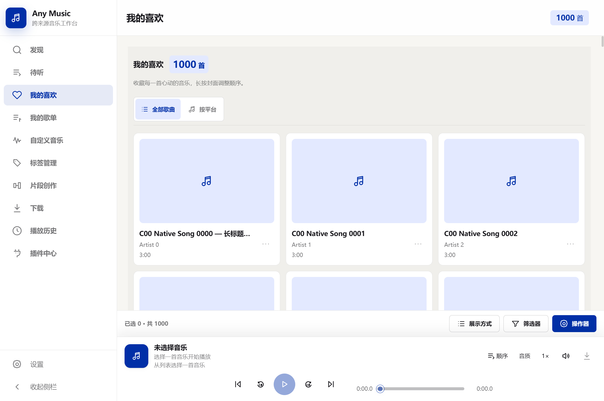
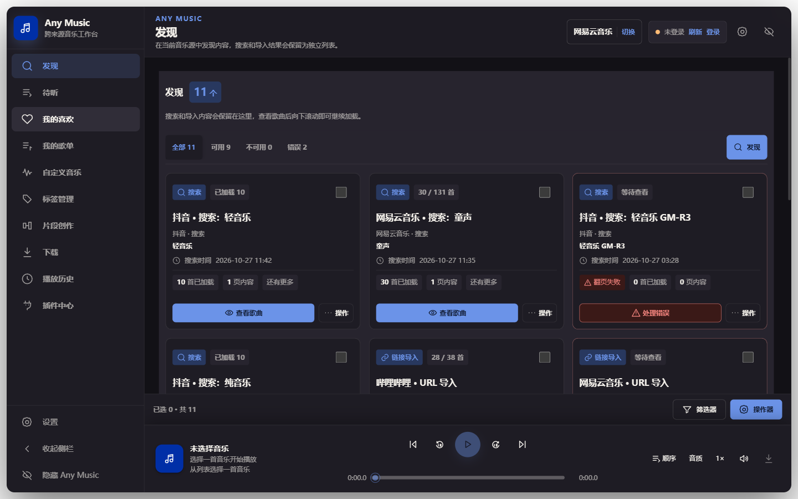

  

<h1 align="center">Any Music</h1>

<strong>Music from different platforms, in one library</strong>

  <a href="https://github.com/WindAndDream/any-music/releases/latest"><strong>Download the latest release</strong></a>
  · <a href="#download-and-install">Installation</a>
  · <a href="#getting-started">Quick start</a>
  · <a href="README.md">简体中文</a>

Any Music is a cross-platform music player for personal use. In the desktop app or browser userscript, you can find music on Bilibili, Douyin and NetEase Cloud Music, import supported links, and save tracks from different platforms to the same playlist.

<em>Windows desktop app · Classic theme · Example library</em>

See the browser userscript in dark mode

## Features

- **Discover music.** Search by platform or import a supported track, playlist, or collection link.
- **Organize your library.** Favorite tracks, create playlists across platforms, and find songs again with tags and filters.
- **Queue up music.** Add songs to Listen Later, change the play order, and revisit tracks in your playback history.
- **Manage downloads.** Save one track as an MP3 or several as a ZIP. Check progress and retry failed tasks from Downloads.
- **Manage source accounts.** The desktop app supports multiple accounts for the same platform and per-account proxy settings.

## Download and install

Open the [latest release on GitHub](https://github.com/WindAndDream/any-music/releases/latest) and choose the installer under **Assets**.

| Edition                | How to install                                                                                                                                                                                                                                     |
| ---------------------- | -------------------------------------------------------------------------------------------------------------------------------------------------------------------------------------------------------------------------------------------------- |
| **Windows**            | Download and run the x64 `*-setup.exe` installer. The app requires [Microsoft Edge WebView2 Runtime](https://developer.microsoft.com/en-us/microsoft-edge/webview2/#download-section).                                                             |
| **macOS**              | Download the `.dmg` for your Mac. Choose `arm64` for Apple silicon or `x64` for Intel.                                                                                                                                                             |
| **Linux**              | On x64, use the `.AppImage`, or choose the `.deb` on a Debian-based distribution.                                                                                                                                                                  |
| **Android**            | Choose the `arm64` `.apk` for most phones or `x64` for an x86-64 device. Requires Android 8.0 or later and WebView 111 or later.                                                                                                                   |
| **Browser userscript** | Install [Tampermonkey](https://www.tampermonkey.net/), then install [any-music.user.js](https://github.com/WindAndDream/any-music/releases/latest/download/any-music.user.js). Refresh a regular webpage and select the floating Any Music button. |

Desktop testing primarily covers Windows. Runtime verification for the macOS and Linux packages is pending. The Windows installer is unsigned and the macOS bundles lack Apple notarization. The Android app currently focuses on Bilibili and foreground playback.

## Getting started

1. Open **Discover (发现)** and choose a music source. Sign in to that platform if prompted.
2. Search for a keyword or paste a supported track or list link. Open the results and choose a track to play.
3. Save tracks to **Favorites (我的喜欢)**, **Listen Later (待听)**, or one of **My Playlists (我的歌单)**.

Search, import, playback, and downloads depend on the platform, content, and account permissions. Each installation keeps its own local library. You can export and import playlists to move them between devices.

## Feedback and development

- Report problems in [GitHub Issues](https://github.com/WindAndDream/any-music/issues) with your Any Music version, operating system, and steps to reproduce.
- For local builds, see the [source setup guide](docs/en/guides/source-setup.md). See the [documentation index](docs/en/README.md) and [contributing guide](CONTRIBUTING.md) for more developer information.
