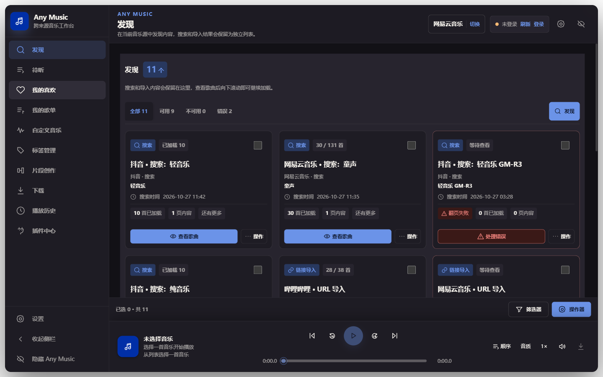

  

<h1 align="center">Any Music</h1>

<strong>把不同平台的音乐，收进同一个资料库</strong>

  <a href="https://github.com/WindAndDream/any-music/releases/latest"><strong>下载最新版</strong></a>
  · <a href="#下载与安装">安装说明</a>
  · <a href="#初次使用">快速开始</a>
  · <a href="README.en.md">English</a>

Any Music 是一款面向个人使用的跨平台音乐播放器。在桌面端或浏览器脚本版，你可以从 Bilibili、抖音和网易云音乐查找音乐、导入支持的链接，把喜欢的内容加进同一个歌单。

<em>Windows 桌面端 · 经典主题 · 示例资料库</em>

查看浏览器脚本版的深色界面

## 主要功能

- **发现音乐**。按平台搜索，或粘贴支持的作品、歌单和收藏链接导入。
- **整理资料库**。收藏单曲，创建跨平台歌单，用标签和筛选快速找回内容。
- **安排播放**。把想听的音乐加入待听，调整播放顺序，从播放历史找回听过的歌曲。
- **管理下载**。单曲保存为 MP3，多首打包为 ZIP，在下载页面查看进度和重试失败的任务。
- **管理平台账号**。桌面端支持为同一平台管理多个账号，并按账号配置代理。

## 下载与安装

打开 [GitHub 最新发布](https://github.com/WindAndDream/any-music/releases/latest)，在 **Assets** 中选择对应的安装文件。

| 版本           | 安装方式                                                                                                                                                                                                                    |
| -------------- | --------------------------------------------------------------------------------------------------------------------------------------------------------------------------------------------------------------------------- |
| **Windows**    | 下载 x64 的 `*-setup.exe` 并运行。应用需要 [Microsoft Edge WebView2 Runtime](https://developer.microsoft.com/en-us/microsoft-edge/webview2/#download-section)。                                                             |
| **macOS**      | 下载 `.dmg`。Apple 芯片选 `arm64`，Intel 芯片选 `x64`。                                                                                                                                                                     |
| **Linux**      | x64 系统可选择 `.AppImage`，Debian 系发行版也可使用 `.deb`。                                                                                                                                                                |
| **Android**    | 多数手机选 `arm64` 的 `.apk`，x86-64 设备选 `x64`。需要 Android 8.0 或更新版本，以及 WebView 111 或更新版本。                                                                                                               |
| **浏览器脚本** | 先安装 [Tampermonkey（篡改猴）](https://www.tampermonkey.net/)，再安装 [any-music.user.js](https://github.com/WindAndDream/any-music/releases/latest/download/any-music.user.js)。刷新普通网页，点击 Any Music 的悬浮入口。 |

桌面使用目前主要在 Windows 上验证，macOS 和 Linux 的安装包仍待运行验证。Windows 安装包未签名，macOS 安装包未经 Apple 公证。Android 版目前以 Bilibili 和前台播放为主。

## 初次使用

1. 打开 **发现**，选择一个音乐来源。需要登录时，按提示登录对应的平台账号。
2. 搜索关键词，或粘贴支持的作品或列表链接。打开结果，选一首开始播放。
3. 把喜欢的歌曲加入 **我的喜欢**、**待听** 或 **我的歌单**。

各平台开放的搜索、导入、播放和下载范围取决于内容和账号权限。各端的资料库独立保存在本地。换设备时，可以用歌单导出和导入功能转移歌单。

## 反馈与开发

- 遇到问题可在 [GitHub Issues](https://github.com/WindAndDream/any-music/issues) 反馈，附上 Any Music 版本、系统和复现步骤。
- 从源码构建见[源码开发指南](docs/zh-cn/开发指南/源码开发.md)，其他技术资料见[文档索引](docs/zh-cn/文档索引.md)和[贡献指南](CONTRIBUTING.md)。
