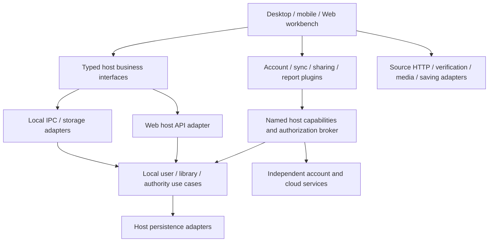

# Multi-user and Local/Cloud Deployment Plan

Chinese counterpart: [多用户与本地／云端部署规划](../../../zh-cn/跨平台/架构/多用户与本地云端部署规划.md).

## Status, scope and reading order

Prepared on **2026-10-30**, revised on **2026-11-01** for plugin-owned services. Status: **design proposal; implementation has not started**. This revision changes documentation only, without implementation batches, product tests or live acceptance. Next: A01, the host/plugin/service ownership and lifecycle inventory.

Any Music remains a music workbench and plugin container supporting offline local users. Each local user may bind multiple accounts across multiple independent account systems. Plugins and independent services provide optional account systems, cloud synchronization, sharing and reports. The host provides canonical music data, controlled contracts and authority, with business interfaces extracted from Tauri for a future Web client.

This replaces the original allocation of registration/password/email, synchronization and sharing to a unified core identity service. **Local user isolation, authoritative binding verification, canonical writes and plugin authorization remain host responsibilities.** Local music requires neither an Internet account system nor a global cloud provider.

This page owns future tasks, decisions and acceptance. Current behavior follows [Project Architecture](project-architecture.md), [Package Boundaries](reusable-package-boundaries.md), [Data Ownership](plugin-data-ownership.md), [Desktop Runtime](../../desktop/runtime-architecture.md) and [Plugin Status](plugin-system-refactoring-steps.md). User switching, bindings and the proposed extension contracts are unimplemented. This plan changes no current source transport, external policy or mobile admission.

Original inputs were the 2026-10-30 working-tree review and the [public discussion](https://chatgpt.com/share/6ae37da2-3538-83e8-841e-25b7b081322a) beginning with “我主要是针对我的any music项目”; that review recorded retrieving its body. This revision follows the present user requirements. Earlier technology suggestions are not adopted dependencies, and working-tree observations with other uncommitted changes do not certify a clean commit or release.

| Next task              | Read first                                         |
| ---------------------- | -------------------------------------------------- |
| Local users/bindings   | Ownership, identity, account contract              |
| Web/backend extraction | Deployment, service/device boundaries              |
| Sync/sharing/reports   | Listening facts, migration/sync/sharing, lifecycle |
| Infrastructure         | Selection, caching, jobs, recovery/network         |
| Execution              | Small-batch queue and closure                      |

## 1. Ownership and deployment modes

| Capability         | Host                                                                                      | Plugin/independent service                                                  |
| ------------------ | ----------------------------------------------------------------------------------------- | --------------------------------------------------------------------------- |
| Local users        | Stable IDs, display names, selection/switching, ownership/isolation                       | Optional profile presentation, no takeover of local lifecycle               |
| External accounts  | Binding registry/verification, secure adapters, use grants                                | Registration/login/password/email/MFA/recovery, remote sessions             |
| Music              | Canonical tracks/playlists/favorites/queue/recipes, playback/downloads, controlled writes | Source discovery/import/details/resolution and extensions                   |
| Cloud sync/hosting | Versioned reads/writes, change/idempotency foundation, scoped grants                      | Replicas, synchronization/conflict policy, offline submission, deployment   |
| Sharing/social     | Portable music documents, validated imports, scoped exports                               | Links, recipients/friends, access, expiry/revocation, subscriptions         |
| Listening reports  | Consented minimal facts, bounded queries                                                  | Aggregation/reports/recommendations, retention, optional remote computation |
| Backups/assets     | Core integrity, versioned import/export, local recovery                                   | Optional remote storage/backups, quotas/retention                           |

Do not create a dedicated core subsystem for every future feature. Sync may use one account provider and sharing another. Compose through named, versioned, authorized services, never private plugin state or the complete workbench. Extract public packages after concrete validated reuse.

| Mode                     | Host                                                        | Optional services                                               |
| ------------------------ | ----------------------------------------------------------- | --------------------------------------------------------------- |
| Standalone               | Local users/data on computer/phone, IPC/local adapters      | No account server, HTTP listener or cache sidecar               |
| Private                  | Optional headless host API for Web/trusted clients          | Separately configured self-hosted account/sync/sharing services |
| Public cloud             | Independent host API with service-local actor authorization | Operator account/cloud services with independent lifecycles     |
| Web                      | Separate browser entry consuming controlled host APIs       | Service selection/bindings, no arbitrary native authority       |
| Connected desktop/mobile | Retain local users/data, explicit connections               | One or more services selected by binding/business scope         |

Local/private versus remote cloud is deployment/configuration, not a different host identity model. One provider implementation can run as separate NAS/public instances. Different providers may use different contract-compliant implementations; no universal server/database is required. Mobile is not a persistent server host.

## 2. Current implementation and missing boundaries

| Evidence                                                                                                                                                                                                                                          | Planned response                                                                              |
| ------------------------------------------------------------------------------------------------------------------------------------------------------------------------------------------------------------------------------------------------- | --------------------------------------------------------------------------------------------- |
| [LibraryUserProfile](../../../../packages/core/src/library/models.ts) has only stable ID/display name; one profile per current library                                                                                                            | Model local selection, scoped data and lifecycle; display names are not login/authority       |
| [Native Account](../../../../apps/tauri/src-tauri/src/model.rs) is a music-source account                                                                                                                                                         | Separate local users/external subjects; do not reuse source pools for product login           |
| [Native storage](../../../../apps/tauri/src-tauri/src/storage/product.rs) writes complete product.json with revision checks/32 MiB budget; [renderer storage](../../../../apps/tauri/src/platform/product-storage.ts) has a mirror/ordered writes | Add async boundaries for users/Web; introduce relational storage incrementally when justified |
| [History](../../../../packages/core/src/library/models.ts) has at most 500 position/time/completion entries; [track removal](../../../../packages/music-workbench/src/features/library/use-local-music-library.ts) removes related history        | Separate recent presentation from optional consented facts                                    |
| [RuntimeState](../../../../apps/tauri/src-tauri/src/state.rs) combines accounts/browsers/media/storage                                                                                                                                            | Extract Tauri/WebView-free use cases, retain device/source adapters                           |
| [Plugin database](../../../../apps/tauri/src-tauri/src/storage/plugins.rs) is schema-3 native authority                                                                                                                                           | Not a general cloud business database or remote identity                                      |
| [Atomic-file recovery](../../../../apps/tauri/src-tauri/src/storage/vault.rs) handles interrupted replacement                                                                                                                                     | Separately validate long-term backup/migration/deletion/disaster recovery                     |

Preserve source CookieStores/proxies, cancellation, media grants and revocation. [PortablePlaylist](../../../../packages/music-workbench/src/storage/portable-playlist.ts) can carry shares; author IDs establish attribution, never login/binding/ownership.

## 3. Service, plugin and device boundaries

Extract the backend for Web/headless host use cases, without moving account-provider/cloud business into core. Client plugins integrate independent servers; installing an `.amplugin` deploys no server/database/mail infrastructure and grants no native execution.

| Proposed boundary; names provisional | Responsibility                                                                             |
| ------------------------------------ | ------------------------------------------------------------------------------------------ |
| Host user/library use cases          | Local identity, ownership, canonical writes, versions/transactions; injected storage/clock |
| Binding/authentication broker        | Verify provider/instance/proof/scope; produce trusted caller context                       |
| Host persistence adapters            | Files/databases/migrations; no plugin SQL/database-file access                             |
| apps/server candidate                | Tauri-free host HTTP composition, trusted sessions/permissions, startup/deployment         |
| apps/web candidate                   | Browser entry/capabilities using workbench without native dependencies                     |
| Provider plugin/account service      | Login integration/account business, independently built/deployed/replaced                  |
| Sync/sharing/report plugins/services | Their policy/namespaces/remote data/jobs                                                   |
| Versioned contracts/client adapters  | DTOs/errors/pagination/idempotency/cancellation/discovery; extract when reused             |

Retain root Cargo workspace/Cargo.lock/target and apps/tauri. Do not move all TypeScript source protocols/mapping/playback to Rust or prebuild empty crates. Introduce async use cases incrementally; StableValueStorage is not a remote database.

Generate cross-language DTOs from one versioned contract and verify semantics with contract cases. Servers independently check authorization/canonical write invariants instead of trusting frontend validation. Do not move every host business contract into plugin SDK or introduce reverse core/SDK dependencies.

Web host APIs independently verify sessions/binding proofs, mapping verified external subjects to trusted service-local actors/library permissions. Client/plugin localUserId/ownerUserId claims, browser display names/profile selection and CORS establish no authority. A02/A04 settle Web session transport, CSRF/CORS, revocation and initial enrollment/binding recovery.

Server sources, credential hosting and media relays need separate design/admission. Desktop Douyin system-browser capability is not headless/mobile capability. Sync establishes neither universal resolution nor audio redistribution authority.

## 4. Technology selection and admission

Rust/Axum/Tokio is a host-service candidate. SeaORM, SQLite/PostgreSQL, Moka, Valkey and filesystem/S3 are optional choices by responsibility, not universal dependencies. Independent account systems may use other compliant technology.

- Standalone may retain current storage or adopt SQLite for concrete user/concurrency needs. Services choose SQLite/PostgreSQL by capacity, without clients opening network-shared database files.
- A03 checks rusqlite/new-driver SQLite linking, MSRV, Android/iOS builds and size. Test database differences with real contracts, not just connection-string changes. Separate upgrades from complete migration.
- Adopt Moka/Valkey after measured benefit, with capacity/invalidation/failure policy; neither replaces durable data or media caches.
- Start necessary jobs with database tables/Outbox; SSE/WebSocket are hints, while durable changes support reliable sync.
- Scale against peak concurrency, size, P95/P99, queues and RPO/RTO, without presupposing Kubernetes/Kafka/microservices/sharding.

Original references: [SeaORM drivers](https://www.sea-ql.org/SeaORM/docs/install-and-config/database-and-async-runtime/), [SQLite WAL](https://www.sqlite.org/wal.html), [Moka](https://docs.rs/moka/latest/moka/future/struct.Cache.html). Recheck versions/linking/platforms and WAL/checkpoint/writer queues at adoption; do not incidentally change authority-database policy.

## 5. Identity, ownership and bindings

Distinguish **local user, external subject, provider implementation, account-service instance, source account, device and cloud-business service instance**. Display names may repeat/change. Same email/name never merges identities, and URLs alone do not establish instance identity.

Example: Xiaoming keeps one localUserId while binding NAS account A, public-service account B and another system's account C, including multiple accounts in one system. Each share/sync/remote operation selects its binding/destination; defaults do not broadcast to every binding or merge remote libraries.

Identify external subjects by at least `(providerId, issuer/instanceId, subjectId)`: contract implementation, verified stable instance/trusted endpoints, and immutable instance-local subject, never nickname/email. Mismatches require renewed confirmation rather than silent address-based rebinding.

| Conceptual entity; not final DDL                     | Owner/constraint                                                                           |
| ---------------------------------------------------- | ------------------------------------------------------------------------------------------ |
| local_users, libraries                               | Host; localUserId, displayName, ownerLocalUserId, libraryId                                |
| account_providers, account_service_instances         | Controlled host registry; versions/capabilities/stable identities/trusted endpoints        |
| account_bindings                                     | Host; binding ID/user/complete subject/verified status/use scope, no secrets               |
| credential_refs, service_sessions                    | Secure runtime adapters; user/binding/service isolation, no ordinary export                |
| source_accounts                                      | Source runtime; distinct external accounts, future user-scoped grants                      |
| tracks, playlists, favorites, published_recipes      | Host; library ownership, stable source IDs, entry IDs/order/versions                       |
| plugin_namespaces                                    | Plugin; user/library and necessary binding/instance scope, schema                          |
| device_instances, change_records, operation_receipts | Required host device/change/idempotency foundation with scoped writes                      |
| sync_peers, shares, reports, jobs/outbox             | Respective plugins/services, not mandatory core tables                                     |
| assets, asset_refs                                   | Owning runtime/service; stable identity/integrity/lifecycle, no temporary URLs/final paths |

Default: one complete external subject binds to one local user within one host storage domain. Another device may bind the same subject after fresh verification, not by copying records. Same-device sharing/ownership transfer needs a separate explicit flow, without implicit shared sessions.

Persistent entities use globally unique stable IDs and necessary origin-instance mappings. Store UTC plus event-time timezone/offset for local-time reports. Each fact has one authoritative owner, with rebuildable summaries; history references its original version/necessary snapshot rather than changing with current names/metadata.

Switching freezes new old-context writes, commits/cancels pending work by policy, stops old playback/download/source/plugin sessions, invalidates requests/caches, closes storage scope, then activates the new user. Late results cannot write into the new scope. Define user/device ownership for source credentials, plugin data/grants, queues and machine settings; replacing a profile pointer/name is insufficient.

Simple switching provides product isolation, not authentication against a malicious person using the same OS account. Local locks/encryption/OS protection need separate design, without mandating Internet passwords.

## 6. Account-system contract and lifecycle

Contract behavior/verification is standardized, not internal account tables/login methods. The following are **requirements to design, not existing SDK capability names**:

1. Discover version/stable provider-instance identity/endpoints/login/logout/revocation/binding proofs/errors; reject unknown required capabilities.
2. Trusted adapters verify proof issuer/audience/subject/expiry/single-use challenge and initiating user/device/transaction/callback. Plugin login-success claims confer no host authority.
3. Host binding/reauthentication confirmation identifies user/provider/instance/account/data scope; reject crossed callbacks/replay/silent replacement.
4. Secure adapters store/inject credentials; plugins receive allowed status/opaque references, neither exportable bearer tokens nor arbitrary-domain authority.
5. Authentication, binding, local reads, private-data uploads and remote sync/sharing are separate grants. Binding grants no full-library read/upload/write.
6. Distinguish logout/unbind/disable/remove/local-user-delete/remote-account-delete. Stop/revoke local access while retaining appropriate music. Unbinding does not prove remote deletion; remote cleanup needs results/failure handling.

Registration/password/email/MFA/recovery/abuse control/remote device sessions belong to account systems. A reference service separately validates password hashing, single-use/expiring/rate-limited challenges, durable mail and revocation; none blocks local users. Local features remain offline; expired remote identities deny remote operations explicitly.

Disablement stops new/background calls, cancels in-flight work and revokes contexts while retaining music/namespaces. Re-enable revalidates sessions/bindings. Upgrades/service changes/new permissions cannot reuse invalid grants. Provider loss disables dependent operations, never deletes local users.

Current generic guest networking remains anonymous/public-target bounded. Existing [declarative source authentication](../../desktop/source-authentication.md) provides source-specific native credentials, not product-user/account-system binding authority. Account-system secret injection, private/localhost connections, private egress and cross-plugin services need versioned capabilities and native/server acceptance. Cloud plugins cannot gain generic cookies/HTTP proxies/SQL/files/IPC/processes or weaken Gate. Userscript retains GM, one host source account, isolated storage and externalPlugins: none; mobile retains current admission.

## 7. Listening facts and reports

Recent host history stays bounded at 500 entries; long-term reports are optional. Host supplies consented minimal versioned facts and paginated/budgeted queries. Plugins own aggregation/reports/retention/optional services, without mandatory permanent behavioral recording.

- positionMs is not effective listening time. Sessions identify track/work version/device/entry/end reason; intervals distinguish wall time/media coverage/rate/completeness.
- Pause/buffering/seek/rate/switch/interruption adjust intervals. Bounded checkpoints limit crash loss without per-frame appends.
- Deduplicate session/sequence; define midnight/timezone splits and multi-device overlap. Mark missing tails incomplete.
- Unlinking tracks does not delete retained facts. Clear replicas/aggregates/pending uploads explicitly. Facts/aggregates/audit have retention/space budgets; aggregates have algorithm versions/rebuild watermarks.
- Device reports are not tamper-proof billing evidence. No secrets/full responses/unrelated clicks/media.

Private-history reads and uploads need separate consent; read-only reports do not gain networking. Disablement stops collection/projection or follows explicit host history policy, without unlimited upload backlog.

## 8. Migration, synchronization and sharing

### 8.1 Portable data and migration

Host owns a versioned current-baseline format for core data/namespaces, entities/relations/assets/digests/original credits/origin-instance mappings. Preflight scope/capacity/version, preview preservation/merge/conflicts, import idempotently and verify counts/references/order/files. Preserve sources on failure, without default permanent dual writes or obsolete readers.

Trusted destination context assigns ownership; author IDs/name/email confer none. Preserve source identity/credits. Exclude passwords/sessions/cookies/proxy secrets/installations/grants/epochs/binding proofs; reauthenticate/rebind at destination. Namespaces cannot smuggle secrets. Disaster recovery is a separate administrator flow.

### 8.2 Synchronization plugins

Start with migration, then incremental pull/offline push/entity merges. Host supplies scoped reads/writes/versions/changes/idempotency; plugins/services own topology/cursors/conflicts/replicas. Incoming writes pass host validation, never whole-product.json replacement or unrelated namespace writes.

Initially one library/data scope has one explicit coordinator. Different scopes may choose different providers. Multiple bindings do not authorize uncontrolled multi-writers; same-scope multi-provider sync needs coordination/provenance/loop suppression.

Protocol: operation/device ID, base version, trusted actor/library, receipts, durable changes, opaque cursors, tombstones, conflicts, version. Canonical writes/host changes/receipts commit together; plugin queues have separate durable storage, not a host-to-server distributed transaction. Retry the same operation after lost acknowledgment.

| Data                               | Initial merge                                    |
| ---------------------------------- | ------------------------------------------------ |
| Listening                          | Append/deduplicate                               |
| Favorites                          | Explicit add/remove with confirmed version       |
| Playlist name/description          | Detect concurrency, retain conflict              |
| Entries                            | Add/remove by independent entry ID               |
| Ordering                           | Detect/select conflict; automatic merge later    |
| Works                              | Immutable versions preserving divergence         |
| Preferences/plugin data            | Versioned rules, authorized schema-aware writers |
| Credentials/proofs/grants/sessions | Reauthenticate/authorize, never ordinary sync    |

Tombstones have retention/ack watermarks. Expired offline devices rebuild baseline/reconcile unsent operations without resurrection. Restored services change sync generation/invalidate cursors. Scope queues/caches by user/binding/instance/library/data range; A never submits to B. Switch/unbind/revoke invalidates late results. Remote revocation does not automatically erase offline copies.

Retain unknown/disabled namespaces as bounded opaque data, without execution/automatic merge/overwrite; sync needs versioned data contracts. Native installations/grants/contexts never replicate.

### 8.3 Sharing plugins

Use PortablePlaylist fixed versions first. Host controls scoped export/import preview; plugins own links/account delivery/audience/revocation/expiry/budgets/receipts. Subscriptions/collaboration/friends require later acceptance. Share metadata/recipes, no credentials/temporary media/audio; imports create rather than silently replace playlists.

localhost links reach one machine; LAN/public shares need reachable services. Receiving shares grants no local access. Bound targets/redirects/size/timeouts; private connections need dedicated authorization, not arbitrary fetching.

## 9. Caching and isolation

Separate UI transient caches, durable local records/queues, query caches and media caches. TTL cannot evict durable queues; media grants/bytes stay out of business backups. Share safe public metadata only; isolate private source results by source account.

Private keys include user/plugin/binding/instance/library/permission epoch/query/version. Switch/logout/revoke invalidate requests and stale refill. Commit versions before cache update/invalidation; preserve read-your-writes. ETags/versions avoid duplicate transfer.

Moka serves measured benefits only. Rebuildable Valkey caches may degrade within bounds; auth/revocation/security limits cannot fail open. Versions/TTL/durable changes recover lost notifications.

## 10. Jobs and capacity

Host schedules its own jobs; mail/sync/sharing/reports belong to their plugin/service, without generic background execution. Durable jobs carry owner/ID/idempotency key/lease epoch/attempts/retry/deadline/error/result. Test cancellation/restarts/stale leases/backlog.

Service transactions use Outbox with idempotent at-least-once consumers; document mail/other side-effect duplicates. Channels/PubSub wake up, never replace durable queues. Jobs/authority are not evictable caches.

Host APIs enforce trusted auth/authorization/redacted logs/request IDs/timeouts/cancellation/body budgets/limits/CORS/trusted proxy headers; independent services enforce their own applicable boundaries. Measure indexes/pagination/batching/connection waits/backlog before replicas/time partitions/workers/sharding. Lag cannot break revocation/cursors/read-your-writes. Public/private catalogs stay separate; global sharing/libraryId sharding remain open.

## 11. Database migration and recovery

- Host/services own separate versioned schemas, locks/checksums/compatibility windows/space preflight. Preserve failure; unknown versions are not empty.
- Expand/backfill/verify before contraction. App rollback does not imply safe down migration. Test SQLite/PostgreSQL transactions/table rebuilds separately.
- Restore independently, verify relations/counts/assets/queries, then switch. Consistent SQLite backup and optional PostgreSQL WAL/PITR complement logical migration.
- Relate files/databases through manifests/versions/digests. Separate credential/key backup policy; reauthorize on loss, no plaintext fallback. Account services protect passwords/sessions/recovery.
- Least privilege/parameterized queries/TLS/backup isolation; optional RLS supplements business checks, with correct pooled identity isolation.
- Define/exercise RPO/RTO. Sync propagates deletion, not backup. Transport/at-rest encryption is not E2EE; later E2EE reconsiders server search/reports/recovery.

Original references: [SeaORM migration](https://www.sea-ql.org/SeaORM/docs/migration/writing-migration/), [SQLite Backup](https://www.sqlite.org/backup.html), [restic](https://restic.readthedocs.io/en/stable/), [pgBackRest](https://pgbackrest.org/), [PostgreSQL PITR](https://www.postgresql.org/docs/current/continuous-archiving.html). Recheck chosen versions/security updates at implementation.

## 12. Networking and failures

Prefer IPC locally. Host API/account/sync/sharing/source connections have separate target/identity/timeout/cancellation/proxy policy. Database/cache/mail/storage does not inherit source proxies. Service automatic/direct/explicit proxy choices are independent; required-proxy failure cannot fall back direct or disable TLS verification. [Existing no_proxy handling](../../../../apps/tauri/src-tauri/src/network/proxy_routing.rs) cannot guarantee bypassing OS TUN.

Test IPv4/IPv6/DNS/TUN/proxy auth/unreachable LAN/network changes/TLS/reconnect/long-connection loss/lost write acknowledgments. Reverify relocated instances; localhost is not authorization. Optional local HTTP needs explicit listening/auth/Origin/Host/rebinding protection. Private-service capabilities cannot weaken ordinary anonymous public networking.

## 13. Packaging and releases

Host desktop/mobile, future Web/API, account and cloud services ship independently, without requiring separate Git repositories. Clients contain no server database/mail/signing secrets. Validate TS minification/optional obfuscation, Rust release/private symbols, platform/update signatures per artifact; obfuscation does not prevent extraction.

Android already has release optimization/signing; R8 does not protect WebView JS/Rust. Check playback/Worker/WASM/dynamic resources/native bridges in final signed optimized builds. Preserve iOS tooling/signing and S16 open exits. Web inherits no native authority; services need deployment/migration/rollback/recovery exercises.

## 14. Small-batch queue

All **not started**. Preserve original IDs with revised ownership. Providers/cloud features are optional branches, not local-user prerequisites. Execute IDs/variants separately.

| ID   | Objective and acceptance                                                                   |
| ---- | ------------------------------------------------------------------------------------------ |
| A01  | Host/plugin/service data/credentials/jobs and user/device ownership                        |
| A02  | Local/external identity/instance ADR, binding uniqueness, Web trust/deployment             |
| A03  | Persistence-driven dependency/linking/MSRV/target checks                                   |
| A04  | Host/binding/provider/cloud contracts: versions/errors/grants/unknown-capability rejection |
| B01  | User-scoped storage: empty/unknown version/repeated startup                                |
| B02  | Chosen migration runner: locks/versions/failure retention                                  |
| B03  | Local backup/independent verified restore                                                  |
| C01  | Local users/private libraries: create/select/isolation/cross-owner rejection               |
| C02  | Provider/instance registration: multi-instance/version/endpoint/identity mismatch          |
| C03  | Broker/proof: challenge/audience/replay/crossed callbacks/no guest secrets                 |
| C04  | Multiple systems/accounts per user: explicit selection/duplicate binding/isolation         |
| C05a | Logout/unbind/revoke/disable: cancellation/late-write rejection/data retained              |
| C05b | Switch/delete local user: source/playback/download/cache/plugin/queue lifecycle            |
| C06  | Named provider integration without whole-host/source-secret/private-plugin dependencies    |
| C07  | Controlled local-user/binding UI, clear scopes/accounts/grants, offline use                |
| D01  | Async playlist reads/current-data adapter preserving presentation                          |
| D02  | Authoritative playlist CRUD: ownership/version/conflict, independent storage choice        |
| D03  | Entries/order: stable IDs/duplicate policy/transactions                                    |
| D04  | Favorites uniqueness/removal                                                               |
| D05  | Stable source metadata/private customization isolation                                     |
| D06  | Current-baseline migration preflight/verification/failure retention                        |
| D07  | Entity-by-entity frontend APIs, one authoritative writer                                   |
| E01  | Optional minimal consented playback facts/identity/end reasons                             |
| E02  | Effective intervals: pause/seek/rate/interruption/dedup/budgets                            |
| E03  | Report plugin: bounded reads/semantics/revoke/delete, separate egress consent              |
| F01  | Headless host shell, no Tauri/WebView/provider business                                    |
| F02  | Web session/actor mapping, per-request grants, forged localUserId rejection                |
| F03  | Incremental Web entry/host HTTP cases/browser degradation                                  |
| F04  | Sharing plugin: fixed document/account choice/preview/revoke/idempotent import             |
| G01  | Host export: core/namespaces/assets, no secrets/grants                                     |
| G02  | Import: trusted ownership/existing data/integrity                                          |
| G03  | Transactional host changes/receipts, idempotent retry                                      |
| G04  | Sync pull: pages/cursors/restored-service generation                                       |
| G05  | Plugin offline queue: user/binding/instance/scope and lost acknowledgment                  |
| G06  | Entity conflict/deletion/expired baseline/unknown namespaces                               |
| G07  | Provider switching: isolated queues/one coordinator per scope/no loops                     |
| H01  | Owning service jobs: restart/lease/cancel/budget                                           |
| H02  | Owning service Outbox: duplicates/transaction recovery                                     |
| H03  | One justified Moka/equivalent path/invalidation                                            |
| H04  | Optional Valkey/equivalent shared-cache failure/degradation                                |
| H05  | Assets: stable references/capacity/lifecycle                                               |
| H06  | Optional remote backup/storage: integrity/grants/recovery                                  |
| I01  | Selected service isolation, RLS/pooling where needed                                       |
| I02  | Multi-instance workers when needed: stale leases/duplicates/backlog                        |
| I03  | Capacity/failure experiments informing scaling                                             |
| J01  | Final PC artifact/signature/plugin acceptance                                              |
| J02  | Android optimized/signature/bridge/playback, retain S16 gates                              |
| J03  | iOS toolchain/signing/capabilities                                                         |
| J04  | Separate Web/host API/optional-service deployment/migration/rollback/recovery              |

A settles boundaries. Relevant B recovery precedes real migration. C01/C05b form the local path without C02–C04 remote login. D provides host use cases. F requires trusted sessions/server permissions before exposure, beyond local switching. E/F04/G require named capabilities/admission, never generic command/network workarounds. A reference account service needs separate registration/mail/recovery batches with durable delivery/revocation, not host C work. J live inspection requires explicit current-task authorization.

## 15. Execution, verification and closure

Handoffs retain objective/allowed modules/contract-data changes/acceptance/issues/next ID. Do not combine upgrades/storage/source migration/UI rewrites. Define reviewable contracts before consumers, one migration purpose per batch.

Acceptance: offline music without cloud plugins; two isolated users; multi-system/accounts; instance isolation; replay/crossed-callback rejection; no late writes after switch/revoke; separate private egress consent; core data retained on disable; Web rejects claimed identity; no secret/authority replication; idempotency/concurrency/disconnect/crash recovery/integrity. Use real database contracts for each selected database.

Implementation follows root targeted tests/native/full pre-commit gates. Documentation checks formatting/bilingual facts/indexes/links, not product tests. This task launches no UI/browser/emulator and does not commit/push.

Update evidence here on completion; only implemented facts enter guides/status. Preserve open gates/recovery/original evidence and condense repetition under [documentation lifecycle](documentation-lifecycle.md). Open decisions: proof protocol, instance trust/relocation, Web sessions/enrollment, credential adapters, same-scope coordination, duplicates/order, retention/capacity, database versions, RPO/RTO, global catalog and delivery targets.
