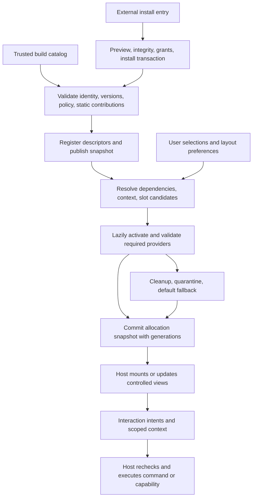
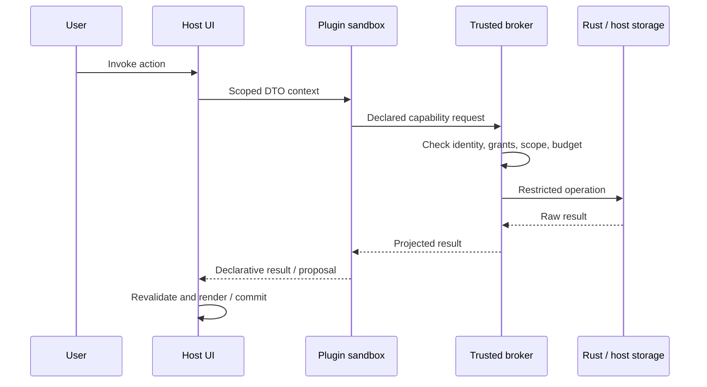

# Plugin Extension and Security Contracts

Chinese counterpart: [插件扩展与安全契约](../../../zh-cn/跨平台/架构/插件扩展与安全契约.md). This specification retains extension/allocation and security contracts, including explicitly unimplemented capabilities. Current behavior follows [implementation status](plugin-system-refactoring-steps.md) and desktop/mobile delivery matrices. Networking, secrets, external media and mobile-code requirements below grant no capability absent from those matrices.

## 1. Overall design and system boundaries

Adopt a **microkernel host, required system modules and independent feature plugins, typed extension points, and minimal context with controlled capabilities**. Registration covers the whole product; host policy decides whether a module can be disabled, removed, or replaced. Plugins receive only explicitly supplied data and capabilities. The host controls rendering, authorization, data access, playback, downloads, and actual network requests.

Confirmed product direction:

- Userscript accepts only built-ins shipped with the application. Tauri desktop and mobile both target declarative and restricted JavaScript externals with shared package format, installation transactions, and Rust brokers. Code execution opens after isolation acceptance for the relevant system/channel.
- Other music applications can reuse plugin protocols and business logic.
- Desktop/mobile public HTTPS networking is capability-based rather than mandatory per-domain consent, subject to stricter channel consent rules. Plugins may opt into enforced host restrictions. Userscript exposes no external networking capability.
- Published compositions remain playable/downloadable without the creation plugin; their source dependencies still apply.
- Desktop and mobile start with local packages and applicable file associations, share reception, URLs, and deep links, all through installation preview. A later marketplace reuses the installer. Built-ins update with the application.

### Future account and cloud-service plugins

The [local-user and service proposal](multi-user-local-cloud-plan.md), revised 2026-11-01, owns the unimplemented follow-up to this baseline. Local user IDs, isolated libraries, verified binding records and canonical write authority remain host services. A local user may bind multiple accounts across independent providers and service instances; source accounts remain distinct. Registration/password/email/recovery, cloud synchronization, sharing/social and advanced reports belong to optional plugins and independent services, rather than a mandatory core identity/cloud subsystem.

Providers, sync, sharing, reports and remote backup may be selected independently through named, versioned, authorized contracts. Private versus public deployment does not define identity; provider/issuer-instance/subject does. Binding is not permission to read/upload the library, and disabling a cloud plugin retains local music. Web motivates Tauri-free host use cases and a separately authenticated API, not absorption of independent account services. A client plugin does not deploy its backend or gain server/native authority by installation.

These contracts, secret injection, private-service access, private-data egress and cross-plugin composition require separate design and runtime acceptance. Current SDK capabilities and S15/S16 admission remain authoritative; no unrestricted broker, namespace access or capability names are introduced here. Detailed batches belong only to the linked plan.

### Runtime policy

The application injects policy; shared packages do not infer it from the environment:

```ts
type ExternalPluginPolicy = 'none' | 'declarative' | 'sandboxed'
```

- none: no external installation, registration, restoration, or execution.
- declarative: validated manifests interpreted by trusted host code; no external code.
- sandboxed: additionally permits an accepted restricted executor.

Enforce policy at installation, registration, restoration, enablement, capability calls, and media resolution. Effective support is the intersection of built capabilities, distribution-channel rules, runtime acceptance, and user grants. Desktop externals remain closed until acceptance. Mobile declarative networking also requires native transport, authorization, and migration acceptance.

Model three dimensions independently: **installation entry** locates a package; **execution kind** selects the declarative interpreter or restricted code executor; **runtime policy** limits kinds allowed by this system, channel, and environment. Any entry can import either supported kind. Mobile targets accepted sandboxed execution, with declarative or none for restricted targets rather than inferring declarative-only from mobile form. Reject code packages with unmet required capabilities during preview; never silently discard code and install them as declarative.

| Area                                            | Userscript                                  | Tauri desktop                     | Tauri mobile                                                                         |
| ----------------------------------------------- | ------------------------------------------- | --------------------------------- | ------------------------------------------------------------------------------------ |
| External policy                                 | none                                        | sandboxed after acceptance        | Target sandboxed; declarative/none where system/channel/environment requires         |
| Built-in creation, tags, sources, contributions | Bundled                                     | Bundled                           | Bundled with mobile presentation                                                     |
| External JavaScript                             | Unsupported                                 | Accepted sandbox only             | Delivery target, subject to section 7 system/channel acceptance                      |
| Executor                                        | Excluded from production graph              | On demand                         | Assemble only in code-capable builds; load on demand and reject unsupported runtimes |
| Public-network broker                           | Not assembled                               | Rust                              | Shared Rust logic, independently accepted                                            |
| Plugin Center                                   | Built-in enablement/settings/version/errors | Also install/grants/update/remove | Small-screen management; host-owned full-screen grant pages                          |

QuickJS-WASM supports isolated contexts and explicit host functions, providing an implementation path rather than proof of this application's isolation. Tampermonkey sandbox selection does not establish per-plugin authority inside one script, and its GM transport does not give this application complete connection-target verification. This project therefore chooses built-ins only for Userscript. [QuickJS-WASM](https://github.com/justjake/quickjs-emscripten), [Tampermonkey sandbox](https://www.tampermonkey.net/documentation.php?ext=hinc&q=sandbox), [GM request API](https://www.tampermonkey.net/documentation.php?q=GM_xmlhttpRequest).

The threat model covers malicious external plugins while trusting the shipped host and executor. Built-ins are trusted application code; minimal-context conventions help decoupling but do not sandbox trusted code in the same environment. Compromised hosts, operating systems, or WebView engines are outside the guarantee.

### Core and plugin ownership

Current ownership and disablement rules belong to [data ownership](plugin-data-ownership.md) and [runtime policy](plugin-runtime-policy.md).

## 2. Packages, contracts, and data ownership

### Package responsibilities

Use [package boundaries](reusable-package-boundaries.md) and [native crate boundaries](../../desktop/backend-engineering.md#workspace-and-plugin-crate-boundaries). Public roots remain lightweight, failed imports retryable, and production apps never depend on CLI/testkit.

### Authoritative schemas and cross-language conformance

Version manifest, wire, capability, and external UI JSON Schemas under plugin-sdk/schema using a fixed JSON Schema 2020-12 subset. Forbid remote $ref, arbitrary regex, and unregistered schemas. Version protocol identifiers and positive/negative corpus together. Generate standalone AJV ESM and TS DTOs at build time; check generated drift and avoid runtime code generation in restricted WebViews. Rust generates explicit serde DTOs and field checks from that same Schema and uses them, unknown-field rejection, and bounds, tested against the same corpus rather than a second independent JSON Schema. TS/Rust must reject duplicate JSON keys, excessive depth, unsafe integer ranges, and invalid Unicode consistently.

The wire carries DTOs/references, never functions/iterators/cancellation objects. No external any, generic invoke(method,args), or getService(name). Trusted service tokens remain internal; public operations are named and versioned. Negotiate contribution, wire, Profile, package, and data versions independently of SDK semver.

### Public contracts

Use Manifest plus multiple contributions and permission-scoped host services rather than expanding MusicSourcePlugin into a universal interface.

Manifest declares stable ID/version/name/description, SDK compatibility, declarative/code type, required/optional permissions with localized reason, supported runtimes/forms and minimum host capabilities, requested memory class, contributions, activation events, entry point, and integrity metadata. Host records exclusively own builtIn status, trust, and actual grants. Official-looking names or signatures cannot create built-in identity.

| Contract                   | Purpose                                                                              |
| -------------------------- | ------------------------------------------------------------------------------------ |
| PluginManifest             | Installation, compatibility, declarations                                            |
| HostCapabilities           | Supported services/contributions, policy, desktop/mobile form, executor availability |
| ContributionDescriptor     | Views, actions, details, filters                                                     |
| CommandContext             | Scoped references, selection, versions/expiry                                        |
| HostRequest / HostResponse | Validated asynchronous wire calls/results/errors                                     |
| PluginStateStore           | Own namespace only, quotas, versioned migration                                      |
| MusicSourceProvider        | Search, paged import, media descriptions                                             |
| HostEvent                  | Authorized projected events; subscriptions revoke with grants                        |
| PluginTask                 | Progress, cancellation, deadline, host scheduling                                    |
| SecretRef, reserved        | Future host-managed secret reference; neither public nor implemented initially       |

Lyrics and metadata enrichers remain reserved. Theme tokens, layouts, and row presentation are trusted built-in points, excluded from the external SDK/installer. Contribution contracts do not enable unsupported extension points. External plugin-to-plugin provides/consumes services remain unavailable in the first release: cooperation uses host-authorized projections. Trusted system modules and built-in themes may use an internal dependency graph and versioned host-service tokens, without exposing that contract to externals. Never pass Vue objects, functions, repositories, stores, or WorkbenchRuntime to externals.

### Source adaptation and version negotiation

| Existing behavior                  | External wire/host adapter                                                                                                                                               |
| ---------------------------------- | ------------------------------------------------------------------------------------------------------------------------------------------------------------------------ |
| Descriptor and local URL preflight | Read without code activation; reject unsupported URLs before list creation/networking                                                                                    |
| Search/import                      | Expiring listingRef; one page per nextPage; close/cancel stops further work; bounded instance-owned cursors                                                              |
| Session/availability               | Keep lifecycle, enablement, runtime faults, source availability, and login orthogonal; network failure does not mean invalid/logout; public sources default not-required |
| Media resolution                   | Preserve default highest available quality, quality ID/rank, alternatives, MIME, loading strategy, and cancellation; return current descriptions or host references      |
| Cleanup/verification               | Trusted adapters create release/verify/cancellation functions from operation/resource IDs; idempotently release discarded candidates; no functions on the wire           |

Plugin IDs, source-provider IDs, and contribution IDs are distinct. Preserve bilibili, douyin, all stored Track.source.pluginId values and stable track IDs; use explicit host aliases where necessary. External packages cannot occupy built-in namespaces. One plugin can contribute multiple sources.

Negotiate manifest schema, SDK semantic version, wireVersion, runtimeProfileVersion, contribution versions, and data schemaVersion separately. Missing required capabilities prevent activation; unsupported optional contributions are skipped with explanation. Reject unknown mandatory fields/capabilities/versions. Map SDK errors into Any Music's canonical AppErrorState instead of maintaining independent AM error numbering.

### Data ownership

Current host/plugin namespace and portable-data rules are maintained in [data ownership](plugin-data-ownership.md).

## 3. Dynamic UI and extension mechanisms

Existing CSS such as track-actions-dialog__section is an implementation detail, not a plugin API. Define versioned semantic positions:

| Contribution               | Placement                                                          | Status                                   |
| -------------------------- | ------------------------------------------------------------------ | ---------------------------------------- |
| navigation.sidebar         | Sidebar; mobile bottom navigation/drawer                           | First release                            |
| workspace.views            | Main content                                                       | First release                            |
| track.actions.secondary    | Additional track actions                                           | First release                            |
| track.details              | Details                                                            | First release                            |
| trackList.operator.actions | Batch operator; mobile action sheet                                | First release                            |
| trackList.filters          | List filters                                                       | First release                            |
| settings.sections          | Plugin settings                                                    | First release                            |
| music.sources              | Source selection/search/import                                     | First release                            |
| lyrics.providers           | Lyrics                                                             | Reserved                                 |
| track.metadata.enrichers   | Metadata/artwork                                                   | Reserved                                 |
| theme.tokens               | Built-in color/type tokens; built-in modules own components/styles | Built-in theme stage; no external access |

Every song-list area uses the same scoped context rather than repeated per-plugin branches. Distinguish location, single/multiple selection, and permitted operations. Core playlist navigation/actions use the layout registry but never depend on plugin grants or installation.

The host determines visibility from enablement, permissions, support, and context. Restricted when/filter expressions read whitelisted fields and cannot run JavaScript, enumerate objects, or initiate requests. Only declared contribution IDs may register. Namespaced keys cannot override core commands. Keep core ordering stable and sort plugin groups deterministically; preserve user navigation preferences. Disable/uninstall revokes views, actions, subscriptions, and requests, returning an affected active page to Discover.

Semantic positions map to the host form factor. Plugins do not dictate pixels, hover-only behavior, or fixed layouts. HostCapabilities reports actual supported positions; unsupported optional positions are inactive rather than fatal. Host layouts adapt tables to mobile lists and own touch targets, accessibility, focus, and keyboard behavior.

Externals submit controlled text/buttons/forms/lists/tables/tags/progress and host song-list nodes. Actions reference declared commands; event values are validated. No external Vue components, HTML, arbitrary CSS, scripts, inline event code, or untreated SVG. Only shipped trusted /vue modules may implement complex creation timelines.

Anti-impersonation requirements:

- Fixed host-owned plugin identity strip on each plugin surface, impossible for plugin nodes to cover or move.
- No password input nodes; persistent warning against entering account secrets. Host-owned login and permission flows remain separate. These constraints reduce impersonation without detecting every deceptive text.
- Bounded node count/depth/page size; paginated/virtualized large lists under message budgets.
- Images/links use authorized host entry points with plugin identity; they do not inherit unrestricted RemoteImage behavior.

Version UI nodes/events and bind events/updates to viewRevision; reject stale events and responses. Host song-list widgets expose only authorized fields. The host owns modal stacking, Escape/Back, focus return, error boundaries, and retry. A failed plugin must not block core playback. Leaving a view cancels its work, while independently authorized host-scheduled PluginTask work may continue.

Filters declare fields, editor controls, summaries, and restricted expressions. Host projections execute common tag filters without per-row sandbox calls. Computation produces versioned batch annotations first. Intersect dimensions; honor each field's explicit AND/OR semantics. Disable deactivates filters visibly and preserves dormant conditions; users choose restoration. Remote filtering covers loaded data unless explicitly supported server-side; never crawl all pages automatically. One tag plugin supplies navigation, single/batch actions, and filters from one state owner.

### Whole-product plugin framework: feasibility and precedents

**Feasible and adopted as the target direction.** Functionality and presentation participate in assembly through shared contracts, covering the sidebar, destination views, list types, and row rendering. Individual DOM nodes, utilities, and business records do not each need installation packages or lifecycles. The following summarizes official mechanisms and derives choices for this project; these projects do not share one security model or establish a single industry standard. Sources reviewed on 2026-10-16.

| Official project and evidence                                                                                                                                             | Existing mechanism                                                                                          | Adopted pattern and boundary                                                                                        |
| ------------------------------------------------------------------------------------------------------------------------------------------------------------------------- | ----------------------------------------------------------------------------------------------------------- | ------------------------------------------------------------------------------------------------------------------- |
| [VS Code extension anatomy](https://code.visualstudio.com/api/get-started/extension-anatomy), [theming](https://code.visualstudio.com/api/extension-capabilities/theming) | Manifest contributions and event activation; separate color and product-icon themes                         | Static registration, lazy activation, separate themes/features; not its privilege model                             |
| [JupyterLab plugins and services](https://jupyterlab.readthedocs.io/en/stable/extension/extension_dev.html#plugins)                                                       | Core menus/file browser are plugins; packages may contain several plugins; required/optional service tokens | Uniform system assembly and explicit internal dependencies; no direct service-object sharing with untrusted plugins |
| [Eclipse Theia extensions](https://theia-ide.org/docs/extensions/)                                                                                                        | Build-time Theia extensions deeply customize products; runtime VS Code extensions use a bounded API         | Separate trusted product modules from installable external plugins; keep internal APIs private                      |
| [Backstage extension structure](https://backstage.io/docs/frontend-system/architecture/extensions/)                                                                       | Typed inputs/outputs, parent attachment points, singleton input constraints form an extension tree          | Typed slots, attachment validation, explicit cardinality; no React dependency or copied assembly timing             |

Use a lightweight microkernel/contribution registry while retaining Vue. This need does not justify a full IDE framework, remote module federation, or a general DI container. The difficult parts are replacement contracts, lifecycle, and state ownership rather than maintaining a shared Map.

### 1. Packages, modules, contributions, and instances

| Concept                 | Identity and responsibility                                                                                | Application to this proposal                                                            |
| ----------------------- | ---------------------------------------------------------------------------------------------------------- | --------------------------------------------------------------------------------------- |
| Plugin package          | Distribution, version, and contributions; external packages additionally use installation/integrity/grants | One built-in theme supplies colors, navigation, views, lists, and rows                  |
| System/feature module   | Host assembly/lifecycle unit; system modules may be required, optional plugins disableable                 | Discover, playlists, player, tags, sources; not necessarily separate workspace packages |
| Extension point         | Versioned semantic slot with typed input/output, cardinality, support, fallback, and trust requirements    | Navigation, main content, list rendering, row presentation                              |
| Contribution definition | One module-owned record, keyed by host-generated ownerId/localId                                           | Register a compact track presentation once and reuse it                                 |
| View instance           | A mounted use of a definition with local presentation state and disposal scope                             | Two instances of the same track in Discover and queue                                   |
| Business object         | Canonical domain data, stable identity, and references                                                     | Tracks and playlist members are not installed plugins                                   |

Ten thousand tracks reuse one row presentation definition; the host paginates or virtualizes visible instances. There are not ten thousand executors, grants, or registrations. Selection, scroll, and editor drafts use scoped view identities; queue, tasks, and library state remain in the shared workbench and survive renderer disposal.

### 2. Minimal host and unified control

The fixed host owns bootstrap, trusted build catalog, installation/policy/authorization authority, dependency resolution, registration/allocation, cleanup, recovery, and the boundaries of data/playback/download service ports. Trusted service implementations may use internal module registration but remain required providers; third parties cannot replace security boundaries. The eight core areas become system modules without changing business ownership or availability. Do not introduce plugin-playlists.

The Plugin Center page is a control-plane UI, not the plugin framework itself. Closing it leaves the framework running. Split host responsibilities rather than creating one object holding components, HTTP, databases, and every business state:

| Role                           | Responsibility and authority                                                                                                         |
| ------------------------------ | ------------------------------------------------------------------------------------------------------------------------------------ |
| Installation catalog/installer | Origins, immutable package versions, integrity, transactions; build catalog for built-ins and section 4 installer for externals      |
| Lifecycle controller           | Enable, activate, suspend, stop, update, recover; serialize commits using dependency order and generations                           |
| Service/contribution registry  | Versioned definitions, ownership, static metadata; no execution, Vue instances, or business repositories                             |
| Allocator                      | Derive deterministic slot assignments and rejection reasons from snapshots, policy, scope, and user choices                          |
| Command/capability broker      | Recheck identity, permissions, object versions, and context on invocation; Rust remains authoritative for Tauri installations/grants |
| Vue adapter                    | Pass resolved allocations to controlled components; manage mounting, focus, local failures, and disposal                             |
| Diagnostics/recovery           | Dependencies, placements, selected providers, conflicts, budgets, failures, default-theme recovery, safe startup                     |

plugin-center owns registration/scheduling state, not a second Rust grant database. The controller requests native changes and publishes local snapshots against returned installation/authorization generations; changing a frontend enabled field grants no native capability. Unified control does not imply a shared executor for trusted and external code or change GM/Rust transport ownership.

### 3. Slots, scopes, and replacement contracts

Keep existing business contribution points and add presentation points. Navigation targets and views share a stable viewId; clicking navigation asks the host to select a view. Navigation renderers do not create pages or perform hidden routing. Every point declares additive, singleton-selection, or constrained-decoration semantics. Reusing another contribution's ID is not a replacement mechanism.

| New extension point | Cardinality/scope                        | Initial exposure                                                                          |
| ------------------- | ---------------------------------------- | ----------------------------------------------------------------------------------------- |
| theme.root          | One complete built-in root per workbench | Independent root/views/resources through ui/theme; application-owned loaders and fallback |

Descriptors include pointId, contract version, owner, contributionId, input/event schemas, scope, cardinality, allowed implementation kinds, fallback, and budgets. Scope uses host-defined area/list/form enums rather than DOM selectors, arbitrary object traversal, or track-ID wildcard rules. New list instances join by type without individual registration.

These global theme/presentation points require trusted-built-in origin determined by the host build catalog. External packages cannot register, restore, or occupy them, including code-free, same-named, or validly signed packages. Component factories use static build-catalog mappings without external import paths. Built-in themes supply compatible namespaced definitions selected by the host without overwriting core registration IDs. External feature plugins retain their own declarative pages/actions/details; host list widgets in those pages use the current built-in theme and confer no global skinning or core-view replacement authority.

List/row contracts retain loading/empty/error states, keyboard/touch selection, stable trackId, pagination, drag alternatives, play/favorite/download/action events, and disabled semantics. Presentation emits intents for host validation/execution; themes cannot redefine favorites or silently remove required actions. Authorization, login, installation preview, plugin identity strips, native file confirmation, and recovery are not replaceable theme slots.

### 4. Installation, registration, activation, allocation, and display



1. **Discover/install:** trusted built-ins come from the build catalog without external installation. External entries use the same section 4 transaction under runtime policy. Installation does not imply enablement, activation, or all grants.
2. **Register:** parse static manifests before loading Vue, providers, or sandboxes. Validate conflicts, point versions, required/optional capabilities, reserved identities, and dependencies; publish immutable definition snapshots for navigation/command metadata.
3. **Enable/dependencies:** trusted modules declare versioned host-service requires/optional dependencies. Missing/incompatible required services or cycles block affected optional modules with dependency paths. Failed required system modules enter built-in recovery. Provider disable explains affected consumers and applies the defined cascade; required core providers cannot be disabled. External first-release plugins depend only on public host capabilities, without automatic dependency download/execution.
4. **Candidate allocation:** match current scope. Static when evaluation does not fetch or activate every plugin; unknown conditions do not match. Inactive modules can expose static entries and activate on interaction. Built-in themes load trusted Vue/style entries from the build catalog without QuickJS/Worker sandboxes or dependence on external-plugin policy.
5. **Lazy activation:** start necessary providers in dependency order, coalescing concurrent activation. Clear failed promises for retry. Validate installation ID, package hash, and generation before accepting results; late completion after disable/reinstall cannot register again.
6. **Commit/display:** prepare/validate renderers, then atomically publish allocations with registryRevision/lifecycleGeneration. Vue consumes resolved results without mounting duplicate player controllers. Keep the previous valid snapshot during theme preparation, while permission revocation takes immediate effect.
7. **Commands:** visibility/disabled status is presentation. Each dispatch rechecks user gesture, enablement, grants, data versions, and scope; hidden direct invocation, forged row events, and stale view events cannot bypass checks.
8. **Disable/remove:** close admission and increment generation, revoke grants/handles, abort scoped reads/tasks, then dispose views/subscriptions/listeners/styles/object URLs in reverse order and publish fallback. An invalid active page returns to core Discover; retain data/preferences and never replay old tasks on enable. External removal follows section 4 data/install rules.

Model available/verified packages (plus installed for externals), user enabled intent, inactive/activating/active/failed/suspended runtime state, and eligible/selected/visible contribution state separately. These are not one linear enum. Hiding navigation does not stop playback; unselected built-in themes remain available without loading. External policy restricts external packages without disabling built-in themes; theme switching replaces presentation without uninstalling system functionality.

### 5. Unified allocation and conflict resolution

The allocator is a pure, Vue/DOM-independent calculation over validated registrations, effective policy/capabilities, host context, and preferences. It outputs slot mappings and explanations without installing plugins, requesting grants, or executing contributions. Controller/broker checks remain authoritative at runtime.

- **Filter first:** identity/integrity, policy, enablement/failure status, point/input contracts, required dependencies, current grants, and scope/when. Missing required capabilities reject the plugin; optional contributions may be omitted with reasons.
- **Additive slots:** preserve required core groups. User order takes precedence, followed by host group/default contribution order and full contribution ID as a deterministic tie-breaker. Arbitrary priority cannot bypass reserved boundaries.
- **Singletons:** the host admits one complete build-owned theme.root and validates its required/optional feature coverage before commit. Failure triggers whole-root fallback/recovery. Semantic navigation/views/actions/filters retain their own allocation; partial theme overrides are not supported. Last-installed plugins cannot select a theme.
- **Unavailable choices:** retain dormant preferences, apply defaults, and explain why. Never restore a revoked snapshot. Reinstallation does not automatically reclaim an active slot.
- **Structure:** validate the UI attachment tree separately from the service dependency graph; neither may contain cycles. Initial decoration supports only host-defined badges/details rather than arbitrary nested wrappers with ambiguous event order.
- **Explainability:** Center diagnostics show registration target, candidates, selected provider, and unsupported-runtime/permission-denied/incompatible-contract/dependency-missing/not-selected/failed reasons. Cross-layer failures still map to AppErrorState.

Registration is an owner-scoped batch transaction with full rollback on failure. Each registration has an idempotent disposal handle tied to module generation. Plugins cannot dispose another owner's contributions; the controller can force cleanup after timeout/failure. Import-time global registry mutation is forbidden.

### 6. Themes, layouts, and component replacement

**UI themes are trusted built-in plugins only.** A theme is an implementation of presentation and interaction across product areas, including functional logic rather than only code-free colors. Theme source passes project review/build/tests and ships with the application. External authors can contribute source for inclusion in a build; runtime import, signatures, or official-looking names cannot confer built-in identity.

A built-in theme combines these capabilities without a new external template language or tiered permission model:

| Capability                      | Implementation                                                                       | Ownership                                                                                    |
| ------------------------------- | ------------------------------------------------------------------------------------ | -------------------------------------------------------------------------------------------- |
| Appearance/resources            | Colors, typography, radii, spacing, icons, motion                                    | Built-in tokens, reviewed SCSS/CSS and build-time assets using --am-* and AppIcon            |
| Structure/presentation          | Sidebar/items, views, lists/grids, track cards/details                               | Built-in Vue through typed slots and props/events, preserving feature contracts              |
| Presentation/interaction logic  | Theme settings, navigation collapse, drag, transitions, density, responsive behavior | Theme-owned composables and controlled state with explicit dependencies, disposal, and tests |
| Business capability composition | Playback, favorites, downloads, enabled-plugin entries in alternate layouts          | Injected commands, read-only state, named services; no copied business rules/data            |

Themes receive contracted track/selection state and component events; the previous external-template assumption that themes never see track values no longer applies. They cannot create another player/download/library authority or obtain capabilities through private stores/repositories, DOM guessing, or application imports. New domain behavior belongs to its feature module. Theme-specific cross-view functionality/async effects belong to explicit theme modules/composables under the same lifecycle. When optional tags/creation/sources are disabled, themes hide unsupported entries or fall back rather than enabling those plugins.

Built-in themes execute in the host Vue realm with the same trust as other shipped application code. Contracts, explicit injection, and review reduce coupling/misuse rather than isolating malicious built-ins. Third-party Vue sandboxes, external theme installation/marketplaces, global external CSS injection, and external row-template interpreters are outside scope, not mandatory future stages. Existing external feature-plugin QuickJS and declarative UI work retains its independent section 4 acceptance.

Theme metadata declares stable ID, host UI contract version, supported forms/areas, required/optional services, presentation mapping, default tokens, and settings schema. These are internal module contracts rather than external SDK APIs. One product root normally activates one coordinated navigation/view/list/row theme. The default is a non-removable system fallback. Alternatives expose selection/settings/diagnostics without external installation, permission prompts, or independent updates. Code changes/removal ship with application upgrades; switching off an active theme first restores the default and then cleans up. Theme IDs do not change viewId, trackId, or source identities.

Trusted themes may use scoped Vue styles and separate SCSS rather than the external UI CSS prohibition. Keep product-root scope, semantic tokens, accessibility, no-referrer images, and normal resource-loading rules. User settings accept schema-validated values, never arbitrary CSS/code or component paths. Precedence is system defaults, active theme, explicit user overrides, then host accessibility/security constraints. Store light/dark/system mode separately from theme choice. Namespace theme settings by themeId/schemaVersion and retain dormant missing-theme preferences; restoring them does not grant external execution authority.

Keep preparation inert by scoping theme styles under a host-controlled product-root marker such as data-am-ui-theme. Preloaded styles do not match the active theme until the marker changes with the allocation commit. Loaders start no business operations, listeners, or timers at import time; effects belong to explicit activation/mount scopes. Shared base and theme-specific styles hold separate resource references. CSS scope supports switching/cleanup rather than untrusted-code isolation.

Switch through prepare, validate, commit, cleanup: load build-known components/styles, verify required slots/services/form, atomically commit theme/allocation snapshots, then dispose old views/listeners/styles. On failure keep the prior valid theme or use built-in defaults and independent recovery. Preserve playback, downloads, selection, business drafts, and navigation identity; move focus/scroll through stable view keys and host-held snapshots, transferring only contracted state. Isolate failed theme-settings migrations and restore defaults without altering business repositories. Trusted infinite loops may still block the renderer; error boundaries are not process isolation.

Both Userscript and Tauri select from injected built-in catalogs independently of ExternalPluginPolicy, external installers/sandboxes, or mobile code-plugin availability. Read metadata lightly and load Vue/styles only when the product starts and the theme is selected. Apply themes to the product Shadow Root or embedded root and corresponding overlays; release previous theme resource references without disrupting shared base styles. Host authorization/login/install/recovery and plugin identity surfaces retain host implementations/styles, with theme SCSS explicitly excluding them. This is a trusted-code implementation rule rather than same-realm CSS isolation. Themes declare supported mobile forms and fall back before mounting incompatible layouts instead of overriding touch constraints.

### 7. Implementation ownership and minimal contract sketch

The following is a target responsibility map and internal sketch, not existing APIs; freeze schemas/filenames during the corresponding stage:

| Location                        | Responsibility                                                                                                                                                         |
| ------------------------------- | ---------------------------------------------------------------------------------------------------------------------------------------------------------------------- |
| packages/plugin-center/src      | Preserve PluginCatalog identity semantics; separate lifecycle controller, registry, dependency resolver, pure allocator; framework-free root                           |
| Future plugin-sdk               | Public feature-contribution DTOs, point versions, executor ports; theme replacement and trusted service contracts stay outside external APIs                           |
| packages/music-workbench        | Adapt navigation/view descriptors, list contexts, commands, business services; migrate system modules without duplicate data/task state                                |
| packages/ui                     | Controlled shell/list/row components and tokens; typed props/events/slots consume allocations without depending on plugin-center/plugins                               |
| Future plugin-ui-vue            | Public ui consumption, internal theme contracts/trusted assembly, host rendering of external declarative UI, errors/theme scope; no component references in registries |
| Built-in plugin-theme-* modules | Compose Vue views, SCSS, assets, interaction composables across areas; consume explicit state/command contracts and update with application builds                     |
| Application composition         | Build catalog, actual capabilities, built-in loaders, runtime adapters; Rust installation/grant authority and Userscript external-path pruning remain                  |

```ts
// Internal sketch: descriptors are data; component factories stay in the trusted Vue adapter.
interface ContributionRegistration {
  ownerId: string
  localId: string
  pointId: string
  contractVersion: number
  implementation: 'host-component' | 'declarative'
  implementationId: string
}

interface AllocationSnapshot {
  registryRevision: number
  lifecycleGeneration: number
  // Semantic slot/scope -> validated full contribution IDs, without private track data.
  slots: Readonly<Record<string, readonly string[]>>
}
```

Descriptor validation separately enforces schemas/scopes/trust. host-component is not a self-grantable external permission. Register owner batches, allocate snapshots, and resolve implementationId in the adapter rather than checking getPlugin()/permissions inside each component. Use typed/versioned commands, scoped subscriptions/disposal, and named business ports rather than a universal state/event bus.

The navigation slice uses [navigation definitions](../../../../packages/ui/src/product/product-navigation.ts) and the Classic theme's [ProductWorkbench](../../../../packages/theme-default/src/components/shell/ProductWorkbench.vue), [TrackList](../../../../packages/theme-default/src/components/music-sources/TrackList.vue), and [TrackRow](../../../../packages/theme-default/src/components/music-sources/TrackRow.vue). Workbench adapters own descriptions and business control; theme components consume controlled contracts and allocated contributions. Retain core ProductViewId identities and add validated plugin-view references rather than widening everything to string. Migrate persisted navigation with ID mappings; lightweight registration must not statically load every view/Vue component. Internal system modules can remain directories in existing packages until independent reuse justifies extraction.

### 8. Keeping the framework decoupled

Maintain an executable extension-point catalog: owner, version, input/output schemas, trust, cardinality, activation, fallback, data cost, and cleanup scope. New points require a real consumer and contract tests. Do not replace domain ports with a general event bus, arbitrary middleware, or universal hooks. Version/deprecate contracts explicitly and keep internal theme services out of the external API.

Uniform registration still requires a **minimal recovery bootstrap outside the plugin framework**: inspect prior failure, disable optional modules, restore defaults, and show plugin/data recovery without external contributions or the same broken allocator. Create player/download/library controllers once per host; themes and lists consume them. Required-module failures enter diagnosable recovery rather than blank UI.

Model module dependencies, UI attachment trees, and data references independently. Dependency resolution executes no plugins. Initially exclude external dependencies, automatic installation, cyclic service lookup, and shared mutable stores. when uses a bounded host-interpreted AST for booleans/enums/allowlisted fields, with no scripts/regex/arbitrary paths/custom operators. Cross-module commands declare inputs, cancellation, idempotency, and effects rather than broadcast-triggered writes.

Allocation caches hold IDs/non-sensitive matches, keyed by registryRevision, policy/permissionEpoch, scope, and preference versions; never reuse private contexts across scopes. Static discovery activates nothing. Render visible rows and submit annotations in batches. Record startup/activation/switch/reclaim p50/p95/memory during acceptance, preserving playback budgets without inventing measurements. Fault attribution, breakers, and recovery are per plugin; diagnostics expose dependency paths/reasons without private payloads.

### 9. Internal-framework acceptance

Internal modules and built-in themes follow current host contracts independently of external sandbox admission.

Additional automated acceptance:

- **Determinism:** changing discovery order leaves default allocations stable; exercise singleton conflicts, selections, theme mappings, cross-scope/contract mismatches, dependency cycles, and required/optional degradation.
- **Lifecycle/races:** coalesced activation, retry after failed import, registration rollback, late results/events after disable/remove/reinstall, no partially committed navigation/view/style batches.
- **Business/presentation separation:** hidden navigation keeps work running; required functionality cannot uninstall; shell/list/row switching does not recreate player/download/library controllers; failed active page/theme falls back with recovery reachable.
- **Identity/feature boundary:** external forged theme kinds, signatures/built-in flags, global slots, backup restoration, and component paths cannot register/load themes. Existing external declarative pages still display under the current theme. Trusted themes consume contracted track/selection props/events; switching does not duplicate business controllers, crawl pagination, or submit user operations. Disabled optional features fall back correctly.
- **Delivery/recovery:** built-in themes work with ExternalPluginPolicy none; Userscript lightweight entries do not eagerly load Vue/styles. Preparation activates no new styles/effects. One theme is active, required-contribution failure restores the whole default, switching cleans styles/effects, bad theme settings leave the library intact, and host safety/recovery surfaces remain. Use ordinary Vue/composition tests without QuickJS adaptation.
- **Scale/disposal:** ten thousand records in a list keep a constant number of contribution definitions/executors, mount visible rows only, and make no per-row sandbox calls or implicit pagination crawl. Repeated switching/removal returns listeners/handles/styles/instances to baseline. Measure device budgets rather than treating this plan as performance evidence.
- **Runtime/recovery:** preserve default behavior, Shadow/embedded scope, core persisted IDs, and user order in both production hosts; native mobile remains subject to section 7. Real focus/visual/device inspection requires explicit user authorization to launch; Node component tests are not substitutes.

## 4. External-plugin security for Tauri desktop and mobile

Shared contracts do not require every host to expose every capability. Mobile code-specific provisions apply only after section 7 gates. Userscript assembles none of these external execution/network services.

### 4.0 Threat model and mandatory properties

Treat packages, authors, dependencies, remote responses, imported data, generated UI/links, and all plugin messages as hostile, including later releases from a signed publisher. Protect credentials, library integrity, other plugins, native file/network authority, playback availability, and genuine host consent.

| Attack surface                                     | Mandatory boundary                                                                    | Required outcome                                                                  |
| -------------------------------------------------- | ------------------------------------------------------------------------------------- | --------------------------------------------------------------------------------- |
| Malicious JS, interpreter/bridge escape            | Per-plugin VM/Worker, separated executor WebView, native authorization                | At most that installation's granted capabilities; no accounts/files/other plugins |
| Context forgery/replay/confused deputy             | Channel-bound identity, projections, epoch/request/task/version/expiry                | Self-reported pluginId/granted/window/gesture establishes no authority            |
| Network/media/images/links/write-back exfiltration | Historical sensitivity ledger, unified exits, provenance, host previews               | Changing exits, object ownership, or installation IDs cannot downgrade data       |
| SSRF/DNS/proxy/redirect bypass                     | Native normalization, public-address policy, pinned connections, per-hop/retry checks | Reject routes that cannot maintain constraints                                    |
| Package tampering/bombs/malicious upgrades         | Bounded archives, signatures/hashes, immutable snapshots, journals/revocation         | No install scripts, partial activation, or restored revoked grants                |
| CPU/heap/Promise/message/disk exhaustion           | VM and native global limits, independent watchdog, bounded queues/backpressure        | Terminate/reclaim while preserving playback/recovery                              |
| Phishing and injection                             | Controlled nodes, identity strip, host consent, no arbitrary HTML/CSS/scripts         | Plugins cannot establish consent; deceptive text remains a residual risk          |

The TCB includes native host, launcher/VM bridge, validators/renderers, engines/dependencies, and application-shipped code. Separation is not protection against a fully compromised OS/WebView/TCB, and revocation cannot recall delivered data. Rust authority and executor resource separation must still contain interpreter/bridge logic compromise; do not dismiss every JS defect as outside the model.

Initially prohibit native plugins, supplied WASM/bytecode, host eval/import, arbitrary HTML/CSS, background auto-start, external cross-plugin calls, dependency installation, and generic files/process/accounts. Internal contract discipline provides decoupling, not isolation of malicious built-ins.

### 4.1 Minimal context

Create a scoped context per user action. Project necessary fields instead of passing a full workbench object. Playlist names, notes, and history are user data even if visible on screen. Exclude host account IDs, raw host-source responses, credentials, paths, signed URLs, and native media grants from plugin projection, including nested data/errors/logs.

Contexts carry object versions, scope, and expiry. Guessed IDs do not widen access. Plugins receive copies; extra data requires named capability calls with renewed checks. Submit typed operation proposals; the trusted host validates and commits. Selection change, call end, or revocation invalidates contexts. Background tasks require their own bounded scope/deadline.

Types, freezing, and small arguments do not isolate code executed in the host JavaScript realm. Declarative interpretation still requires data/UI/network validation. Userscript does not accept externals merely because they contain no JavaScript.

### 4.2 Restricted executor

Each active external code plugin gets a separate Worker, QuickJS Runtime, and WASM instance. Trusted shipped code runs the launcher/bridge/interpreter. Plugin text executes only inside QuickJS, never via host eval, Function, dynamic import, or a plugin Worker script. Bundle dependencies into one entry; no external module loading or runtime dependency installation. Workers alone are not authority sandboxes. [Worker capabilities](https://developer.mozilla.org/en-US/docs/Web/API/Web_Workers_API/Using_web_workers), [QuickJS-WASM](https://github.com/justjake/quickjs-emscripten).

Do not expose DOM, host-page objects, browser storage/cookies, fetch/WebSocket, GM, Tauri IPC, Node/files/shell/process/native modules, account/proxy secrets, CDP, native grants, or remote modules.

#### Defense in depth

WASM linear memory helps isolation but does not prove that vulnerabilities affect only that memory. Bridges, imported host functions, handles, executor resources, and the WebView engine remain security boundaries requiring maintenance and fuzzing.

- Serve trusted Worker scripts with independent restrictive CSP response headers, including blocked direct networking. Do not use blob/data Worker launch URLs. Validate actual behavior on each target; host CSP alone is insufficient.
- Desktop targets a dedicated executor window without product commands. First put application commands under explicit AppManifest permissions and grant only exact host labels; enumerate rejection tests for accounts, HTTP, storage, media, files, and other commands. No broad wildcard capabilities covering executors.
- No business IPC does not mean no communication: a host-created dedicated channel carries bounded wire messages to a trusted relay. Any necessary native relay command can only forward validated protocol messages, tied to actual caller/window and Rust-created session. Document this exception instead of claiming absolute zero IPC.
- Hidden state is not isolation. Same-origin windows may share storage. Validate storage partitions/origins, no host broadcasts/snapshots, navigation/resource restrictions, and exact message recipients. A separate window is not necessarily a separate OS process. Keep code externals closed if these conditions cannot be established.
- Mobile initially uses one main product view, without treating that as a framework limitation. Official mobile multi-window support does not establish a hidden isolated executor. Verify the locked Tauri/system versions and devices. iframe is not the default escape hatch: Tauri documents iframe/window IPC distinction limits on Linux/Android. [Mobile windows](https://v2.tauri.app/learn/mobile-multiwindow/), [capability limitations](https://v2.tauri.app/security/capabilities/).
- Do not enable SharedArrayBuffer/cross-origin isolation. Tauri Isolation Pattern may add IPC validation but does not replace per-plugin grants. [Isolation Pattern](https://v2.tauri.app/concept/inter-process-communication/isolation/).
- Probe Worker/WASM/CSP at runtime. Unavailable code execution never falls back to direct host execution; report unavailable capability. Declarative functionality remains subject to its own native acceptance.

#### Concrete executor acceptance contract

1. **One native principal per external executor.** Each active desktop code plugin gets an independent executor WebView, security origin/isolated storage, Worker, QuickJS runtime, and WASM memory. Never share one native WebView principal and trust a JS pluginId to distinguish owners. Mobile requires equivalent identity/storage/IPC boundaries before enabling code; neither the product view nor an iframe is a substitute. Native caller/session/hash establish identity; labels locate executors and cannot be chosen/created by plugins.
2. **Separate resource origin and CSP.** Load only shipped launchers/locked engine resources. Plugin source is VM input data, never a WebView script/module/protocol page. Deny access to product resources/storage, navigation, new windows, downloads, popups, device grants, Service Worker registration, and arbitrary asset-protocol files. Test cookies/Cache/BroadcastChannel/shared workers/opener/native broadcasts as well as storage; hidden windows provide none of this by themselves.
3. **Three CSP policies.** Product page, executor document, and Worker response each have a policy. Worker connect-src is none; executor permits only required trusted assets and exact relay transport. Any required ipc/local transport allowance exists only on the relay document, never arbitrary localhost/HTTP. Permit only necessary wasm-unsafe-eval, not unsafe-eval/remote scripts/plugin URLs. Verify response headers, successful VM startup, and actual denied requests. [Tauri CSP](https://v2.tauri.app/security/csp/)
4. **Complete AppManifest coverage.** Generate/check permissions against registered commands in CI. Test all business commands and Tauri core/event/resource/window/official-plugin commands on each target. The executor has only a named relay, no generic invoke, cross-window events, or resource handles. Wildcards or capability unions cannot leak main-window rights. Tighten the framework's custom-command defaults explicitly. [Tauri capabilities](https://v2.tauri.app/security/capabilities/)
5. **Hostile-relay resistance.** Even after launcher compromise, Rust maps the actual caller to one installation and rechecks scope/budgets/epoch; plugin tokens, destinations, and claimed host actions are not authority. Responses target only that session. Only the controlled product entry creates grants/contexts; the executor cannot confirm user consent.
6. **Probes are not acceptance.** A build acceptance artifact records application/engine/Profile/OS/WebView versions and isolation evidence. Runtime probes confirm an already accepted combination remains usable; successful Worker startup or a CSP canary cannot approve a new combination. Unknown/failing combinations use declarative/none and reject code packages. Dedicated WebViews do not guarantee separate OS processes; process-wide resource risk remains part of device acceptance.

#### Runtime Profile

Pin QuickJS/WASM release, language target, and Profile version. Disable external module loading. Reject dynamic import/eval/Function in builds. The production Profile uses a trusted engine variant with dynamic code evaluation disabled, covering indirect function/async-function/generator constructor paths rather than deleting globalThis.Function alone. No external loader or supplied bytecode. Code remains disabled until the variant passes semantics and escape tests; lint is not the boundary.

Specify bounded console, timers, URL/URLSearchParams, text encoding, base64, structuredClone, and secure randomness, identifying pure VM implementations, trusted polyfills, or host ports. Never inject raw browser/Node globals. Test every promised feature in QuickJS.

The current [VM Profile](plugin-execution.md) exposes bounded SHA-256/HMAC-SHA-256; MD5 is unavailable. Future crypto additions require a versioned contract and never expose host keys. host.html is deferred; a budget-checked pure parser may run inside the VM. Any future host parser must bound text/selectors/output and execute no scripts, resources, or external entities. Cross-boundary tools are asynchronous; only measured pure local polyfills may be synchronous.

#### Versioned budgets

The current [VM](plugin-execution.md), [native authority](native-plugin-authority.md), [network](plugin-networking.md) and [package](plugin-packages.md) guides own enforced budgets. Future mobile/higher-memory profiles require measured device acceptance; increases need a new version. Fresh request IDs, retries and reloads cannot reset principal totals. These are not whole-browser-process memory limits.

#### Instance lifecycle

Activate on demand and reclaim idle instances (initial five-minute target). Share compiled trusted WASM modules only where supported, with independent runtimes/memory; deliver trusted bytes/modules without relaxing Worker networking. Cross-window module transfer/cache support requires validation.

Treat runtime memory as temporary; persistent allowed state goes through PluginStateStore. Crashes/limits terminate the instance and revoke its work; restart with bounded exponential backoff and automatically suspend after repeated failures with user-visible recovery. Mobile backgrounding may pause/terminate plugins; host playback must not depend on plugin residency.

### 4.3 Data and capability grants

Authorization is **identity × operation × data scope × lifetime**. Installation shows a summary; missing necessary grants are explained at first user-initiated use, with no repeated prompts inside scope. Optional denial disables only that feature; offline plugins need no network grant. Expanded scope/capabilities require renewed consent.

| Level | Meaning                                                                                 | Rule                                                              |
| ----- | --------------------------------------------------------------------------------------- | ----------------------------------------------------------------- |
| L0    | Public source metadata                                                                  | Minimum necessary grant                                           |
| L1    | User-action association: selection/query/current object and field-limited copies        | Explicit current scope; never lowers field sensitivity            |
| L2    | Private playlists/notes/tags/favorites/queue/history and derived/stored data            | Explicit grant and network-combination rules                      |
| L3    | Host account credentials, proxy secrets, paths, native grants and host-held signed URLs | Never projected; provider-owned transient URLs/cookies follow 4.4 |

Sensitivity and scope are orthogonal. Selected private notes remain L2. Associating public tracks with private favorites/history can create L2. Derived/encoded/hashed data conservatively inherits the highest input level; changing keys/versions does not downgrade it.

Hard combination rules:

- A plugin cannot combine public/host-restricted networking with L2 reads unless it declares private-data export and receives highest-risk consent on a separate host page showing full scope and fixed risk wording.
- L1 plus networking requires disclosure of both readable data and outbound transmission.
- Own-store copies count as historical reads; later networking must consider them.

First release: selected fields or explicitly scoped lists are paged; no global library/history enumeration, cross-plugin storage, general local-file access, or arbitrary authenticated URLs. Reads do not grant writes. Favorites/queue/playlist/publication modifications are typed host operations; destructive or irreversible batches require host-rendered impact confirmation. Exports are host-generated/user-saved without returning paths.

| Risk    | Examples                                                                       | Host presentation                                     |
| ------- | ------------------------------------------------------------------------------ | ----------------------------------------------------- |
| Low     | Offline L0/L1                                                                  | Concise summary                                       |
| Medium  | Restricted-host L0 networking; offline L2 task                                 | Destinations/scope; explicit private-data explanation |
| High    | General networking, network plus L1, larger memory, independent cookie session | Prominent combined-risk explanation                   |
| Highest | Any networking plus L2 export                                                  | Separate page; never merged with other grants         |

Take the highest applicable risk. Restricting destinations does not automatically lower a level, especially private-data export. Developer-written reason supplements, never replaces, host wording. Suspend network/L2 grants unused for 90 days under this versioned BudgetProfile; distribution channels may impose stricter consent.

Network-enabled plugins may send all received data to reachable services. Revocation stops future delivery/work but cannot recover data already received/saved/sent. Maintain a conservative host ledger of historical highest data level tied to namespace/install provenance/publisher/version. Do not claim arbitrary JavaScript taint analysis. Revocation, updates, reinstalls, ID changes, or restored data do not clear historical risk; unknown imported data is L2 unless old instances/data are explicitly cleared.

Review all exits, including images, links, host writes/projections, exports, and cooperation with other plugins. Authorizations require actual user actions, with deduplication/rate limits; timers, startup, and remote messages cannot spam prompts. Host previews canonical link destinations and prohibits bundled private context; file export previews the data scope.

#### Prevent host-data laundering and cross-plugin forwarding

The ledger is more than a plugin-wide flag. Host-owned provenance records the origin principal, input context, highest sensitivity, and install/data generation for deliveries, stored namespaces, and plugin-submitted business values. Outputs conservatively inherit operation inputs and historical-store sensitivity; plugins cannot label them public. This covers tags, annotations, titles, recipe notes, free-text forms, and URLs.

Required attack case: A encodes private notes into a track title and network-enabled B reads it. Reject or require private-export consent. Workbench commits provenance atomically with validated data, and B's reads check its rights and the value's sensitivity. An instance that received L2 cannot revoke read access and continue networking without export consent or termination and relevant-state cleanup. Remote public responses cannot overwrite existing private provenance.

Unknown imported/restored plugin data defaults to L2. ID changes are handled through preserved host labels or this conservative default, not guessed publisher identity. Diagnostic exports cannot turn raw bodies/errors/logs into an unapproved exit; host audit exports have their own preview and are not plugin-readable. Automatic telemetry excludes plugin bodies/private information.

This covers observable host APIs/storage flows, not malicious users manually copying information or every covert channel. Do not claim precise arbitrary-JS taint analysis. Where field provenance cannot be maintained, label the entire object/namespace L2 and expose less capability.

### 4.4 Host-mediated networking

#### Capabilities and destinations

network.publicHttps is optional and normally permits public HTTPS without mandatory domain lists. Optional manifest network.hosts is enforced at every redirect and shown as restricted destinations. New hosts require a new version and renewed scope authorization. It never waives private-data rules.

First-release host restrictions use canonical exact host/port rules with HTTPS, explicit default ports, IDNA, trailing-dot and subdomain semantics; no substring/suffix matching or implicit wildcards. Enforce destination rules together with connection-address checks. Profile 1 permits HTTPS port 443 (implicit/explicit equivalent), GET/HEAD/POST, POST bodies up to 1 MiB, URLs up to 8 KiB, total request headers up to 16 KiB, and three redirects. No CONNECT/TRACE/arbitrary ports/tunneling/upgrades. Media uses named GET/HEAD/Range channels. Expanding this set requires a new capability version.

| Capability                       | Plugin input                                                  | Host action                                                  |
| -------------------------------- | ------------------------------------------------------------- | ------------------------------------------------------------ |
| Public HTTPS                     | URL, supported method, business headers, bounded body         | Independent non-account transport and restricted response    |
| Authenticated business operation | Implemented operation ID, scoped object references/parameters | Fixed host protocol, host-selected account, projected result |

Never silently attach unauthorized identities/data. No arbitrary credentials:include, account selection, direct generic IPC/HTTP objects, or user secrets in plugin forms. Unsupported authenticated services remain unavailable.

#### Headers and independent cookies

Allow supported Accept/Content-Type, normalized Referer/Origin/User-Agent, Range, and permitted business X-* headers. Reject Host/Cookie/Cookie2/Proxy-_, hop-by-hop/transport framing fields, CRLF, conflicting duplicates, excessive size, and host-controlled headers. Authorization can only contain provider-protocol values, not user API keys or host credentials. Across origins, do not forward Authorization, X-_ business headers, original bodies, or other sensitive fields; rebuild a safe request or reject.

Optional network.cookieJar means an independent source session, not anonymity from website tracking. Rust stores/sends cookies by installation with Domain/Path/Secure/expiry/public-suffix rules and count/size limits, never borrowing account jars. Do not expose HttpOnly. Signing access requires an additional origin/field restriction and only eligible non-HttpOnly values. Strip Set-Cookie from ordinary response outputs. Disable/revoke stops use; uninstall/delete clears the jar; no ordinary backup includes it. Without this capability, responses do not persist cookies.

#### Future SecretRef, not first release

Users enter secrets only in host UI backed by platform secure storage. Plugins reference names/templates without reading plaintext. Rust injects only into bound hosts, stripping or rejecting redirects outside scope. Never log/store plaintext in plugin data. Until implemented, services requiring user API keys remain unavailable.

#### Transport guarantees

- Anonymous public requests never inherit host account sessions. Each redirect preserves identity, authorization, target restrictions, and cumulative budgets; unsupported guarantees return capability unavailable.
- Bound body/response/concurrency/redirects, support cancellation, filter errors/headers/diagnostics, and do not render response HTML as host code.
- Rust canonicalizes URLs and rejects credentials, non-public/special destinations, unusual IP encodings, loopback/link-local/private/shared ranges, and IPv4-mapped IPv6 bypasses. Validate DNS, connected address, redirects, and every route; bind verified IPs while checking TLS against the original hostname.
- Images/media/downloads inherit the same policy and cannot upgrade to account transport or direct WebView loading. [Target validation](https://cheatsheetseries.owasp.org/cheatsheets/Server_Side_Request_Forgery_Prevention_Cheat_Sheet.html).

Proxy routes default to local resolution/validation and connection to the validated IP, including HTTP CONNECT, with original-host TLS verification. If DNS pollution/CDN geography makes that impossible, reject the route rather than switching to proxy-side DNS. First release has no weaker proxy-resolution mode. Correct forwarding still trusts the user-configured proxy; this is not protection against a malicious proxy. Desktop/mobile proxy behavior is accepted separately.

Transport additionally disables automatic redirects, environment proxies, and uncontrolled cookies. Retries, Range/resume, and pooling apply the same identity/target rules. Validate all DNS A/AAAA candidates before binding an actual address; cover final CNAME addresses, IPv4-mapped IPv6, and NAT64/other translation rather than public-address string prefixes. Reject routes whose translated target or proxy behavior cannot be established. Maintain versioned special-address policy. Isolate pools by installation, epoch, proxy route, and origin/target policy; stale connections cannot bypass new grants. No arbitrary Alt-Svc, server-chosen proxy, or automatic cross-origin connection reuse.

#### Outbound audit

Record plugin, time, destination host, method, status class, byte counts, and denial category locally. Do not record URL paths/queries, header values, or bodies. Bound count/retention (initial 30 days), support per-plugin viewing/export/clear, and surface new-host/unusual-byte activity without interrupting normal use.

#### Declarative interpreter

Use the same broker/grants/budgets. Preserve the existing restricted template/dot-path language initially. Future regex must be linear-time or a safe subset; do not execute hostile backtracking regex on the main thread. Escape template variables by URL path/query/header context; reject control characters/CRLF. Bound selector/query depth, complexity, results, parsing, and rendering. Data-only interpretation is not permission to add script migration or arbitrary expressions.

#### Media, images, downloads, and cleanup

Providers may see transient URLs in their own responses; the host does not return account-derived signed URLs/headers/native grants. Register submitted descriptions as unguessable, expiring references bound to install/session/permission epoch, then map internally to runtime media handles. Keep release closures inside trusted adapters. Revoke reads and losing candidates on cancellation, seek, track changes, disable/revocation, or account-environment changes.

External URLs never enter generic RemoteImage remote src or third-party audio src directly. Artwork, media/alternatives, Range, retries, complete reads, and downloads all pass the same plugin target/grant checks before becoming controlled host streams/resources. Persist stable references/recipes only, never transient handles, URLs, quality sessions, bytes, or final paths.

Preserve lightweight resolution → native streaming → bounded Range/MSE → complete-read fallback and existing custom-leaf prefetch budgets. External native streaming consumes host-controlled streams, not direct unrestricted remote URLs. complete-binary resolvers do not run in background descriptor prefetch. Downloads reuse global host scheduling/concurrency/retry; API's 4 MiB limit is separate from bounded media budgets.

#### Userscript

Built-ins retain GM transport and account semantics. Remove wildcard @connect reserved for custom sources after retirement, while verifying required built-in domains. [Current build](../../../../apps/userscript/vite.config.ts).

### 4.5 Capability broker, messages, tasks, and authority



Identity comes from host-created channels, never self-reported pluginId. Bind every operation to installation, session, request ID, object version, and grant generation. Rust authorization handles are not delivered to plugins. Reinstall/revoke/disable/page closure invalidates affected late results. Check both directions for schema/depth/length/dangerous properties. No host references, returned functions, or arbitrary cross-command execution.

Wire contracts are independent of Worker/IPC transport. Only schema-defined JSON values and bounded binary encoding are supported; reject cycles, custom prototypes/accessors, functions, nonfinite numbers, and unsafe integers. Use milliseconds; count encoded bytes. A request carries ID/context/deadline/payload; trusted transport adds authoritative install/session/permissionEpoch. Reject replay, duplicate IDs, malformed/out-of-order cancellation, unknown fields, or stale sessions. Cancellation propagates through Worker/host/Rust and releases all cursors/resources.

Authorized HostEvent payloads carry IDs/versions with backpressure, no full-history replay or default permanent activation. Events may duplicate or disappear; recovery uses authorized snapshots, not assumed exactly-once playback/network delivery. PluginTask has bounded scope/lifetime/progress/concurrency/retries and stable recipe metadata. Resume only through host scheduling with renewed checks. Preview batch changes, deduplicate operation IDs, commit expected versions, and do not blindly retry side-effecting POST/write commands.

Rust is the sole Tauri authority for installation instances, grants, budgets, package hash, permission epochs, caller-channel binding, and expiry; Center only caches/displays. Revocation writes/increments Rust authority first, cancels work, then updates UI. Never accept renderer claims of granted=true or arbitrary authorized scope. Trusted renderer business repositories may remain, but their host adapter enforces field/object/version rules; Rust authority does not automatically validate all music business semantics.

Explicit per-platform command permissions and parameter checks remain necessary. Audit desktop/mobile separately; do not directly expose existing generic IPC. Userscript has no Rust and manages trusted built-in state only. [Tauri capabilities](https://v2.tauri.app/security/capabilities/).

#### Revocation, commit, and decoding races

Serialize revocation and native commits per installation: close admission and persist the new epoch, cancel work/handles, then publish state. At commit, recheck epoch, expectedVersion, and idempotent operationId. After revocation acknowledgment, old generations cannot initiate native writes/requests. Workbench commits share task barriers and trusted version checks rather than relying on button-time authorization. Already transmitted bytes and completed external effects cannot be recalled; expose that boundary accurately.

Bound encoded bytes before decoding and depth/nodes/strings during decoding. Reject duplicate keys and dangerous **proto**/constructor/prototype paths; do not fully parse on the UI thread before metering. VM property/getter/toJSON/exception evaluation stays inside the metered VM; only validated bytes/plain values cross. Dispose QuickJS handles, deferred Promises, subscriptions, and responseRefs on every success/failure/cancel/timeout path. Trusted host functions also have budgets/cancellation/cleanup.

### 4.6 Installation, updates, identity, and trust

[Package verification and recovery](plugin-packages.md) owns immutable snapshots, signatures, publisher continuity, revocation and paired transactions. [Desktop delivery](plugin-system-s15-tools-and-desktop-delivery.md) owns acquisition, native preview/consent, rollback and DEV. Future mobile entries must reuse those authority transactions with separately accepted platform acquisition, storage and execution adapters; a marketplace reuses the installer rather than adding a second trust path.

## 5. Tooling and Userscript

[Desktop delivery](plugin-system-s15-tools-and-desktop-delivery.md) owns implemented CLI, continuation, DEV, consent and compatibility contracts. [Userscript development](../../userscript/development.md) and [runtime policy](plugin-runtime-policy.md) own the built-ins-only product. No completed migration or initial extraction sequence remains active.

## 7. Tauri mobile roadmap

Mobile shares Rust capabilities, authorization, wire protocol, and package format with desktop, targeting built-ins, declarative externals, and restricted JavaScript plugins. Files, associations, share reception, URL imports, and deep links use the installer in section 4.6. A marketplace is not required and there is no separate mobile JSON installation system. Shared Rust logic does not constitute a mobile delivery claim.

Maintain a capability matrix by system, distribution channel, and minimum supported environment, recording installation entries separately from execution kinds. Accepted targets use sandboxed; declarative-only targets use declarative, or none if even declarative requirements fail. Do not impose one policy on every mobile build or promise packages with unmet required capabilities will work.

Code execution requires all following gates. A passing system/channel may ship it with its first plugin release without waiting for other mobile targets:

1. Worker/WASM/independent CSP and runtime probes pass on supported iOS WKWebView/Android WebView versions, with explicit unsupported behavior.
2. Record platform/distribution policy review. On 2026-10-16, Apple guidance includes both 2.5.2 and 4.7, including native API and individual consent constraints; Google Play also conditions interpreted runtime code. Declarative format/interpreters do not establish approval. Channel-specific consent may be stricter than long-lived grants; keep none where requirements cannot be met. No application approval is claimed. [Apple guidance](https://developer.apple.com/app-store/review/guidelines/), [Google Play guidance](https://support.google.com/googleplay/android-developer/answer/9888379?hl=en).
3. Representative low-end devices meet measured memory/CPU budgets and background/termination recovery expectations.
4. The [mobile delivery gates](plugin-system-s16-mobile-delivery.md) pass on the exact target.

Share SDK, Center, Vue contribution rendering, Rust authority/network/audit logic, package validation, compatibility, installation/update transactions, and errors. Platform adapters own file/URI acquisition, system entries, and lifecycle rather than duplicate installation business logic. Matching SDK/Profile code remains subject to minimum capabilities and mobile budgets. Split command registration/capabilities by platform and validate each target. Assemble the on-demand executor only in code-capable builds.

| Area               | Desktop                                                 | Mobile                                                                                        |
| ------------------ | ------------------------------------------------------- | --------------------------------------------------------------------------------------------- |
| Window model       | Dedicated executor still requires IPC/storage isolation | Initially one main view; additional-window isolation requires locked-version/device evidence  |
| Worker/WASM        | Target desktop WebViews                                 | Per supported system/provider, runtime probes                                                 |
| Lifecycle          | Host task scheduling                                    | Pause/terminate in background; no plugin residency promise                                    |
| Memory/concurrency | Larger initial budgets                                  | Lower budgets, low-memory reclamation                                                         |
| Secrets            | System credential service                               | Keychain/Keystore adapters when implemented                                                   |
| Install            | Files/drop/associations/URLs/deep links                 | Files/associations/share/URLs/deep links; shared acquisition and installation preview         |
| Acquisition        | Paths become private immutable staging snapshots        | Platform reads content/file URIs into private staging; no persistent external access reliance |
| Network/proxy      | Accepted desktop routes                                 | Independently accepted routes, network switches/offline handling                              |
| UI/grants          | Sidebar/dialog/operator                                 | Navigation drawer/bottom areas/action sheets; host full-screen grant pages                    |
| Development        | Directory mode                                          | Packaged device acceptance initially                                                          |

Maintain an explicit mobile capability matrix for account login, media, and saving. Desktop Chrome/Edge/CDP/process profiles and loopback grants are not automatically mobile capabilities. Declare supported login, audio-session/background playback, Range/seek, native save, secure storage, and proxy adapters; unavailable means unavailable, with no WebView-cookie fallback. Public externals use independent sessions. iOS/Android and distribution channels may expose different policies.

Use the portable data format, preserve unknown namespaces, and exclude authorization/session/integrity state from import/sync. Reinstall/regrant externals on the destination. Optional synchronization plugins/services follow the [separate plan](multi-user-local-cloud-plan.md), without changing mobile admission.

## Release gates and design freeze

This baseline freezes architecture, package ownership, executor direction, and developer interfaces. The following are required implementation evidence, not unresolved security boundaries:

| Release item                 | Owner                                | Evidence / failure behavior                                                                                                                                |
| ---------------------------- | ------------------------------------ | ---------------------------------------------------------------------------------------------------------------------------------------------------------- |
| Schema/Profile/BudgetProfile | SDK, plugin-vm, Rust protocol/policy | Versioned schemas/generated output/corpus/compatibility matrix; reject unsupported required contracts                                                      |
| Executor isolation           | Tauri app/browser adapter            | Exact OS/WebView/engine, CSP/all IPC/origin/storage tests; disable code for unknown/failing combinations                                                   |
| Grants/data exits            | Runtime/network/workbench            | Context/history/provenance, A→host→B forwarding, revoke/commit and media tests; unknown provenance is L2                                                   |
| Install/update/revocation    | Package/runtime/native store         | Cross-language signature vectors, journal faults, paired rollback, key rotation/monotonic revocation; disable/preserve data if safe rollback is impossible |
| Performance/support floor    | Executor/device adapters             | Low-end peak memory/latency/lifecycle evidence; tighten capability without weakening isolation                                                             |
| Supply chain/developer flow  | CLI/testkit/release                  | Reproducible package, independent examples, SBOM/licenses/advisories, DEV separation; block vulnerable components                                          |
| Mobile/channel               | Platform adapters                    | Separate system/channel/entry/kind matrix, current review requirements and device results; no presumed store approval                                      |

Security changes require an ADR covering threats/compatibility plus synchronized plans, schemas, tests, and release matrix. Never replace failed probes with host execution, exact scope with wildcards, or permissions with signatures. Implementation details may change within contracts without competing plans. Evidence-based budget/minimum-version/period changes are versioned with migration/degradation guidance.

Deferred: marketplace/automatic publication, SecretRef, lyrics/metadata points, and optional account-provider/sync/sharing/report contracts and services tracked in the [follow-up plan](multi-user-local-cloud-plan.md). External themes/row templates, arbitrary Vue/native/WASM plugins, generic files/processes, and weak proxy resolution are out of scope. Internal themes, restricted code, declarative support, and mobile follow the stated gates independently of deferred features.

Current implementation and evidence: [implementation status](plugin-system-refactoring-steps.md), [S15 desktop matrix](plugin-system-s15-tools-and-desktop-delivery.md) and [S16 mobile record](plugin-system-s16-mobile-delivery.md).
