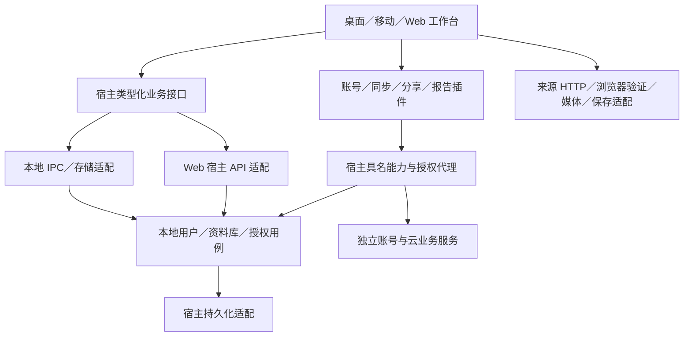

# 多用户与本地／云端部署规划

英文对应页：[Multi-user and Local/Cloud Deployment Plan](../../../en/cross-platform/architecture/multi-user-local-cloud-plan.md)。

## 状态、范围与阅读入口

初稿形成于 **2026-10-30**，**2026-11-01** 根据插件化方向修订。状态为**设计提案，尚未实施**；本次仅修改文档，没有完成实现批次、产品测试或线上／设备验收。下一项是 A01：按宿主、插件、独立服务列出数据所有权与生命周期。

目标：Any Music 作为音乐工作台与插件容器，支持离线可用的本地多用户；每个本地用户可显式绑定多个独立账号系统中的多个账号。账号系统、云同步、分享、报告等可选业务由插件及其独立服务提供。宿主提供稳定音乐数据、受控扩展契约与权限边界，并为未来 Web 端拆出不依赖 Tauri 的业务服务接口。

这项修订替换初稿“核心统一实现产品注册／密码／邮箱、云同步与分享”的职责安排。宿主不内置统一的互联网账号系统，也不要求选择一个全局云服务才能使用本地音乐功能。**本地用户隔离、绑定关系的权威校验、核心数据写入和插件授权仍属于宿主**，不能交给可替换插件自行裁定。

本页拥有后续任务、待决策项和验收边界。当前行为以[项目架构](项目架构.md)、[包边界](可复用包边界.md)、[数据归属](插件数据归属.md)、[桌面运行时](../../桌面端/运行端架构.md)和[插件实施状态](插件系统重构实施步骤.md)为准。本地多用户切换、账号绑定和相关扩展点均未实施；本文不扩大当前外置插件、来源传输或移动准入。

初稿保留的依据是 2026-10-30 工作区源码审查及[公开讨论](https://chatgpt.com/share/6ae37da2-3538-83e8-841e-25b7b081322a)中以“我主要是针对我的any music项目”开头的提问及后续回答；当时记录已读取公开页正文。本文以本次用户需求重划归属，不把那次选型建议当作已采用技术。源码观察针对有其他未提交修改的工作区，不是干净提交或发布产物认证。

| 后续任务             | 先读章节                                 |
| -------------------- | ---------------------------------------- |
| 本地多用户与账号绑定 | 职责划分、身份与绑定、账号系统契约       |
| Web 与后端拆分       | 部署形态、服务与设备边界                 |
| 同步、分享、报告插件 | 收听事实、迁移／同步／分享、插件生命周期 |
| 基础设施与可靠性     | 技术选型、缓存、任务、恢复与网络         |
| 执行下一批           | 最小批次清单、执行与关闭规则             |

## 1. 职责划分与部署形态

| 能力         | 宿主责任                                               | 插件／独立服务责任                                 |
| ------------ | ------------------------------------------------------ | -------------------------------------------------- |
| 本地用户     | 稳定 ID、显示名、选择／切换、资料库归属和隔离          | 可选资料展示，不接管本地用户生命周期               |
| 外部账号     | 绑定注册表、验证结果校验、凭据安全适配和使用授权       | 用户注册、登录、密码／邮箱／多因素、恢复及远端会话 |
| 音乐基础能力 | 规范曲目、歌单、喜欢、队列、配方、播放／下载与受控写入 | 音乐源发现、导入、详情、媒体解析及其他扩展         |
| 云同步／托管 | 版本化读写接口、变更与幂等基础、范围授权               | 远端副本、同步策略、冲突协调、离线提交与服务部署   |
| 分享／社交   | 可移植音乐文档、导入校验、范围明确的导出               | 链接托管、收件人／好友关系、访问控制、撤销与订阅   |
| 听歌报告     | 用户同意后的最小播放事实与有界查询接口                 | 长期分析、报表、推荐与可选远端计算                 |
| 备份／资产   | 核心数据完整性、版本化导入导出和本机恢复               | 可选远端备份、存储适配及其配额／保留政策           |

宿主可提供通用契约，但不为每个后续功能建立专用核心子系统。云同步插件可使用账号提供方插件，分享插件可使用另一提供方；组合走具名、版本化、授权的服务，不能读取其他插件私有状态或把完整工作台对象传过去。先实现一个可验证场景，再判断是否需要独立公共包。

| 形态             | 宿主                                               | 可选服务                                 |
| ---------------- | -------------------------------------------------- | ---------------------------------------- |
| 本机独立运行     | 当前电脑／手机的本地用户与数据，优先 IPC／本地适配 | 无需账号服务器、HTTP 服务或缓存 sidecar  |
| 私有部署         | 可部署无界面宿主 API，供 Web／受信客户端访问       | 可自托管账号、同步、分享服务，分别配置   |
| 公共云部署       | 独立部署宿主 API，按服务内主体校验数据权限         | 运营方提供的账号／云业务服务，独立演进   |
| Web 客户端       | 独立 Web 入口，通过受控 API 消费宿主业务           | 选择服务与账号绑定；浏览器无任意原生权限 |
| 联网桌面／移动端 | 保留本地用户与本地数据，显式选择连接               | 按绑定和业务范围连接一个或多个服务       |

“本地云端”与“远程云端”是部署位置／配置差异，不是两套宿主身份模型。同一提供方实现可部署到 NAS 与公网，形成不同服务实例；不同提供方可使用完全不同实现，只需符合契约。不要求所有账号系统使用同一服务器程序或数据库。移动端不承担常驻服务器角色。

## 2. 当前实现与待补边界

| 观察与证据                                                                                                                                                                                                     | 规划动作                                                                                  |
| -------------------------------------------------------------------------------------------------------------------------------------------------------------------------------------------------------------- | ----------------------------------------------------------------------------------------- |
| [LibraryUserProfile](../../../../packages/core/src/library/models.ts)只有稳定 ID 和显示名，当前资料库只有一个 profile                                                                                          | 将本地用户选择、数据作用域与生命周期建模；显示名不作登录名或权限证明                      |
| [原生 Account](../../../../apps/tauri/src-tauri/src/model.rs)属于音乐来源账号                                                                                                                                  | 与本地用户、外部账号系统的主体分开；不复用来源账号池承担产品登录                          |
| [产品存储](../../../../apps/tauri/src-tauri/src/storage/product.rs)整份保存 product.json，含 revision 检查和 32 MiB 预算；[渲染端存储](../../../../apps/tauri/src/platform/product-storage.ts)有镜像和顺序写入 | 为多用户与 Web 引入异步业务边界；关系库按实际需要分批引入，不为可选云功能强制重写全部数据 |
| [播放历史](../../../../packages/core/src/library/models.ts)至多 500 条，含位置、时间、完成状态；[曲目删除](../../../../packages/music-workbench/src/features/library/use-local-music-library.ts)会移除相关历史 | 近期展示与可选收听事实分开，避免曲目移除破坏已同意保留的报告数据                          |
| [RuntimeState](../../../../apps/tauri/src-tauri/src/state.rs)组合账号、浏览器、媒体、存储                                                                                                                      | 拆出无 Tauri／WebView 的宿主用例，设备与来源执行保留适配边界                              |
| [插件数据库](../../../../apps/tauri/src-tauri/src/storage/plugins.rs)是 schema 3 原生权限账本                                                                                                                  | 不用作通用云业务库，不复制安装／grant／epoch 作为远端身份                                 |
| [原子文件恢复](../../../../apps/tauri/src-tauri/src/storage/vault.rs)处理替换中断                                                                                                                              | 与长期备份、迁移、误删／灾备恢复分别验收                                                  |

保留来源独立 CookieStore／代理、请求取消、媒体授权和插件撤销。[PortablePlaylist](../../../../packages/music-workbench/src/storage/portable-playlist.ts)可作为分享载荷；作者 ID 仅供署名，不证明登录、绑定或所有权。

## 3. 服务、插件与设备边界

需要拆分后端是因为 Web 和无界面部署需要可独立调用的宿主业务，不是因为要把账号提供方和云业务装进核心。客户端插件是集成代码，独立服务承担服务器职责；安装 `.amplugin` 不会自动部署服务器、数据库或邮件设施，也不授予原生执行权限。

| 建议边界，名称待定           | 职责                                                      |
| ---------------------------- | --------------------------------------------------------- |
| 宿主用户／资料库用例模块     | 本地身份、归属、核心音乐写入、版本与事务；注入存储／时钟  |
| 宿主账号绑定／认证代理       | 校验提供方及实例、绑定证明与使用范围；产生受信调用上下文  |
| 宿主持久化适配               | 本地文件／关系库及迁移，不向插件暴露 SQL 或数据库文件     |
| apps/server（候选）          | 无 Tauri 的宿主 HTTP 组合、受信会话验证、权限、启动与部署 |
| apps/web（候选）             | 浏览器入口及能力组合；复用 workbench，不引入原生依赖      |
| 账号提供方插件与独立账号服务 | 登录集成与账号业务；可独立开发、部署和替换                |
| 同步／分享／报告等插件与服务 | 各自策略、命名空间、远端数据及任务                        |
| 版本化契约／客户端适配       | DTO、错误、分页、幂等、取消及能力发现；有复用再抽包       |

继续使用根 Cargo workspace、Cargo.lock 和 target，保留 apps/tauri。不整体搬迁 TypeScript 来源协议、映射或播放器到 Rust，不预建大量空 crate。异步接口逐项接入；StableValueStorage 不伪装成远端数据库。

跨语言 DTO 由单一版本化契约生成，并用契约用例核对语义；服务端独立校验权限和核心写入约束，不信任前端校验。宿主业务契约不因此全部搬入插件 SDK，避免 core 与 SDK 的反向依赖。

Web 宿主 API 必须独立验证会话／绑定证明，将已验证外部主体映射为服务内受信操作者和资料库权限；不相信客户端或插件提交的 localUserId／ownerUserId。浏览器本地显示名、profile 选择和 CORS 均不能替代服务端鉴权。Web 会话承载、CSRF/CORS、会话撤销、首次建档／绑定恢复由 A02/A04 明确。

服务器来源执行、凭据托管和媒体转发另行设计验收；不能把桌面 Douyin 系统浏览器能力当作无界面服务器或移动端已有能力。同步歌单不代表能够解析全部来源或转发音频。

## 4. 技术选型与引入门禁

Rust + Axum + Tokio 是宿主服务候选；SeaORM、SQLite/PostgreSQL、Moka、Valkey、文件系统／S3 均是按责任选择的候选，不是所有宿主与插件服务的统一依赖。独立账号服务可使用符合契约的其他技术。

- 本机可继续当前存储，按多用户／并发写入需要引入 SQLite。私有／云服务按容量选择 SQLite 或 PostgreSQL，不让多台客户端直接打开网络共享数据库文件。
- A03 验证当前 rusqlite 与新增驱动的 SQLite 原生链接、MSRV、Android/iOS 构建和体积；数据库差异需真实契约测试，不能只更换连接串。依赖升级与全量存储迁移分批。
- Moka／Valkey 只在测量证明收益后引入，具有容量／失效／故障策略；不替代持久数据或现有媒体资源缓存。
- 后台任务按需要从数据库任务表＋Outbox 起步；SSE／WebSocket 仅提示更新，可靠同步依赖持久变更。
- 按峰值并发、数据规模、P95/P99、排队预算、RPO/RTO 决定扩展；不预设 Kubernetes、Kafka、微服务全拆分或分片。

初稿选型资料：[SeaORM 驱动](https://www.sea-ql.org/SeaORM/docs/install-and-config/database-and-async-runtime/)、[SQLite WAL](https://www.sqlite.org/wal.html)、[Moka](https://docs.rs/moka/latest/moka/future/struct.Cache.html)。版本、链接兼容、WAL/checkpoint／写队列和平台支持在引入时复核，不据此改动现有权限库策略。

## 5. 身份、归属与绑定模型

必须区分：**本地用户、外部账号主体、账号提供方实现、账号服务实例、音乐来源账号、设备、云业务服务实例**。显示名可重复、可修改；同邮箱／同名账号不自动合并，服务 URL 相同或变化也不单独证明实例身份。

示例：本地用户“小明”的 localUserId 保持不变，绑定家庭 NAS 的账号 A、公共服务的账号 B，以及另一账号系统的账号 C；同一系统的多个账号也可绑定。每次分享、同步或远端访问选择明确绑定与目标，不因设置一个默认账号就向所有绑定广播数据，也不自动合并它们的远端资料库。

外部主体至少由 `(providerId, issuer/instanceId, subjectId)` 唯一定位。providerId 指提供方契约实现；服务实例具有经验证的稳定身份与可信端点；subjectId 是该实例内不可变主体，不是昵称／邮箱。发行者或实例不匹配时重新确认，不能按地址静默接管绑定。

| 概念实体，非最终 DDL                                 | 归属与约束                                                          |
| ---------------------------------------------------- | ------------------------------------------------------------------- |
| local_users、libraries                               | 宿主；稳定 localUserId、显示名、ownerLocalUserId、libraryId         |
| account_providers、account_service_instances         | 宿主受控注册表；协议版本、能力、稳定实例身份、可信端点              |
| account_bindings                                     | 宿主；绑定 ID、本地用户、完整外部主体、验证状态与使用范围；不含秘密 |
| credential_refs、service_sessions                    | 运行端安全适配；按本地用户、绑定和服务作用域隔离，禁止普通导出      |
| source_accounts                                      | 来源运行端；与外部账号分离，未来按本地用户授权隔离                  |
| tracks、playlists、favorites、published_recipes      | 宿主；libraryId 归属、稳定来源身份、成员 ID／顺序／版本             |
| plugin_namespaces                                    | 插件；按本地用户／资料库及必要绑定／实例隔离，保留 schema           |
| device_instances、change_records、operation_receipts | 宿主所需的设备、变更及幂等基础；按写入范围校验                      |
| sync_peers、shares、reports、jobs／outbox            | 对应业务插件／服务；不成为必需核心表组                              |
| assets、asset_refs                                   | 所在运行端／服务；稳定身份、校验与生命周期，不存临时 URL／最终路径  |

同一完整外部主体默认在一个宿主存储域内只绑定一个本地用户；跨设备绑定同一远端主体属于正常场景，不靠复制本地绑定记录获得信任。若以后支持同机共享绑定或迁移归属，必须另设显式授权流程，不隐式共享会话。

持久实体使用全局唯一稳定 ID，必要时保留来源实例映射；时间以 UTC 保存，按当地时间报告的事实同时保留发生时的时区／偏移。一份业务事实只有一个权威来源，派生摘要可重建；历史引用当时版本／必要快照，不随当前显示名或曲目资料变化而改写含义。

本地用户切换顺序：冻结旧上下文的新写入，按策略提交／取消未完成任务，停止旧播放器／下载／来源与插件会话，失效请求及缓存，关闭旧存储作用域后再激活新用户。迟到结果不能写进新用户；来源凭据、插件数据／授权、同步队列和本机设置分别定义用户级／设备级归属。不得仅替换显示名或当前 profile 指针。

简单本地用户切换提供产品数据隔离，不等于抵御同一操作系统账号下恶意操作者的安全登录。若需要本机锁定、加密或 OS 身份保护，另行设计；不因此强制实现互联网密码系统。

## 6. 账号系统的规范与生命周期

契约约束行为和验证结果，不统一各提供方的内部账号表或登录方式。以下是**待设计契约项，不是现有 SDK 能力名**：

1. 提供方与实例发现：版本、稳定身份、端点、支持的登录／登出／撤销、绑定证明与错误状态；未知必需能力拒绝启用。
2. 可验证的认证／绑定证明：受信适配验证发行者、受众、主体、有效期和一次性挑战，绑定发起本地用户、设备、事务与回调；插件自报“登录成功”不建立宿主权限。
3. 绑定与重新认证：宿主展示本地用户、提供方／实例、外部账号、数据范围并确认；禁止串账号回调、重放和静默换绑。
4. 凭据与会话：秘密由安全适配存储／注入，插件只得到允许的状态或不透明引用；引用不成为可导出的通用令牌，也不赋予任意域请求权。
5. 业务访问：身份认证、账号绑定、读取本地数据、上传私密数据、远端同步／分享分别授权。绑定成功不等于全库读取、上传或核心写入权限。
6. 注销、解绑、禁用、卸载、本地用户删除、远端账号删除分别定义。停止并撤销本地访问，保留默认应保留的音乐数据；本地解绑不假定远端副本已删除，删除远端数据需独立结果和失败处理。

注册、密码、邮箱验证、多因素、密码恢复、账号风控和远端设备会话属于独立账号系统。若另建参考账号服务，应独立维护密码哈希、挑战单次消费／到期／限流、可靠邮件、会话撤销等验收，不把它们设为本地多用户前置。离线情况下本地功能继续可用；远端身份过期明确拒绝远端操作。

禁用插件停止新调用与后台任务、取消在途任务并撤销上下文；保留本地音乐及插件命名空间，重新启用需验证绑定／会话。插件代码升级、服务变更、权限增加均不能沿用已失效授权。共享提供方服务消失时只让依赖它的操作不可用，不能删掉本地用户。

当前通用访客联网仍以匿名公共目标为边界；已有[声明式音乐源认证](../../桌面端/音乐源认证.md)只提供来源专属的原生凭据通道，不建立产品用户／账号系统绑定。账号系统的秘密注入、私网／localhost 服务连接、私密数据出站和跨插件服务均需独立的版本化能力设计、原生／服务端校验与验收。不能借“云插件”开放通用 Cookie、任意 HTTP 代理、SQL、文件、IPC 或进程执行，也不能放宽现有 Gate。Userscript 保持 GM、单宿主来源账号、独立存储及 externalPlugins: none；手机外置能力保持现有准入。

## 7. 收听事实与报告插件

近期至多 500 条历史继续是宿主展示；长期报告为可选能力。宿主只按同意范围产生最小、版本化播放事实并提供分页／预算接口；报告插件拥有聚合算法、报告、保留政策和可选服务，不强制给所有用户永久记录完整行为。

- positionMs 不是有效收听时长。记录会话、曲目／作品版本、设备、入口及结束原因；有效区间区分墙钟时长、媒体覆盖、速率与完整性。
- 暂停、缓冲、跳转、倍速、切歌及系统中断调整区间；有界检查点限制崩溃损失，不按每帧无限追加。
- 会话 ID／区间序号幂等；跨午夜／时区拆分，多设备累计或去重口径明确；缺失末尾标记不完整，不伪造补齐。
- 移除曲目关联不自动清除报告事实；清除收听数据需覆盖副本、汇总与待上传队列。事实、汇总、审计分别定义保留期及空间预算，汇总有算法版本与重建水位。
- 客户端事实具有上报可信度边界，不作不可伪造计费凭证。不记录秘密、完整响应、无关点击或媒体。

报告读取私密历史及向外发送分别授权；只读报告插件不自动拥有联网权限。禁用后停止采集／投影或按明确的宿主历史策略处理，不能无限积压等待上传。

## 8. 迁移、同步与分享

### 8.1 可移植数据与迁移

宿主维护当前基线的版本化核心数据与插件命名空间格式：实体、关系、资产清单、校验和、原始署名及来源实例映射。目标预检范围／容量／版本，提供已有数据的保留、合并和冲突预览，分批幂等导入并核对数量、引用、顺序和文件。失败保留原数据；不以长期双写或旧架构兼容链为默认方案。

迁入数据的所有者由目标受信上下文决定，文件内作者 ID 不授予所有权。保留来源身份与署名，不凭同名／同邮箱重认身份。不导出密码、会话、Cookie、代理秘密、安装／grant／epoch 或绑定证明；账号需在目标重新认证与绑定。普通插件命名空间也不得夹带秘密。服务灾备是独立管理员流程。

### 8.2 同步插件

先一次性迁移，再增量拉取、离线推送和逐类双向合并。宿主提供范围明确的读取／写入、版本、变更及幂等；同步插件及服务负责协调拓扑、游标、冲突和远端副本。远端操作仍走宿主业务校验，不能覆盖整个 product.json 或修改其他插件数据。

一个资料库的同一数据范围初期只接受一个明确的同步协调者；可以为不同资料库／范围选择不同提供方。不因绑定多个账号就让多个插件无主并发回写。多提供方共同同步同一范围需另行设计协调、来源追踪与回环抑制。

协议包含操作／设备 ID、基础版本、受信操作者与资料库、幂等收据、持久变更、不透明游标、删除标记、冲突结果和协议版本。业务变更与宿主变更／收据在同一权威事务提交；插件队列有自己的可靠存储，跨宿主与远端不能假定一个事务。确认丢失重试同一操作。

| 数据                       | 初期合并规则                                           |
| -------------------------- | ------------------------------------------------------ |
| 收听区间                   | 追加并去重                                             |
| 收藏                       | 显式添加／取消及确认版本                               |
| 歌单名称／描述             | 检测并发，保留冲突内容                                 |
| 歌单成员                   | 独立成员 ID 合并增删                                   |
| 歌单顺序                   | 检测冲突并选择；自动合并后评估                         |
| 作品                       | 不可变版本，保留编辑分歧                               |
| 偏好／插件数据             | 版本化字段规则；只由获授权且能理解 schema 的写入者处理 |
| 凭据／绑定证明／权限／会话 | 重新认证与授权，不走普通同步                           |

删除有保留窗口与确认水位；离线超窗重建基线后协调未上传操作，不复活删除。服务恢复旧备份更新同步代次、失效旧游标。队列／缓存按本地用户、绑定、实例、资料库与范围隔离，A 账号或服务的队列不能发往 B；切换、解绑或撤销后迟到结果失效。远端撤销不自动擦除曾下载到设备的数据，需明确产品语义。

未知／禁用插件的命名空间按预算不透明保留，不执行、不自动合并或覆盖；同步需其版本化数据契约。原生安装、权限和执行上下文永远不随用户数据复制。

### 8.3 分享插件

固定版本分享先复用 PortablePlaylist：宿主受控导出与导入预览，分享插件负责链接、账号间收发、受众、撤销、过期、容量与幂等记录；订阅、协作和好友关系后续独立验收。默认分享元数据／配方，不携带凭据、临时媒体或音频；用户导入新歌单不自动覆盖现有歌单。

localhost 链接仅原机可达，局域网／公网需要实际可达服务。接收外部账号分享不自动授予本地资料库权限。链接读取限制目标、跳转、大小和超时，私有服务走专门授权连接，不能变成任意抓取入口。

## 9. 缓存与隔离

界面去重／分页／短期缓存、本地持久数据／离线队列、热点查询缓存、媒体资源缓存分别管理。离线队列不受 TTL 淘汰；媒体短期授权和字节不进业务备份。公开元数据确认可共享后复用，私人来源结果按来源账号隔离。

私有缓存键覆盖本地用户、插件、绑定／实例、资料库、权限代次、查询和版本。切换／退出／撤销失效旧请求；防止旧查询回填。提交返回新版本后更新／失效缓存，读己之写不能读回旧副本。ETag／版本避免重复传输。

Moka 仅服务有收益路径；Valkey 故障时可重建缓存有界降级，鉴权、撤销、安全限流不能统一静默放行。通知丢失由版本、TTL 和持久变更兜底。

## 10. 任务与容量扩展

宿主只调度自己拥有的任务；邮件、云同步、分享托管、报告由所属插件／服务调度。不能向插件开放通用后台执行器。持久任务具有 ID、归属、幂等键、租约代次、尝试次数、重试／截止、错误与结果；取消、重启、旧租约回写及积压均需测试。

服务业务事务使用 Outbox，至少一次投递依赖幂等与去重；邮件等外部副作用说明重复边界。内存 channel／Valkey Pub/Sub 仅唤醒，不作唯一可靠队列。任务和权限数据不受缓存淘汰。

宿主 API 处理受信鉴权、授权、脱敏日志、请求 ID、超时、取消、请求体预算、限流、CORS 和可信代理头。独立服务各自实施同样适用的约束。先测索引、分页、批量查询、连接等待与任务积压，再考虑副本、时间分区、Worker 或分片；副本延迟不得破坏撤销、同步游标或读己之写。公共目录与私有数据分开，全局目录共享范围与 libraryId 分片仍待决定。

## 11. 数据库迁移与可恢复性

- 宿主与插件服务分别拥有 Schema 和版本化迁移；锁、校验信息、兼容窗口和空间预检明确，失败保留现场，不清库或把未知版本当空数据。
- 破坏性变更先扩展／回填／验证，再收缩；回滚应用不等于安全执行 down migration。SQLite/PostgreSQL 的事务与表重建分别验证。
- 恢复到独立目录／实例，核对关系、数量、资产及关键查询后切换。SQLite 做一致性备份，PostgreSQL 按需采用 WAL／时间点恢复；逻辑导出不替代灾备。
- 文件与数据库通过稳定清单、版本和校验关联。凭据／密钥独立备份策略，丢失后重新授权，不降级明文；账号服务单独保护密码、会话和恢复材料。
- 最小权限、参数化查询、TLS 与备份访问隔离；数据库支持时 RLS 可作第二道隔离，不能替代业务校验，连接池身份不能串用户。
- 明确 RPO/RTO 并演练；同步会传播误删，不能替代备份。传输／静态加密不等于 E2EE，后续 E2EE 必须重审服务端搜索、报告和恢复。

初稿恢复资料：[SeaORM 迁移](https://www.sea-ql.org/SeaORM/docs/migration/writing-migration/)、[SQLite Backup API](https://www.sqlite.org/backup.html)、[restic](https://restic.readthedocs.io/en/stable/)、[pgBackRest](https://pgbackrest.org/)、[PostgreSQL PITR](https://www.postgresql.org/docs/current/continuous-archiving.html)。选用版本与安全更新在实施时复核。

## 12. 网络与异常环境

本地优先 IPC；宿主 Web API、账号服务、同步／分享服务连接和来源请求分别有目标、身份、超时、取消与代理策略。数据库／缓存／邮件／对象存储出站不继承用户来源代理。服务连接的自动／直连／指定代理与来源代理分开，要求代理时失败不擅自直连，不关闭证书验证。[现有代理实现](../../../../apps/tauri/src-tauri/src/network/proxy_routing.rs)的 no_proxy 不保证绕过系统 TUN。

验收 IPv4/IPv6、DNS、TUN、代理认证、局域网不可达、切网、TLS、重连、长连接断开及写成功但确认丢失。地址变化重新核验实例，localhost 不构成授权；本机 HTTP 如启用须明确监听、认证、Origin/Host 及重绑定防护。私网连接能力不能削弱普通插件匿名公网约束。

## 13. 打包与发布

宿主桌面／移动、未来 Web／API、账号服务和云业务服务独立交付，不把独立系统等同独立 Git 仓库。客户端不携带服务器数据库／邮件／签名私钥。Vue/TypeScript 压缩及按需混淆、Rust release 与私有符号、平台签名／更新验签按产物验收；混淆不保证不可提取。

Android 已有 release 优化和签名配置；R8 不保护 WebView JavaScript 或 Rust 库。最终优化签名包检查播放器、Worker、WASM、动态资源与原生桥接。iOS 工具链／签名和现有 S16 未完成门禁保留；Web 不因复用工作台继承原生权限，服务端需部署／迁移／回滚／恢复演练。

## 14. 最小批次清单

以下均**未开始**。保留初稿编号用于追踪，按新归属重写目标；账号提供方和云功能属于可选分支，不是本地多用户的必经阶段。每个编号独立执行，变体不自动合批。

| 编号 | 单批目标与验收                                                         |
| ---- | ---------------------------------------------------------------------- |
| A01  | 宿主／插件／服务的数据、凭据、任务和用户／设备作用域清单               |
| A02  | 本地身份、外部主体与实例 ADR，绑定唯一性、Web 信任与部署选择           |
| A03  | 按实际持久化需要验证数据库依赖、链接、MSRV 和目标构建                  |
| A04  | 宿主业务、绑定、提供方及云插件契约草案；版本、错误、权限与未知能力拒绝 |
| B01  | 用户作用域存储初始化：空库、错误版本、重复启动                         |
| B02  | 所选存储迁移执行器：锁、版本和失败保留                                 |
| B03  | 本机备份／独立恢复并核对                                               |
| C01  | 本地用户与私人资料库：创建／选择、两用户隔离、禁止跨归属引用           |
| C02  | 提供方／实例注册与验证：同实现多实例、端点／版本／身份不匹配拒绝       |
| C03  | 认证代理与绑定证明：挑战、受众、重放、串回调、秘密不进入访客           |
| C04  | 一个本地用户绑定多系统／多账号：显式选择、重复绑定与隔离               |
| C05a | 注销／解绑／撤销／禁用：取消任务、迟到写入拒绝，保留本地数据           |
| C05b | 本地用户切换／删除：来源、播放／下载、缓存、插件和队列生命周期         |
| C06  | 提供方集成逻辑：具名端口，无完整宿主对象、来源凭据或其他插件内部依赖   |
| C07  | 受控本地用户／绑定 UI：展示明确作用域、账号与授权，离线可用            |
| D01  | 歌单只读异步接口及当前数据适配，展示保持                               |
| D02  | 歌单权威 CRUD：归属、版本与冲突，存储实现独立选择                      |
| D03  | 成员／排序：独立 ID、重复政策、顺序与事务                              |
| D04  | 收藏：唯一约束及取消语义                                               |
| D05  | 稳定来源曲目与私人属性隔离                                             |
| D06  | 当前基线一次性迁移：预检、核验、失败保留                               |
| D07  | 前端按实体接入业务接口，单一权威写入                                   |
| E01  | 可选最小播放事实接口：同意、身份与结束原因                             |
| E02  | 有效区间：暂停／跳转／倍速／中断／去重与容量                           |
| E03  | 报告插件：有界读取、统计口径、撤销／删除；联网单独授权                 |
| F01  | 无 Tauri／WebView 的宿主服务启动壳；不包含账号提供方业务               |
| F02  | Web 会话验证与主体映射：每请求校验权限，拒绝伪造 localUserId           |
| F03  | Web 入口及宿主 HTTP 用例逐个接入；浏览器能力降级单独验证               |
| F04  | 分享插件：固定文档、账号选择、预览／撤销／幂等导入                     |
| G01  | 宿主迁移包导出：实体、命名空间、资产校验，无秘密／授权                 |
| G02  | 目标导入：受信所有权映射、已有数据和完整性                             |
| G03  | 宿主变更／收据：同事务，重试不重复                                     |
| G04  | 同步插件增量拉取：分页、游标、服务恢复代次                             |
| G05  | 插件离线队列：用户／绑定／实例／范围隔离与确认丢失                     |
| G06  | 冲突／删除逐实体验收，超窗重建；未知命名空间保留                       |
| G07  | 多提供方／服务切换：队列不串、同范围协调者唯一、无回环                 |
| H01  | 所属服务持久任务：重启、租约、取消与预算                               |
| H02  | 所属服务 Outbox：重复投递与事务失败恢复                                |
| H03  | 一个有收益路径的 Moka／同类缓存，验证失效                              |
| H04  | 需要时验证 Valkey／同类跨实例缓存故障及降级                            |
| H05  | 文件资产接口：稳定引用、容量、生命周期                                 |
| H06  | 可选远端备份／对象存储适配：完整性、授权与恢复                         |
| I01  | 选定服务的数据库隔离加固，按需要验证 RLS／连接池                       |
| I02  | 需要时实现多实例 Worker：旧租约、重复、积压                            |
| I03  | 容量／故障实验，依据测量决定扩展                                       |
| J01  | PC 最终产物、签名及插件能力验收                                        |
| J02  | Android 优化、签名与桥接／播放验收，保留 S16 门禁                      |
| J03  | iOS 工具链、签名与能力验收                                             |
| J04  | Web／宿主 API 及可选服务分别发布、迁移、回滚和恢复演练                 |

A 先确定边界；B 的相关恢复能力先于真实数据迁移；C01/C05b 构成本地多用户主线，不依赖 C02–C04 的远端登录。D 提供宿主业务基础；F 对外开放前须完成受信会话及服务端权限，而非仅完成本地切换。E、F04、G 为可选插件分支，必须先有对应的具名能力及授权验收；不能用现有通用命令／网络绕过。参考账号服务若要新增注册、邮件、密码恢复，另列服务内批次并先满足可靠投递／撤销，不塞回宿主 C 阶段。J 的活体验收需在实施任务明确授权。

## 15. 执行、验证与关闭

每批交接只保留目标、允许模块、契约／数据变化、验收、剩余问题和下一编号。一次不混合依赖升级、存储重构、来源迁移与 UI 重写。跨模块先明确可审查契约，再接调用方；数据库每批一个迁移目的。

验收重点：无云插件仍完整使用本地音乐；两个本地用户隔离；一个用户多系统／多账号；同提供方多实例不串主体；绑定回放／串回调拒绝；切换／撤销后迟到任务不能提交；私密数据出站单独同意；插件禁用保留核心音乐；Web 不信任客户端身份；迁移／同步无秘密或授权复制；幂等、并发、断网／掉电和恢复完整性。采用多数据库时分别使用真实数据库契约测试。

实现遵循根指南的目标测试、原生门禁及提交前完整检查。纯文档批次仅检查格式、双语事实、索引和本地链接；不宣称产品测试通过。当前任务不启动产品、浏览器或模拟器，不提交／推送。

批次完成后更新本页证据，只有已实施事实进入当前指南和总体进度。保留未完成门禁、失败恢复及原始证据；按[文档生命周期](文档生命周期与代理约束.md)收缩重复过程。实施前仍需决定绑定证明协议、服务实例信任／迁址、Web 会话与首次绑定、凭据适配、同范围同步协调、歌单重复／排序政策、事实保留／容量、数据库版本、RPO/RTO、全局目录范围及实际交付目标。
