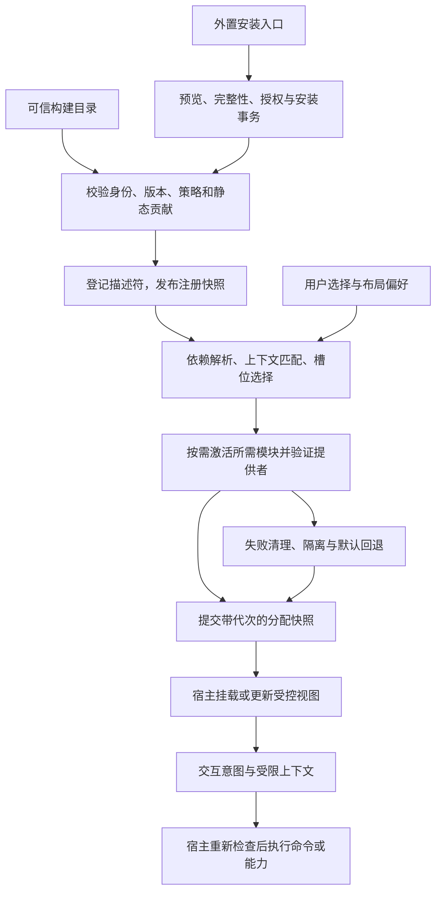
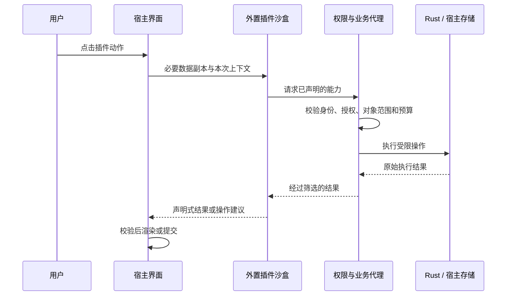

# 插件扩展与安全契约

英文对应页：[Plugin Extension and Security Contracts](../../../en/cross-platform/architecture/plugin-extension-contracts.md)。本规范保留扩展／分配与安全契约，并明确区分未实现能力。当前行为由[实施状态](插件系统重构实施步骤.md)及桌面／移动交付矩阵决定。下文联网、秘密、外部媒体和移动代码要求不授予矩阵尚未提供的能力。

## 一、总体方案与系统边界

采用 **“微内核宿主 + 必需系统模块与独立功能插件 + 有类型的扩展点 + 最小上下文与受控能力”**。统一注册机制覆盖整个产品，模块是否可禁用、可卸载或可替换由宿主策略决定。

安全设计围绕一个原则：**插件只能获得宿主明确交付的数据和能力，不能自行取得宿主的其他权限。** 各端复用 SDK、上下文和扩展点，但按运行端声明支持范围：篡改猴只加载随应用发布的内置插件；桌面与手机（Tauri 2）均以声明式和受限 JavaScript 外置插件为目标，使用统一包格式、安装事务和 Rust 能力代理，代码执行在所属系统与渠道完成隔离验收后开放。

插件可以增加页面、歌曲操作、筛选条件、批量动作和音乐来源；宿主掌握数据访问、权限检查、界面渲染、播放、下载与实际网络请求。

已经确认的设计前提：

- 篡改猴只支持内置插件；桌面端的外置插件支持受限 JavaScript 逻辑和声明式 UI；手机端基于 Tauri 2，复用桌面的 Rust 宿主能力，外置插件按第七章分阶段开放。
- 插件协议与业务逻辑可以被其他音乐应用复用。
- 桌面与手机外置插件支持按能力授权公共 HTTPS 联网，默认不逐个域名授权；插件可选择声明域名以收窄目的地，最终风险按数据与能力组合判定，并服从渠道更严格的同意要求。篡改猴不提供外置插件联网能力。
- 禁用创作插件后，已有作品仍可播放、下载。
- 桌面与手机首版均以本地插件包安装为基础，提供适用的文件关联、分享接收、链接与深链入口，统一经过安装预览；在线市场以后建设，复用同一安装器。篡改猴内置插件随应用版本更新。
- 设计定稿只保存方案；代码实施按独立步骤和退出证据记录。

### 后续账号与云业务插件

**2026-11-01** 修订的[本地用户与服务提案](多用户与本地云端部署规划.md)拥有本基线之后尚未实施的工作。本地用户 ID、资料库隔离、经过验证的绑定及核心写入权威仍归宿主；一个本地用户可绑定多个独立提供方／服务实例中的多个账号，与音乐来源账号区分。注册／密码／邮箱／恢复、云同步、分享／社交与高级报告归可选插件及独立服务，不建立必需的核心身份／云业务系统。

账号提供方、同步、分享、报告和远端备份可通过具名、版本化、授权契约分别选择。私有／公网部署位置不定义身份，提供方／发行者实例／主体才定义身份；绑定不授予全库读取／上传，禁用云插件不影响本地音乐。Web 推动无 Tauri 的宿主用例和独立鉴权 API，不将独立账号服务并入核心。客户端插件安装不部署服务端，也不产生服务器或原生权威。

上述契约、秘密注入、私有服务访问、私密出站和跨插件组合均需独立设计及运行端验收。现有 SDK 与 S15／S16 准入仍定义实际能力，不据此新增无限制代理、命名空间访问或能力名。详细批次仅由链接规划维护。

### 运行端策略

外置插件策略由应用组合层注入，取三级之一，共享包不通过环境猜测：

```ts
type ExternalPluginPolicy = 'none' | 'declarative' | 'sandboxed'
```

- `none`：不安装、不注册、不恢复、不执行任何外置贡献。
- `declarative`：只接受外置声明式清单，由宿主解释数据，不运行第三方代码。
- `sandboxed`：在 `declarative` 之上，允许经隔离验收的受限代码执行器。

策略必须在安装、注册、恢复、启用、能力调用和媒体解析入口共同执行；隐藏界面入口不构成边界。配置值只是目标上限，实际有效能力取“构建包含的能力 ∩ 发布渠道允许的能力 ∩ 运行环境验收结果 ∩ 用户授权”。桌面未通过隔离验收前保持外置功能关闭；手机声明式联网也须先通过原生请求、授权与数据迁移验收，不能只检查有无第三方 JavaScript。

三个维度分别声明：**安装入口**决定包从哪里进入；**执行类型**决定包由声明式解释器还是受限代码执行器运行；**运行端策略**决定当前系统、渠道与设备实际允许哪些类型。同一入口可以导入任一受支持类型；手机目标为验收后的 `sandboxed`，受限渠道或环境可取 `declarative` 或 `none`，不能仅凭“手机”统一判为声明式。代码插件的必需能力不满足时在安装预览拒绝，不静默忽略代码后当作声明式插件安装。

### 核心与插件归属

当前归属及禁用行为由[数据归属](插件数据归属.md)与[运行策略](插件运行策略.md)维护。

## 二、拆包、公共契约与业务归属

### 包职责

见[可复用包边界](可复用包边界.md)与[原生 crate 边界](../../桌面端/后端工程规范.md#工作区与插件-crate-边界)。公共根保持轻量，失败导入可重试，生产应用不依赖 CLI／testkit。

### 协议事实源与跨语言一致性

清单、消息、能力和外置 UI 的 JSON Schema 统一放在 `plugin-sdk/schema`，采用固定的 JSON Schema 2020-12 子集；禁止远程 `$ref`、任意正则和未登记 schema。协议 ID/版本/错误类别与正反例测试样本集一起版本化。AJV 校验器在构建时生成独立 ESM，不在受限 WebView 内用动态代码生成；TS DTO 从 schema 生成并检查产物漂移。Rust 从同一 Schema 生成显式 serde DTO 与字段检查，结合未知字段拒绝及范围校验消费同一协议，通过同一测试样本集做差分测试；不要再维护一份独立 Rust JSON Schema。TS/Rust 对重复 JSON 键、整数范围、深度和 Unicode 采用相同拒绝规则。

线协议不序列化函数/迭代器/取消对象，只有 DTO 和宿主引用。外部不出现 `any`、泛型 `invoke(method, args)` 或 `getService(name)`。内部模块 service token 放可信入口，外部 SDK 只提供已版本化的具名操作。贡献 schema、线协议、Profile、包格式和数据 schema 各自协商，SDK semver 不能代替所有版本检查。

### 插件公共契约

不再用一个越来越大的 `MusicSourcePlugin` 接口承载所有功能。采用 **Manifest + 多类贡献 + 按权限提供的宿主服务**。

Manifest 包含：

- 稳定 ID、版本、名称、说明与 SDK 兼容范围。
- 声明式或沙盒代码运行类型。
- 所需宿主能力、必需权限和可选权限；**每项权限附 `reason` 说明**，名称与说明支持中英文本地化。
- 支持的运行端与形态（桌面、手机），以及对宿主能力的最低要求。
- 可选的内存等级声明（默认最小，提高需在授权时说明）。
- 页面、菜单、命令、筛选器、来源等贡献。
- 按需激活事件，例如打开页面、执行命令、调用来源。
- 入口与资源完整性信息。

`builtIn`、信任等级、已授权权限由宿主记录，外部清单不能自行声明获得。内置身份只来自受信应用构建目录；即使外部包具有官方名称或有效签名，也不能被篡改猴作为内置插件加载。

首版公开的核心接口为：

| 契约                         | 用途                                                                                     |
| ---------------------------- | ---------------------------------------------------------------------------------------- |
| `PluginManifest`             | 安装、兼容性和贡献声明                                                                   |
| `HostCapabilities`           | 查询宿主实际支持哪些扩展点和服务版本，以及运行端策略、形态（桌面/手机）与沙盒可用性      |
| `ContributionDescriptor`     | 声明页面、动作、详情项和筛选项                                                           |
| `CommandContext`             | 当前作用域、对象引用、选择集合及版本                                                     |
| `HostRequest / HostResponse` | 经过校验的异步能力调用与结果；线协议，与传输无关                                         |
| `PluginStateStore`           | 仅访问自身命名空间的限额存储，附 schema 版本迁移辅助                                     |
| `MusicSourceProvider`        | 搜索、分页、导入和媒体描述解析                                                           |
| `HostEvent`                  | 宿主按权限投递的事件（如当前曲目变化、播放结束），只含投影后的 DTO；订阅随禁用或撤权撤销 |
| `PluginTask`                 | 带进度、取消与期限的长任务，由宿主调度，不依赖插件常驻                                   |
| `SecretRef`（预留）          | 对宿主托管秘密的引用，只能由宿主在请求时注入，插件不可读取明文；首版不公开、不实现       |

预留但首版不公开：歌词来源、元数据补全。主题令牌、布局和列表项呈现均为可信内置扩展点，不属于外置 SDK 或安装器支持范围；按第三章阶段实现，不等于本次已经可用。外置插件之间的服务契约（`provides / consumes`）首版明确不开放：外置插件只通过宿主授权的数据投影协作。可信系统模块及内置主题可使用宿主内部版本化服务令牌与依赖图；该内部契约不自动成为外置 SDK 能力。

SDK 中只传输经过投影的 DTO、稳定引用和结构化错误。禁止把 Vue 对象、函数、存储实例或完整 `WorkbenchRuntime` 传给外置插件。

### 来源契约适配与版本协商

现有 MusicSourcePlugin、TrackListing 和 ResolvedMediaSource 留在宿主内；外置 MusicSourceProvider 使用以下线协议语义：

| 宿主行为             | 外置协议与宿主适配                                                                                                         |
| -------------------- | -------------------------------------------------------------------------------------------------------------------------- |
| 描述符、URL 导入预检 | 不激活代码即可读能力与精确导入范围；不支持的 URL 在建列表和联网前拒绝                                                      |
| 搜索与导入           | 返回有期限的 listingRef；nextPage 每次只消费一页，close/cancel 结束后不得继续抓取；游标由所属实例保管且有界                |
| 会话与可用性         | 分离安装、启停、运行故障、来源可用性与账号登录态；网络失败不冒充 invalid 或退出登录；外置公共来源默认 not-required         |
| 媒体解析             | 保留音质 ID/rank、默认最高可用音质、备用节点、MIME、取消与加载策略；resolve 只返回本次描述或宿主资源引用                   |
| 释放与验证           | release、verify 和 CancellationSignal 由宿主适配器生成，协议中只传操作 ID/资源引用；幂等关闭并释放竞争落败的资源，不传函数 |

插件 ID、来源 provider ID、贡献 ID 分开命名；当前 bilibili、douyin 和所有已存 Track.source.pluginId 保持稳定，必要时由宿主维护显式别名，不能因包名变化批量重写曲目 ID。一个插件可贡献多个来源；外部 ID 不能占用内置来源命名空间。

Manifest schema、SDK 语义版本、wireVersion、runtimeProfileVersion、扩展点版本和插件数据 schemaVersion 分别协商。握手返回支持的交集，缺必需能力则不激活；可选贡献可跳过并说明。未知必需字段、能力或协议版本明确拒绝，不能“尽量运行”。宿主内部的 AppErrorState 仍是业务错误事实源；SDK 错误在适配层映射，避免两套编号各自演进。

### 数据归属

当前宿主／插件命名空间与可移植数据规则由[插件数据归属](插件数据归属.md)维护。

## 三、动态 UI 与功能扩展机制

`track-actions-dialog__section track-actions-dialog__details` 是扩展位置的现有实现，但 **CSS 类名不能成为插件 API**。样式重构不应让插件失效。

建立稳定、带版本的语义扩展点：

| 扩展点                       | 展示位置                       | 示例                                         | 状态                     |
| ---------------------------- | ------------------------------ | -------------------------------------------- | ------------------------ |
| `navigation.sidebar`         | 侧边栏（手机为底栏或抽屉）     | 标签管理、自定义音乐                         | 首版                     |
| `workspace.views`            | 主内容区                       | 插件页面、管理面板                           | 首版                     |
| `track.actions.secondary`    | 歌曲操作弹窗的附加动作区       | 管理标签、截取片段                           | 首版                     |
| `track.details`              | 歌曲详情展示区                 | 插件生成的分析结果或说明                     | 首版                     |
| `trackList.operator.actions` | 列表操作器（手机为底部操作表） | 批量加标签、批量分析                         | 首版                     |
| `trackList.filters`          | 列表筛选器                     | 标签、插件生成的分类                         | 首版                     |
| `settings.sections`          | 插件设置区                     | 插件自己的配置                               | 首版                     |
| `music.sources`              | 来源选择、搜索与导入           | 内置或外置音乐来源                           | 首版                     |
| `lyrics.providers`           | 歌词来源选择与展示             | 在线歌词、翻译歌词                           | 预留                     |
| `track.metadata.enrichers`   | 元数据与封面补全               | 批量补全封面、作者信息                       | 预留                     |
| `theme.tokens`               | 内置主题令牌                   | 配色、字号等语义值；组件和样式由内置主题实现 | 内置主题阶段，外置不开放 |

所有包含歌曲列表的板块接入同一套列表扩展上下文，避免在发现、待听、喜欢、歌单、历史中分别写插件判断。上下文明确区分板块、单曲、多选和可执行动作；不支持的操作不显示。

“我的歌单”导航和“加入歌单”等核心动作由宿主注册，可以复用布局与排序基础设施，但不依赖插件的安装、启用或授权状态；标签、分析等插件贡献可以出现在歌单页面。

**宿主负责决定最终展示结果：**

- 插件已启用、权限满足、宿主支持、当前上下文匹配，贡献才生效。
- `when` 使用受限条件表达式，由宿主解释；不执行任意 JavaScript。
- 注册只允许 Manifest 声明的贡献 ID，不能动态扩张权限。
- 插件标识和贡献标识共同形成唯一键，禁止覆盖核心命令。
- 核心动作顺序固定；插件动作在专属分组内稳定排序，侧栏保留用户排序偏好。
- 插件卸载或禁用时撤销页面、动作、订阅与未完成请求；当前页面回到发现。

**多端适配：**

- 扩展点是语义位置，不绑定具体控件。同一贡献在桌面与手机由宿主映射到不同呈现（侧栏对应底栏或抽屉，操作器对应底部操作表），插件不声明像素尺寸、悬停行为或固定布局。
- `HostCapabilities` 报告运行端形态与实际支持的扩展点；当前端不支持某扩展点时，该贡献不生效，且不视为错误。
- 声明式 UI 节点按自适应布局渲染，复杂表格在小屏退化为列表；触控目标、焦点顺序与无障碍语义由宿主渲染层保证，不交给插件。

**外置插件通过声明式 UI 参与交互：**

允许文本、按钮、表单、列表、表格、标签、进度和宿主歌曲列表等受控节点。按钮关联命令 ID，事件只提交校验后的值。

不接受外部 Vue 组件、HTML、脚本、任意 CSS、内联事件处理器或未经处理的 SVG。权限确认、文件选择和系统错误提示始终由宿主绘制，并显示插件身份。

**防止插件界面冒充宿主界面：**

- 每个插件页面、面板与表单区域由宿主固定绘制“来自插件 X”的标识条，插件不能隐藏、覆盖或移动它。
- 表单不提供密码类输入节点；表单区域常驻提示“请勿在插件界面输入账号或密码”。账号登录只通过宿主绘制的流程完成。
- 节点数量、嵌套深度和单页数据量有界；大列表用分页与虚拟化，不一次性提交（与 256 KiB 消息上限配合）。
- 外部链接和图片只能通过宿主入口打开或加载，并继承插件身份与联网授权。

声明式 UI 另有固定契约：节点与事件带 schema 版本，action 只能指向本插件已声明命令；远端更新使用 viewRevision，旧视图事件与过期响应拒绝。when 与筛选表达式只读取白名单上下文，不能触发请求、遍历对象或引用任意函数。表单值、UI 文本、事件和注解同样受数据范围与大小校验；插件只能看到实际授权的宿主歌曲列表字段，不能借宿主列表控件读取隐藏数据。

宿主控制对话框层级、焦点进入与返回、Escape/返回键、键盘替代和错误边界。插件失效时提供局部错误和重试，不能阻塞核心播放器；页面离开后取消该视图请求，但有独立授权的 PluginTask 可继续由宿主调度。贡献只声明支持范围，不让插件自行操作路由或插入核心授权页面。

复杂的内置创作时间线可使用可信 `/vue` 视图适配器。该通道仅对随应用构建的模块开放，外部插件不能通过同名字段进入。

**筛选也是业务扩展，不能只添加一个按钮：**

- 插件声明筛选字段、编辑控件、摘要和受限查询表达式。
- 标签等常规筛选由宿主在授权的插件数据投影上执行，避免逐曲调用沙盒。
- 需要计算的插件先批量生成有版本的注解，再由宿主筛选；禁止在 Vue 渲染过程中逐项调用外部代码。
- 不同维度取交集，同维度沿用声明的 AND/OR 规则。
- 禁用插件后，其筛选条件停止生效并提示用户；条件保留为休眠状态，重新启用后由用户恢复，避免列表被不可见条件过滤。
- 远程列表只筛选已加载数据，除非来源明确支持服务端筛选；不自动遍历全部分页。

例如启用标签插件后，可以同时出现侧栏“标签管理”、单曲“管理标签”、批量“添加标签”和标签筛选器；这些贡献使用同一份插件状态，禁用后一起撤销。

### 全产品插件框架：可行性与参考项目

**结论：可以实现，建议采纳。** “万物皆插件”在本项目中落实为“功能和呈现通过统一契约参与组装”，可以覆盖侧边栏、侧栏项对应页面、每类列表和列表项的渲染方式。它不要求每个 DOM 节点、工具函数或业务对象都拥有独立安装包和生命周期。以下是对官方机制的归纳及本项目的设计推导，不代表这些项目采用相同安全模型或存在唯一行业标准。资料查阅日期：2026-10-16。

| 官方项目与依据                                                                                                                                                    | 已有机制                                                                               | 本项目采用的部分与边界                                                           |
| ----------------------------------------------------------------------------------------------------------------------------------------------------------------- | -------------------------------------------------------------------------------------- | -------------------------------------------------------------------------------- |
| [VS Code 扩展结构](https://code.visualstudio.com/api/get-started/extension-anatomy)、[主题能力](https://code.visualstudio.com/api/extension-capabilities/theming) | Manifest 声明贡献，按事件激活；颜色与产品图标有独立主题机制                            | 静态登记、惰性激活，主题与功能分开；不复制其扩展权限模型                         |
| [JupyterLab 插件与服务](https://jupyterlab.readthedocs.io/en/stable/extension/extension_dev.html#plugins)                                                         | 核心菜单、文件浏览器等由插件组成，一个扩展包可包含多个插件；服务令牌表达必需、可选依赖 | 系统功能也走统一组装；内部使用显式依赖。其直接传递服务对象的做法不用于不可信插件 |
| [Eclipse Theia 扩展机制](https://theia-ide.org/docs/extensions/)                                                                                                  | 构建时 Theia extensions 可深度定制产品，运行时 VS Code extensions 通过限定 API 扩展    | 区分可信产品模块与可安装外置插件；无需把全部内部 API 暴露给第三方                |
| [Backstage 扩展结构](https://backstage.io/docs/frontend-system/architecture/extensions/)                                                                          | 类型化输入/输出、父扩展挂载点、单例输入约束组成扩展树                                  | 借鉴有类型的槽位、挂载校验和明确基数；不引入 React 或照搬其装配时机              |

据此选择轻量微内核与贡献注册表，保留 Vue 渲染层；不为该需求引入完整 IDE 框架、远程模块联邦或通用 DI 容器。实现复杂度主要来自稳定的替换契约、生命周期和状态归属，而不是统一维护一个 `Map`。

### 1. 分清包、模块、贡献和实例

| 概念          | 身份与职责                                                     | 对应本次设想                                           |
| ------------- | -------------------------------------------------------------- | ------------------------------------------------------ |
| 插件包        | 发布、版本及贡献集合单元；外置包另有安装、完整性和授权流程     | 一个内置主题包可同时提供配色、导航、页面、列表与行实现 |
| 系统/功能模块 | 宿主组合与生命周期单元；可信系统模块可为必需，可选插件可禁用   | 发现、歌单、播放器、标签、来源；不要求每个模块单独拆包 |
| 扩展点        | 带版本、输入输出类型、基数、支持范围、回退和信任要求的语义位置 | 导航区域、主内容、列表渲染、歌曲项呈现                 |
| 贡献定义      | 属于某模块的注册记录，唯一键由宿主组合为 `ownerId/localId`     | “紧凑歌曲卡片”渲染定义，一次注册、多处使用             |
| 界面实例      | 某贡献在页面/列表/行中的一次挂载，有独立展示状态和清理范围     | 同一歌曲在发现与待听中的两个行实例                     |
| 业务对象      | 规范数据、稳定 ID 与引用关系，仍由领域模型管理                 | 每条歌曲、每个歌单成员，不是插件安装实例               |

例如一万个歌曲项复用一个歌曲项呈现定义，由宿主分页或虚拟化挂载可见实例；不会建立一万个插件执行器、授权记录或注册项。选中、滚动、编辑草稿按视图实例保存；播放队列、任务与资料库状态继续归共享工作台，不随渲染器卸载而销毁。

### 2. 最小宿主与统一控制中心

固定宿主保留启动、可信构建目录、安装/策略与授权权威、依赖解析、注册与分配、资源回收、错误恢复入口，以及数据/播放/下载服务的端口边界。上述服务的可信实现也可按内部模块注册，但始终是必需提供者，不允许第三方替换安全边界。原八个核心板块以系统模块注册，仍保持既有业务归属与可用性契约；不新增 `plugin-playlists` 包。

插件中心页面只是控制面的界面，关闭该页面不影响插件框架。宿主内部按职责拆分，不建立同时持有组件、HTTP、数据库与所有业务状态的万能对象：

| 角色             | 唯一职责与权威来源                                                               |
| ---------------- | -------------------------------------------------------------------------------- |
| 安装目录/安装器  | 记录来源、不可变包版本、完整性与安装事务；内置目录来自构建，外置包走第四章安装器 |
| 生命周期控制器   | 统一处理启用、激活、暂停、停用、更新与恢复；按依赖拓扑和代次串行提交变更         |
| 服务与贡献注册表 | 保存版本化定义、归属与静态元数据；不执行插件，不持有 Vue 实例或业务仓库          |
| 分配器           | 依据注册快照、有效策略、作用域与用户选择，生成确定的槽位分配和未采用原因         |
| 命令/能力代理    | 执行时重新验证身份、权限、对象版本与上下文；Tauri 的安装及授权以 Rust 为权威     |
| Vue 渲染适配器   | 将分配快照交给受控组件，管理挂载、焦点、局部错误与销毁                           |
| 诊断与恢复       | 显示依赖、贡献去向、占用者、冲突、预算和故障；提供恢复默认主题及安全启动入口     |

`plugin-center` 的状态是注册与调度事实，不是另一个 Rust 授权库。控制器向原生权威申请变更，依据返回的安装/授权代次发布本地快照；前端不能通过修改 enabled 字段直接授予原生能力。统一接口不要求内置与外置走相同执行器，也不改变 GM/Rust 的传输归属。

### 3. 插槽、作用域与替换契约

保留现有业务扩展点，另增呈现扩展点。导航目标与页面共享稳定的 `viewId`，点击侧栏项请求宿主选择视图；页面创建和路由跳转不能藏在侧栏渲染器中。每个扩展点显式声明是多贡献追加、单例选择，还是受限装饰，不能通过注册相同 ID 覆盖原实现。

| 新增扩展点   | 基数/作用域              | 初始开放范围                                      |
| ------------ | ------------------------ | ------------------------------------------------- |
| `theme.root` | 每个工作台一个内置完整根 | ui/theme 独立根／视图／资源；应用持有加载器与回退 |

每个描述符至少包括 `pointId`、契约版本、归属、`contributionId`、输入/事件 schema、`scope`、基数、允许的实现类型、回退定义和资源预算。scope 使用宿主声明的板块/列表类型/形态等稳定枚举，不接受 DOM 选择器、任意对象遍历或歌曲 ID 通配规则。新出现的列表实例按类型自动接入，无需逐项重新注册。

以上全局主题与呈现扩展点均要求 `trusted-built-in` 来源，由宿主构建目录判定；外置包即使无代码、名称相同或具有有效签名，也不能注册、恢复或占用这些槽位。可信组件工厂只由构建目录内的静态映射提供，不接受外部 `import()` 路径。内置主题提供本命名空间的兼容定义，经宿主选择后替换呈现，不覆盖核心注册 ID。外置功能插件仍可按原契约贡献自己的声明式页面、动作和详情；页面内的宿主列表由当前内置主题呈现，不能借该控件获得全局换肤或替换核心页面的能力。

歌曲列表和行契约必须保留加载/空/错误、键盘与触摸选择、稳定 trackId、分页、拖拽替代、播放/喜欢/下载/操作事件及禁用语义。呈现层发出操作意图，宿主判断并执行，主题不能重写“喜欢”语义或静默删除核心动作。授权页、登录页、安装预览、插件身份条、原生文件确认与安全恢复界面不属于主题替换槽位。

### 4. 注册、安装、激活、分配、显示的完整流程



1. **发现和安装：** 内置模块从受信构建目录发现，不运行外置安装流程；外置插件按端策略走相同安装事务。安装只产生可用包记录，不等于启用、激活或授予全部权限。
2. **登记：** 先解析静态 Manifest，检查身份冲突、扩展点版本、必需/可选能力、保留 ID 和依赖；生成不可变定义快照。无需加载 Vue、来源实现或执行沙盒即可登记导航与命令元数据。
3. **启用和依赖：** 可信系统模块可声明版本化宿主服务的 `requires / optional`；必需依赖缺失、版本不兼容或出现环时，阻止相关可选模块并给出依赖路径。必需系统模块失败则进入内置恢复界面。停用提供者前展示受影响的消费者并执行既定级联策略；核心必需提供者不可停用。外置插件首版只依赖宿主公开能力，不自动下载或运行其他插件。
4. **候选分配：** 对当前作用域筛选候选。静态 `when` 不能触发联网或激活所有插件；未知上下文条件按不匹配处理。可展示未激活模块的静态入口，点击后才激活。内置主题按构建目录加载可信 Vue/样式入口，不创建 QuickJS/Worker 沙盒，也不依赖外置插件策略开放。
5. **惰性激活：** 按依赖顺序启动需要的提供者，同一模块并发激活合并为一次；失败清除等待中的 Promise，允许重试。加载完成核对安装 ID、包哈希、生命周期代次；禁用或重装后到达的结果不允许重新注册。
6. **提交和显示：** 准备目标渲染器并验证契约后，控制器一次提交带 `registryRevision / lifecycleGeneration` 的分配快照，Vue 层只消费已解析结果。切换不重复挂载播放器业务控制器；主题更新期间仍显示旧的可用快照，必要的权限撤销则立即生效。
7. **命令执行：** 可见性与 disabled 只是界面状态；命令分派器对每次调用重新检查用户手势、启用状态、授权、数据版本与作用域。直接调用隐藏命令、伪造行事件或旧视图事件不能绕过检查。
8. **停用和卸载：** 先关停新命令/能力调用并递增代次，撤销授权和活动句柄，再中止读取/任务、逆序清理视图/订阅/监听/样式/对象 URL，发布回退快照。失效页面回到核心发现页；保留数据和偏好。恢复启用不自动重放旧任务；外置代码卸载遵守第四章安装与数据规则。

状态分别建模：包的 available/verified（外置包另有 installed）、用户 enabled 意图、运行时 inactive/activating/active/failed/suspended、贡献 eligible/selected/visible。它们不是一条线性枚举；隐藏侧栏项不停止播放器，未选中的内置主题随应用可用但不加载。外置策略只限制外置包，不能把内置主题一并禁用；主题切换替代当前呈现，不卸载系统功能。

### 5. 统一分配与冲突裁决

分配器是无 Vue/DOM 副作用的纯计算模块，输入为已校验注册快照、有效策略/能力、宿主上下文和偏好；输出槽位到贡献的映射及解释。它不自行安装插件、申请授权或执行贡献。运行时校验仍由控制器与能力代理完成。

- **先过滤：** 依次核对身份/完整性、有效端策略、启用与故障状态、扩展点/输入契约、必需依赖、当前授权和 scope/when。缺少必需能力拒绝相关插件；仅缺可选贡献可跳过并说明。
- **追加槽位：** 保留核心分组约束；已有用户顺序优先，随后使用宿主定义的组序与贡献默认顺序，最后以完整贡献 ID 稳定排序。插件不能靠无限大的 priority 越过安全边界。
- **单例槽位：** 宿主只准入一个构建内置 theme.root，在提交前校验必需／可选功能覆盖，失败走完整根回退／恢复。语义导航／视图／操作／筛选保留各自分配，不再支持局部主题覆盖；最后安装的插件不能接管主题选择。
- **失效选择：** 所选插件缺失、停用或不兼容时保留休眠偏好，使用默认回退并显示原因；仅适用于仍获当前授权的情况，不能回退到已被撤权的旧快照。重新安装不自动抢回当前活动槽位。
- **结构约束：** UI 挂载树不能成环；依赖图和界面树分别校验。装饰器阶段初期不开放任意嵌套，只允许宿主声明的徽标/附加详情，避免递归包装和事件顺序不明。
- **可解释：** 插件中心诊断记录“注册到哪里、候选有哪些、当前谁占用、其他候选为什么落选”；例如 `unsupported-runtime / permission-denied / incompatible-contract / dependency-missing / not-selected / failed`。这些是诊断原因，跨层故障继续映射为 `AppErrorState`。

注册和释放采用批次作用域，登记失败整批撤销；每次注册返回幂等 dispose 句柄并绑定模块代次。插件不能释放其他模块的贡献；控制器在异常/超时后仍可强制清理。禁止模块通过导入时副作用自行改全局注册表。

### 6. UI 主题、布局与组件替换

**UI 主题包只作为可信内置插件交付。** 主题是跨板块的界面与交互实现集合，可以有功能逻辑，不限定为无代码配色文件。主题源码经过项目审查、构建和测试，与应用同版本交付；外部作者的主题需要进入源码与构建流程才能成为内置模块，运行时文件导入、签名或“官方主题”名称不能赋予内置身份。

同一内置主题可以组合以下能力，不为它们另造外置模板语言或分级授权：

| 能力           | 可以实现什么                                         | 实现归属                                                               |
| -------------- | ---------------------------------------------------- | ---------------------------------------------------------------------- |
| 外观与资源     | 颜色、字号、圆角、间距、图标、动效                   | 内置 token、经审查的 SCSS/CSS 与构建期静态资源，复用 `--am-*`、AppIcon |
| 结构与呈现     | 侧栏及导航项、页面、列表/网格、歌曲卡片和详情布局    | 内置 Vue 组件，通过有类型的插槽和 props/events 替换，保留功能契约      |
| 展示与交互逻辑 | 主题设置、导航折叠、拖拽、转场、密度切换、响应式行为 | 主题所属 composable 与受控状态；依赖明确、可清理、可独立测试           |
| 业务能力组合   | 在不同布局中提供播放、喜欢、下载及已启用插件的入口   | 通过宿主注入的命令、只读状态和具名服务消费；业务规则与数据不复制       |

主题可以消费渲染所需的曲目和选择状态、处理组件事件；不再沿用“主题永远读不到歌曲值”的外置模板假设。它不能另建播放器、下载调度或资料库事实源，也不通过私有 store、仓库、DOM 猜测或导入应用代码获取能力。新增领域行为仍归相应功能模块；若主题独有的功能跨视图或包含异步副作用，放在明确的主题功能模块/composable 中，通过同一生命周期注册与清理。可选功能未启用时，主题按能力描述隐藏入口或采用默认呈现，不能强制启用标签、创作或来源插件。

内置主题在宿主 Vue 环境执行，信任边界与其他随应用发布的代码相同。契约、显式注入和代码审查用于解耦与控制误用，不宣称能隔离恶意内置代码；不建设第三方 Vue 沙盒、外置主题安装/市场、全局外置 CSS 注入或外置行模板解释器，也不将其列为后续必做阶段。原有外置功能插件的 QuickJS 与声明式 UI 能力继续按第四章建设，与内置主题独立验收。

主题声明稳定 ID、宿主 UI 契约版本、支持的形态/板块、必需与可选服务、呈现映射、默认 token 及设置 schema；这些是内部模块契约，不对外置 SDK 发布。一个产品根默认只激活一套主题，由同一主题统筹导航—页面—列表—行。默认主题是不可删除的系统回退，替代主题提供选择、设置与故障信息，不走外置安装、权限弹窗或单独更新流程。更换/移除主题代码随应用升级完成；当前主题停用或不可用时先切回默认主题，再清理旧实例。主题 ID 不改写 viewId、trackId 或来源身份。

样式可以使用可信 Vue scoped 样式与独立 SCSS，不受外置 UI 的“不可提供 CSS”限制；仍保持产品根作用域，优先使用语义 token，并遵循组件样式、无障碍、no-referrer 图片和资源加载规范。用户设置只保存经 schema 校验的值，不接受任意 CSS/代码或外部组件路径。token 优先级为“系统默认 → 当前主题 → 用户明确覆盖 → 宿主无障碍/安全约束”；浅/深/跟随系统与主题选择分别存储。主题专属设置按 themeId/schemaVersion 隔离，缺失主题的偏好可休眠保留，恢复执行与外置授权无关。

为使准备阶段不污染当前界面，主题样式以产品根的 `data-am-ui-theme` 等宿主标记限定作用域，预加载新资源时尚不匹配当前主题；提交时连同分配快照一次切换标记。主题加载器不在导入时启动业务操作、监听或定时器，副作用只在明确的激活/挂载作用域创建。共享基础样式和主题专属样式分别持有资源引用；CSS 作用域用于可控切换和清理，不承担不可信代码隔离。

主题切换采用“准备 → 校验 → 提交 → 清理”：加载构建期已知的组件与样式资源，核对必需插槽、服务和当前形态，准备成功后一次提交主题与分配快照，随后销毁旧视图并释放主题监听/样式。失败保留先前有效主题；先前也失效则使用内置默认和独立恢复入口。切换保留播放、下载、选择集合、业务草稿及导航身份，焦点和滚动通过稳定视图键与宿主暂存迁移，只迁移契约声明的状态。主题设置迁移失败单独隔离并恢复默认设置，不影响业务仓库。可信代码死循环仍可能阻塞渲染端，错误边界不是进程隔离。

Userscript 与 Tauri 均从应用注入的内置目录选择主题，不依赖 `ExternalPluginPolicy`、外置安装器、沙盒或手机代码插件是否开放。主题清单读取保持轻量，Vue/样式只在产品启动及选中主题时按需加载；Userscript 注入产品 Shadow Root，Tauri 使用产品根，弹层继承同一主题作用域。主题切换时清理旧主题的资源引用，不扰动仍在使用的共享基础样式。安装/权限/登录/恢复及插件身份标识继续由宿主保留实现和样式，主题 SCSS 明确避开这些区域；这是可信代码的实现约束，不是对同环境 CSS 的安全隔离承诺。手机支持范围由内置主题声明，未适配的形态先回退默认主题，不以桌面样式覆盖触控目标。

### 7. 代码落点与最小契约草图

以下为实施时的职责分配与宿主内部草图，字段与文件名须在对应阶段固化，不表示当前已有这些 API：

| 位置                         | 新增或迁移职责                                                                                                   |
| ---------------------------- | ---------------------------------------------------------------------------------------------------------------- |
| `packages/plugin-center/src` | 保留现有 `PluginCatalog` 身份语义；分离生命周期控制器、贡献注册表、依赖解析器与纯分配器，根入口保持无框架        |
| 未来 `plugin-sdk`            | 公开功能贡献 DTO、扩展点版本及执行器端口；主题替换与内部可信服务令牌不导出为外置接口                             |
| `packages/music-workbench`   | 以适配器提供导航/视图描述、歌曲列表上下文、命令与业务服务；逐步迁移系统模块，保留唯一数据和任务状态              |
| `packages/ui`                | 保留受控壳、列表、行和 token；通过类型化 props/events/slots 接收已分配视图，不依赖 plugin-center 或具体插件      |
| 未来 `plugin-ui-vue`         | 消费 ui 公共出口，提供内部主题契约与可信组件装配、外置声明式 UI 的宿主渲染、错误与主题作用域；注册表不存组件引用 |
| 内置 `plugin-theme-*` 模块   | 组合跨板块 Vue 视图、SCSS、资源和交互 composable；仅从显式契约消费宿主状态/命令，随应用构建更新                  |
| 两端应用组合层               | 提供构建目录、实际能力、内置加载器与运行端适配；Tauri Rust 继续掌握安装/授权，Userscript 构建继续裁剪外置链路    |

```ts
// 宿主内部伪接口：描述符是数据，组件工厂只存在于可信 Vue 适配器。
interface ContributionRegistration {
  ownerId: string
  localId: string
  pointId: string
  contractVersion: number
  implementation: 'host-component' | 'declarative'
  implementationId: string
}

interface AllocationSnapshot {
  registryRevision: number
  lifecycleGeneration: number
  // 键为语义槽位及作用域，值为已验证的完整贡献 ID；不含曲目私密数据。
  slots: Readonly<Record<string, readonly string[]>>
}
```

描述符验证器另行检查 schema/scope/信任要求；草图中的 `host-component` 不是第三方可自行获得的权限。注册表按所有者批次登记，分配器生成快照，适配器再解析 implementationId；不让各组件调用 `getPlugin()` 并自行判断权限。跨组件不用万能事件总线传递所有状态：命令有版本化输入/输出，状态订阅有明确作用域和清理，业务数据仍走已有具名端口。

导航切片使用 [导航定义](../../../../packages/ui/src/product/product-navigation.ts) 以及 Classic 主题的 [ProductWorkbench](../../../../packages/theme-default/src/components/shell/ProductWorkbench.vue)、[TrackList](../../../../packages/theme-default/src/components/music-sources/TrackList.vue) 与 [TrackRow](../../../../packages/theme-default/src/components/music-sources/TrackRow.vue)：描述与业务控制归工作台适配器，主题组件消费受控契约和贡献分配结果。当前静态 `ProductViewId` 联合类型保留核心 ID，外加经校验的插件视图引用；不能直接扩成任意字符串。旧导航持久化通过 ID 映射保留；轻量注册不能静态加载全部页面与 Vue 组件。系统模块可作为现有包的内部目录存在，确有独立复用需求后再拆包。

### 8. 防止插件框架变成新的耦合中心

为每个扩展点维护一份可执行目录：owner、版本、输入/输出 schema、信任级别、基数、激活方式、默认回退、数据成本与清理范围。新增扩展点必须给出至少一个真实消费者和契约测试，不用通用事件总线、任意 middleware 或“万能钩子”代替领域端口。扩展点版本变更需要迁移/废弃策略，内部主题服务不能意外成为外部 API。

必需系统模块可以统一注册，但必须有**插件框架之外的最小恢复启动路径**：读取上次失败记录、禁用可选模块、恢复默认主题、显示插件/数据恢复入口。该入口不依赖第三方贡献或同一个失效的 allocator。播放器/下载器/资料库 controller 每宿主只创建一次，所有主题/列表只消费其状态和命令。核心模块失败进入可诊断恢复状态，不以空白页面代替。

模块依赖、UI 挂载树、用户数据引用分别建模；依赖解析不执行插件。默认无外部插件依赖、自动安装、循环服务定位或共享 mutable store。`when` 采用宿主解释的有界 AST（布尔组合、枚举比较、白名单字段）；首版无脚本/正则/任意路径和用户自定义运算符。跨模块命令必须标注输入、取消、幂等性和副作用，不能用广播触发隐式写入。

分配缓存只存贡献 ID 与非敏感匹配结果，key 包含 registryRevision、policy/permissionEpoch、scope 与偏好版本；不跨授权范围复用私密上下文。静态发现不激活插件；列表只在可见范围计算呈现，批量注解异步提交。性能验收记录冷启动、首次激活、切换与回收的 p50/p95/内存基线；保留既有首播预算，不给方案捏造实测数值。每插件故障归属、熔断和恢复独立，诊断输出依赖路径与拒绝原因但不带私密 payload。

### 9. 内部框架验收

内部框架和内置主题遵循当前宿主契约，不依赖外部沙盒准入。

新增自动化验收：

- **确定性分配：** 改变插件发现顺序不改变最终默认分配；单例冲突、用户选择、主题映射、跨作用域/跨契约错误、依赖环及必需/可选依赖降级均给出可复现结果。
- **生命周期与竞态：** 并发激活只执行一次，动态导入失败可重试，注册事务失败撤销，停用/卸载/重装后的迟到结果和事件失效；多模块批次不会留下半套导航/页面/样式。
- **功能与呈现分离：** 导航隐藏不停止工作；系统功能不可卸载；换壳/列表/行不重建播放器、下载调度和资料库；停用活动页面或主题后可回退且仍可打开恢复入口。
- **内置身份与功能边界：** 外置包伪造主题类型、签名/内置标记、全局槽位、备份恢复或组件路径均不能登记/加载为主题；原有外置声明式页面仍可显示并继承当前主题。可信主题可消费规定的曲目/选择 props 与事件，切换不重复创建业务控制器、拉取全部分页或自动提交用户操作；可选功能关闭时正确回退。
- **主题交付与恢复：** `ExternalPluginPolicy: none` 下内置主题可用，Userscript 轻量入口无 Vue/样式提前加载；准备阶段不激活新样式或副作用，一次只激活一套主题，必需贡献失败整套回退，重复切换释放旧样式和副作用；主题设置损坏不影响资料库，宿主安全/恢复界面保留。主题按常规 Vue/组合逻辑测试，不要求 QuickJS 适配。
- **规模与清理：** 同一个列表中一万条数据只有常量数量的贡献定义与插件执行器；只为可见范围创建行实例，渲染不触发逐行沙盒调用或分页爬取；循环切换/卸载后监听、句柄、样式与实例计数回到基线。预算按目标设备实测，不写成已通过性能结论。
- **多端与恢复：** 两正式端默认行为、Shadow/embedded 作用域、核心持久化 ID 与用户排序不变；原生手机按第七章另验。真实焦点、视觉和设备检查仅在用户明确要求启动查看时进行，Node 组件测试不能替代。

## 四、外置插件安全设计（Tauri 桌面与手机）

本节适用于 Tauri 桌面与 Tauri 手机的外置插件；两端共享同一套宿主 Rust 能力、授权模型与线协议，端间差异集中在第七章。篡改猴不装配这些执行与联网能力。共享 SDK 保持可复用，不代表每个宿主必须开放所有能力。手机声明式与受限代码插件均遵守本节规则，受限执行器按第七章对应系统与渠道的开放条件启用。

### 0. 威胁模型与不可绕过的安全性质

把插件包、作者、依赖、远端响应、导入数据、插件生成的 UI/链接以及插件发送的所有消息都视为不可信；同一个已签名发布者也可能在后续版本作恶。需要保护账号秘密、资料库完整性、其他插件数据、原生文件/网络权限、播放可用性与授权 UI 的真实性。

| 攻击面                             | 强制防线                                                               | 必须得到的失败结果                                         |
| ---------------------------------- | ---------------------------------------------------------------------- | ---------------------------------------------------------- |
| 恶意 JS、解释器漏洞、桥逃逸        | 每插件 VM + Worker；执行器 WebView 与产品隔离；Rust 逐请求鉴权         | 最多使用该安装实例已有能力，不能转为账号/文件/其他插件调用 |
| 伪造上下文、重放、混淆代理         | 通道绑定身份、字段/对象投影、permissionEpoch、request/task、版本和期限 | 不信任消息内 pluginId、granted、窗口标签或用户手势声明     |
| 借网络/媒体/图片/外链/业务写入外发 | 历史敏感度账本、统一出口策略、来源标签与宿主预览                       | 不因换出口、写入其他对象或换安装 ID 自动降低等级           |
| SSRF、DNS 重绑定、代理/重定向绕过  | Rust 规范化、公共地址检查、连接绑定、每跳与重试重验                    | 无法维持约束的路径返回不可用，不切换传输                   |
| 安装投毒、压缩炸弹、替换、恶意升级 | 有界读取、签名与哈希、不可变快照、事务事务日志、撤销                   | 不运行安装脚本，不执行半安装包，不恢复已撤销授权           |
| CPU/堆/Promise/消息/磁盘耗尽       | VM 内预算 + 原生总预算/独立 watchdog + 有界队列/背压                   | 超限终止并回收，不阻塞播放器或拖垮恢复入口                 |
| UI 钓鱼与数据注入                  | 受控节点、宿主身份条、独立授权页、禁止 HTML/脚本/任意 CSS              | 插件不能渲染授权结论；文案诈骗残余风险明确保留             |

可信计算基（TCB）包括宿主 Rust、可信启动器/VM 桥、Schema 校验与声明式渲染器、引擎与依赖，以及随应用发布的内置代码。进程/Worker 分离降低故障影响，但不是抵御 OS/WebView/TCB 完全失陷的承诺；数据一旦交付即不能靠撤权收回。对解释器/桥逻辑失陷仍要求 Rust 权限与执行器资源边界有效，不能把任何 JS 层漏洞都归入免责。

首版明确禁止原生插件、插件自带 WASM/字节码、宿主 eval/import、任意 HTML/CSS、后台自启、外置插件相互调用、自动依赖安装与通用文件/进程/账号接口。内置可信模块的接口约束服务解耦，并不声称能隔离恶意内置代码。

### 1. 最小上下文：先确定插件可以知道什么

每次调用由宿主根据用户动作建立独立的上下文，而不是把整个工作台对象交给插件后再逐项隐藏字段。

- 只投影本次所需字段，例如选中歌曲的标题、作者与本次对象引用；歌单名称、个人备注、播放历史都属于用户数据，不因出现在当前页面就自动交付。
- 默认不传账号标识、宿主来源原始响应、Cookie、令牌、系统路径、短时签名 URL 或媒体 grant；嵌套字段、错误和日志同样受投影约束。
- 上下文携带调用范围、对象版本和到期信息；对象引用只用于请求宿主操作，不是绕过授权的通行证，返回一个猜测的 ID 不会扩大范围。
- 插件获得的是序列化副本，修改副本不能改变系统状态。需要额外数据时调用具名 SDK 能力，由宿主重新检查字段、对象、用途与授权。
- 业务修改返回类型化建议，由宿主验证并提交；当前选区变化、调用结束或撤权后，旧上下文失效。后台任务另行持有明确范围和期限。

例如批量标签插件只取得用户选中歌曲的必要字段，返回“给这些引用添加某标签”；宿主校验后写入标签数据。它既不需要读取用户的账号，也不需要取得歌单仓库、其他歌曲或播放历史。

**有限上下文必须有执行边界才能成立。** 在宿主 JavaScript 环境直接调用插件，即使只传入一个小对象，插件仍可能使用全局 API 或共享对象获取更多能力。冻结参数、TypeScript 类型和隐藏字段不能阻止这条路径。纯声明式插件由宿主解释数据，无需运行第三方代码，但仍须校验请求、UI 与数据权限；需要自定义逻辑的插件使用下面的受限执行器。篡改猴不以“没有 JavaScript”为由接收外置清单。

### 2. 最小执行边界：Worker 内运行 QuickJS-WASM

#### 2.1 执行模型

首版选用 **每个运行中的外置插件独立 Worker、独立 QuickJS Runtime 和 WASM 实例**。

第三方代码作为文本交给 QuickJS 执行，绝不能通过宿主 `eval`、`Function`、动态 `import()` 或直接作为 Worker 脚本执行。Worker 中运行的启动器、消息桥和解释器均由项目提供。

普通 Worker 本身仍能使用网络和 IndexedDB，不能单独当作权限沙盒。QuickJS 默认不暴露宿主功能，并提供内存、栈和执行中断接口，适合作为受限逻辑运行环境。[Worker 能力](https://developer.mozilla.org/en-US/docs/Web/API/Web_Workers_API/Using_web_workers)、[QuickJS-WASM 接口](https://github.com/justjake/quickjs-emscripten)

外置插件运行环境不提供：

- DOM、宿主页面、浏览器存储和 Cookie。
- `fetch`、WebSocket、GM API、Tauri IPC。
- Node、文件系统、Shell、进程或原生模块。
- 账号凭证、代理设置、CDP、媒体 grant。
- 外部模块加载、运行时安装依赖或下载代码后在宿主执行。

插件依赖在发布前打包为一个代码入口。解释器和 WASM 随应用发布，不从插件指定地址加载。

#### 2.2 纵深防御

WASM 线性内存约束有助于隔离解释器，但不能据此断言漏洞只影响该内存：桥接句柄、宿主导入函数、执行器资源与 WebView 引擎仍可能破坏能力边界。解释器、WASM 引擎和序列化桥都属于持续维护与漏洞响应范围；桥接层是评审与模糊测试重点，并叠加以下几层：

- **Worker 独立 CSP。** Worker 脚本由受信资源路径提供，并通过其响应头附带独立 CSP（例如 `connect-src 'none'`），使桥接层失守时 Worker 也不能直接联网。不得用 `blob:` 或 `data:` URL 加载 Worker，以免继承宿主策略或失去独立策略。响应头方案在目标 WebView 上是否生效，待验收。
- **桌面：专用执行器窗口。** 目标是不给其任何产品业务命令；先显式把应用命令纳入 AppManifest 权限控制，再由精确窗口/WebView 标签授予主窗口。S03 前 build.rs 仅调用 tauri_build::build()；现已从唯一注册表派生 AppManifest，Windows 固定隔离原型已通过真实 WebView 验收，其他目标未验收。不能靠“capability 为空”推断所有自定义命令已被禁止。枚举并测试 HTTP、账号、文件、媒体、存储等全部命令的拒绝结果，不使用覆盖执行器的通配权限。
- **受控中继。** “无业务 IPC”不等于没有通信：Worker 经窗口内可信启动器进入宿主创建的专用通道，再由可信代理中继。若必须新增原生中继命令，其唯一能力只能是有界协议转发，并校验真实调用窗口与 Rust 创建的会话；不能接受任意窗口标签、事件名或账号。该例外须明确记录，不能仍宣称绝对“零 IPC”。
- **执行器资源隔离。** 隐藏状态不是安全边界，同源窗口可能共享存储。执行器不能接收主窗口广播、产品快照、导航/下载能力或任意 eval；存储分区、协议来源、CSP、可导航地址和消息接收方必须形成可验证隔离。无法保证时外置代码功能不开放；专用窗口也不等于独立 OS 进程。
- **手机：按目标能力选择执行模型。** 首版按单主产品视图设计，但不能把“Tauri 2 手机只支持单 WebView”当成框架事实；官方已提供移动多窗口方案，它也不等于可用的隐藏隔离执行器。仓库锁定版本、系统版本及目标设备须分别验收。iframe 不作为默认补救：Tauri 官方注明 Linux/Android 不能区分嵌入 iframe 与窗口的 IPC 请求，必须另行证明隔离。[移动多窗口](https://v2.tauri.app/learn/mobile-multiwindow/)、[iframe 权限限制](https://v2.tauri.app/security/capabilities/)
- **不启用** `SharedArrayBuffer` 与跨源隔离。
- 可评估 Tauri 的 Isolation Pattern 作为 IPC 消息的附加校验层，它不替代逐插件授权。[Tauri 隔离模式](https://v2.tauri.app/concept/inter-process-communication/isolation/)
- **沙盒可用性探测。** 启动时探测 Worker、WASM 与 CSP 是否按预期工作（旧版 WebView、iOS 锁定模式等环境下可能不可用，待验证）。不可用时 `HostCapabilities` 报告沙盒不可用：外置代码插件不安装；声明式插件仍须通过其原生授权/联网验收；任何情况下都不降级为宿主直接执行。

#### 执行器隔离的具体交付契约

1. **一个原生身份对应一个外置插件执行器。** 桌面每个活动外置代码插件使用独立的执行器 WebView、安全来源/隔离存储、Worker、QuickJS Runtime 和 WASM memory。不能把多个插件塞进一个有共同原生权限的 WebView 后只信任 JS 上报的 pluginId。手机必须提供等价的身份/存储/IPC 边界才能打开代码能力；不共享主产品 WebView，不以 iframe 代替。原生登记的真实调用方、会话与内容哈希形成身份，标签只是定位符，不能由插件创建/选择执行器窗口。
2. **独立资源域与 CSP。** 仅可信启动器和锁定引擎资源可装载；插件源文件是传给 VM 的数据，不能作为 WebView script、模块或协议页面访问。执行器不能打开主产品资源/存储域，禁用导航、新窗口、下载、弹窗、设备权限、服务 Worker 注册与任意资产协议读文件；验收同源存储、Cookie、Cache、BroadcastChannel、共享 Worker、opener 和原生事件广播均不泄漏。存储分区与网络禁用都不能只用“隐藏窗口”替代。
3. **分别制定三处 CSP。** 产品页、执行器文档和 Worker 响应使用不同策略；Worker `connect-src 'none'`，执行器文档只允许所需可信资源与精确中继通道。若 Tauri IPC 需 `ipc:` 或本地协议地址，只在中继页精确开放，不开放任意 localhost/HTTP。WASM 只允许必要的 `wasm-unsafe-eval`，不为兼容加 `unsafe-eval`/远程脚本/插件 URL。需同时验证实际响应头、VM 启动成功与违规请求确实被拒绝；配置文本不是证据。[Tauri CSP](https://v2.tauri.app/security/csp/)
4. **AppManifest 全覆盖。** 从实际注册的应用命令生成/核对权限清单，CI 验证无遗漏；分别测试每个平台全部业务 command、Tauri core/event/resource/window 与官方插件命令。执行器仅可调用具名中继，无通用 invoke、跨窗口事件或资源句柄访问；主窗口的 capability 不能通过通配符或多份 capability 合并泄漏给执行器。自定义命令的框架默认行为必须显式收紧。[Tauri capabilities](https://v2.tauri.app/security/capabilities/)
5. **中继承受恶意调用。** 即使启动器遭到破坏，Rust 仍从真实调用方映射唯一安装实例，并重新校验数据范围、预算和 epoch；不接受插件提供的授权 token、目标窗口或宿主动作证明。输出定向到该会话，主产品无全局广播。只有主产品受控入口能创建授权/上下文，执行器不能伪造用户确认或创建 grant。
6. **可用性探测不等于安全证明。** 构建验收文件记录应用/引擎/Profile/OS/WebView 版本、命令与存储隔离结果；运行时探测只确认该已验收组合仍可用。单次 Worker 启动或 canary CSP 测试不能批准新组合；未知或失败组合保持 `declarative`/`none`，代码包明确不可用。专用 WebView不承诺独立 OS 进程，无法限制的整体浏览器资源风险必须计入设备门槛。

#### 2.3 运行时 Profile

插件看到的运行环境必须明确、可文档化，否则开发者会在不可预期处失败。运行时 Profile 随 SDK 版本发布，变更遵循兼容策略：

- **语言特性：** 固定 QuickJS/WASM 发行版本、ECMAScript 编译目标与 Profile；宿主不提供外部模块加载器。构建规则拒绝动态 import、eval 与 Function；正式 Profile 采用关闭动态代码求值的受信引擎变体，并验证函数/异步函数/生成器构造链等间接入口，不能只删除 globalThis.Function。VM 没有外部模块加载器，也不接收插件字节码。相关变体未通过语义与逃逸测试前不开放代码能力；lint 本身不是边界。
- **宿主注入的标准能力：** 有界 `console`、受预算约束的定时器、`URL` 与 `URLSearchParams`、`TextEncoder` 与 `TextDecoder`、base64、`structuredClone`、安全随机数。QuickJS 默认不提供这些，由宿主逐一注入。
- **宿主工具（带输入、输出和执行成本上限，跨边界统一异步调用；仅纯计算且已计量的本地 polyfill 可同步）：**
  - `host.crypto`：当前 [VM Profile](插件无权限执行.md)仅提供有界 SHA-256／HMAC-SHA-256，不提供 MD5。后续密码工具必须有版本化契约，不暴露宿主密钥；host.html 仍未开放。纯解析器只能在 VM 内按预算运行，后续宿主解析器必须限制文本／选择器／输出且不执行脚本、资源或外部实体。
  - `host.html`：首版不开放；可在 VM 内打包满足许可/预算的纯解析库，未来宿主解析需单独版本化。
- 未来 HTML 工具只解析文本，不执行脚本、不加载图片/样式、不解析外部实体；选择器复杂度、文档体积与结果数有界。crypto 不接受 SecretRef 明文，也不成为任意宿主密钥操作入口。
- Profile 明确 URL/编码/随机数等由 QuickJS 内实现、可信 polyfill 或宿主端口提供，并逐项测试；不把浏览器全局对象直接挂到执行域，也不假定 Node 测试环境的全局可用。
- 上节“不提供”清单同样是 Profile 的一部分。

#### 版本化预算

[VM](插件无权限执行.md)、[原生权威](插件原生权威.md)、[联网](插件联网.md)及[插件包](插件包与恢复.md)指南维护当前强制预算。移动／高内存 Profile 需要设备测量验收，提高上限必须新版本；更换 requestId、重试或重载不能重置主体累计量。这些不构成整个浏览器进程的内存上限。

#### 2.5 实例生命周期

- **按需激活**：由激活事件触发，空闲超时后回收（本版初始值 5 分钟）。
- **共享编译产物**：目标环境允许时共享已编译的受信 WASM 模块，各 Worker 独立实例化；不共享 Runtime、内存或插件对象。Worker connect-src 受限时由可信启动路径交付模块/字节，不能为下载 WASM 放宽插件联网。传输与缓存能力需验收，不作跨窗口必然可共享的承诺。
- **运行内存视为临时**：任何持久状态只能写入 `PluginStateStore`；进程被系统杀掉或实例被回收后，插件应能从存储恢复。
- **崩溃与超限处理**：终止实例并撤销其未完成请求；指数退避后可重启；连续失败达到阈值自动置为挂起，并在插件中心说明原因，由用户决定是否重新启用。
- **手机端**：切到后台时暂停或终止插件，不承诺后台执行；需要持续运行的功能（如后台播放）由宿主实现，不依赖插件常驻。

### 3. 数据与能力授权：默认不给，按任务提供

权限采用：

**插件身份 × 操作能力 × 数据范围 × 有效期。**

联网是单独的可选能力，默认不以精确域名清单作为数据安全边界（可选的域名声明见第四章·4）。安装时展示简明能力摘要，首次实际使用时对缺少的必要授权集中说明；在授权范围内重复操作不反复弹窗，扩大数据范围或增加能力才重新授权。离线插件无需联网授权，可选能力被拒绝时仅关闭相关功能。

例如“读取这次选中的歌曲标题和作者”与“读取播放历史”是两项不同权限；安装标签工具不能顺带获得历史记录。

**数据敏感度分级**：

| 级别 | 含义                                                                                             | 策略                                                              |
| ---- | ------------------------------------------------------------------------------------------------ | ----------------------------------------------------------------- |
| L0   | 公开元数据：来自公开来源的标题、作者、封面链接等                                                 | 按需授权，风险最低                                                |
| L1   | 用户操作关联信息，如当前选区、查询词、正在播放的对象及字段白名单副本                             | 仅在本次明确范围授权后提供；不降低字段原有等级                    |
| L2   | 私密用户数据：歌单名称、个人备注、标签、喜欢与待听、播放历史，以及由它们派生并存入插件存储的数据 | 显式授权；与联网组合受下方硬规则约束                              |
| L3   | 宿主秘密：账号 Cookie/令牌、代理密码、系统路径、媒体 grant、宿主持有的短时签名 URL               | 永不由宿主交付插件；插件自己来源返回的临时 URL/会话按第四章·4处理 |

等级描述数据敏感度，选区、字段、数量与有效期描述授权范围，两者必须正交。选中的私密歌单、备注与标签仍是 L2；公开标题一旦与喜欢关系、历史或私人列表绑定，也可能形成 L2 信息。派生数据至少继承输入的最高等级，不能靠编码、摘要、换存储键或换插件版本降级。

**组合规则（硬规则，不只是披露）：**

- 同一插件**不能同时**持有 `network.publicHttps`（或 `network.hosts`）与 L2 读取，除非插件明确声明“可向外部发送私密数据”（如听歌记录同步类插件）。该声明对应最高风险等级的授权，必须展示完整数据范围和固定的风险说明，不能随安装摘要或“首次使用集中授权”一次带过。
- L1 与联网可以组合，授权文案须同时说明“能读什么”和“这些数据可通过联网发出”。
- 插件把 L1 或 L2 数据写入自身存储，即视同已读取；此后该插件申请联网时按上一条重新审查。

首版默认策略：

| 数据或操作                       | 策略                                    |
| -------------------------------- | --------------------------------------- |
| 当前选中歌曲的必要元数据         | 授权后提供字段白名单副本                |
| 某个列表的数据                   | 显式选择范围，分页提供                  |
| 完整资料库、播放历史枚举         | 不默认提供，首版外置 SDK 不开放全局枚举 |
| 插件自身数据                     | 按插件身份隔离、限额访问                |
| 其他插件的数据                   | 默认拒绝                                |
| Cookie、令牌、代理密码、系统路径 | 不进入插件环境                          |
| 本地文件                         | 首版不开放通用读取接口                  |
| 文件导出                         | 宿主生成并让用户保存，不返回真实路径    |
| 喜欢、待听、歌单、作品发布等修改 | 提交类型化操作，由宿主验证并执行        |

读授权不等于写授权。不可撤销或批量破坏性操作由宿主展示真实对象与影响范围后确认，插件不能自己伪造确认界面。

**授权风险分级与文案：**

| 风险 | 典型组合                                            | 授权界面                                         |
| ---- | --------------------------------------------------- | ------------------------------------------------ |
| 低   | 无联网，仅 L0、L1                                   | 简明摘要                                         |
| 中   | 限定域名联网且只读 L0；或无联网的 L2 任务           | 显示主机/数据范围；L2 仍须独立明确说明           |
| 高   | 通用联网；联网加 L1；较高内存等级；独立 Cookie 会话 | 突出显示风险，按实际组合取最高等级               |
| 最高 | 联网加 L2（声明可外发私密数据）                     | 独立确认页，固定风险说明，不可与其他授权合并确认 |

每项权限的 `reason` 由插件开发者填写并展示，宿主不得用它替代风险说明。授权有效期默认长期，但联网与 L2 类授权连续 90 天未使用则自动挂起，下次使用时重新确认（按本版 BudgetProfile，调整须版本化）。

必须明确：**插件获得某段数据及公共联网能力后，就可能把这段数据发给任意可访问的公共服务。** 授权界面必须同时说明“能读什么”和“这些数据可通过联网发出”，不能只写“允许联网”。不希望交给外部服务的数据就不交给联网插件；账号凭证等秘密始终不进入插件环境。

授权审查覆盖同一插件历次获得的数据及自身存储，不只检查当前调用；离线插件后续申请联网时，要说明它曾保存的数据也可能被发送。撤权会停止未来访问和未完成请求，但不能收回已经交付、保存或发出的数据。

实现时由宿主保守记录插件存储及历史已交付数据的最高等级，不做声称能识别任意 JavaScript 信息流的“污点清洗”。记录与安装来源/发布者、保留的命名空间及版本关联；撤权、升级、重装、换 ID、导入旧数据不能自动清除风险。恢复无法证明等级的数据按 L2 处理，或先清空旧实例与保留数据再建立新状态。不同插件、宿主写入投影、导出文件与外链都可能形成数据出口，不能只审查显式 network 调用。

授权对话框必须来自明确用户操作，去重、合并同任务请求并限频；插件启动、计时器或远端消息不能无限弹出授权页面。外链先由宿主显示规范化目的地并禁止自带私密上下文；显式文件导出由宿主预览范围并确认。匿名图片与媒体加载也按本插件的外发风险评估，不能借其他联网插件或宿主控件代发。

#### 3.1 防止借宿主数据和其他插件转发

敏感度账本不是只给插件一个最高等级标志。宿主给每次交付、持久命名空间和插件提交的业务值保留不可由插件修改的数据来源标记（来源主体、输入上下文、最高敏感度、安装/数据代次）；整次操作的输出保守继承输入与历史存储的最高等级，不能由插件自报公开。标签、注解、标题、配方备注、表单自由文本及 URL 都在范围内。

插件 A 把私密备注编码后写成曲目标题，联网插件 B 再读取该标题，是必须拒绝或触发私密外发授权的测试案例。工作台将数据来源标记保存在宿主元数据中，通过正常命令验证标签与数据原子写入；B 的读取同时检查自身权限与该值的等级。已接受 L2 的运行实例不能通过撤读授权后继续联网，须满足外发授权，或关闭实例、清理相关保留状态后再评估。公开来源远端返回的数据也不自动覆盖已有私密来源标签。

不能证明来源的导入/恢复插件数据按 L2 处理；换 ID 不依赖猜测作者身份来“追踪”，而由被复制数据自带的宿主标签或未知数据默认等级处理。原始正文、日志与错误不能借诊断导出变成无审批出口。宿主审计导出另行预览，不向插件开放读取；自动遥测不包含插件正文与私密信息。

对外写入不意味着防住恶意用户主动复制数据或插件之间所有隐蔽信道；本方案覆盖可观测宿主 API 与存储流。不得声称对任意 JavaScript 进行精确污点分析。字段级来源无法完整维护时采用对象/命名空间整体 L2，优先少开放能力。

### 4. 网络能力：宿主代办，默认不逐域名授权

#### 4.1 能力形态

桌面与手机提供可选的 `network.publicHttps` 能力：用户授权后，插件可请求公共 HTTPS 服务，无需维护精确域名清单，服务域名或 CDN 变化本身不触发重新授权。插件仍通过 SDK 请求宿主代办，不能取得底层 Rust HTTP 或通用 IPC 对象。

在此之上提供**可选的域名声明** `network.hosts`：插件在清单中声明所需主机，宿主强制只允许这些主机（包括每一跳重定向），授权界面显示“仅联网 …”。风险评估可以考虑目的地收窄，但不能自动降一级，尤其不能降低 L2 外发的最高风险等级。未声明才使用通用联网。取舍由开发者承担：限定域名让用户更清楚目的地，代价是 CDN 或域名变化需发布新版本并重新授权新增主机。

首版 network.hosts 使用规范化后的精确主机与端口规则，固定 HTTPS；明确默认端口、IDNA、尾点与子域语义，不用字符串 contains/endsWith 模糊匹配，不默认支持通配符。域名规则与实际连接目标检查同时执行。Profile 1 仅 HTTPS 443（显式 :443 与默认端口等价）、GET/HEAD/POST，POST body ≤ 1 MiB，URL ≤ 8 KiB、请求头总量 ≤ 16 KiB、最多 3 次重定向；不支持 CONNECT、TRACE、任意端口/隧道或协议升级。媒体只使用具名 GET/HEAD/Range 通道。改变该集合属于新能力版本。

网络能力遵循前述数据原则：**宿主不能在执行插件请求时暗中附加插件未获授权的身份或数据。** 因此区分两类操作：

| 能力               | 插件可以提供的输入                          | 宿主职责                                                                      |
| ------------------ | ------------------------------------------- | ----------------------------------------------------------------------------- |
| 公共 HTTPS 请求    | URL、受支持方法、业务请求头和有界正文       | 使用无账号会话的请求通道，返回受限响应；不附带宿主 Cookie、账号令牌或代理秘密 |
| 需要登录的业务操作 | 宿主已实现的操作 ID、授权对象引用和业务参数 | 宿主选择并验证固定的服务协议，绑定本端账号，过滤结果后返回                    |

首版外置 SDK 不开放任意带凭证 URL，也不接收用户在插件表单中填写的账号秘密。不支持的登录服务明确显示能力不可用，不能退回到把 Cookie 交给插件。

#### 4.2 请求头与匿名会话

许多真实来源需要特定请求头和匿名会话 Cookie，完全禁止会让这类插件无法工作，因此明确如下：

- **可设置的请求头：** `Accept` 系列、`Content-Type`、`Referer`、`Origin`、`User-Agent`（宿主规范化后发送）、`Range`、自定义 `X-` 头等业务头。
- **禁止设置：** Host、Cookie、Cookie2、Proxy-_、逐跳头、Content-Length、Transfer-Encoding 与一切宿主控制字段；CR/LF、重复/冲突头和超限头值拒绝。Authorization 仅允许来源协议自身产生且不来自用户输入或宿主账号的值；首版不借此接收用户 API 密钥。跨 origin 重定向不转发 Authorization、业务 X-_ 头、原请求正文或其他可能携带敏感数据的字段，按重新构造的安全请求执行，无法判断则拒绝。
- **独立来源 Cookie jar（network.cookieJar，可选子能力）：** “匿名”只指不继承宿主账号，不保证网站不识别或不跟踪该会话。按安装实例隔离，与账号 CookieStore 分离；遵守 Domain/Path/Secure/有效期与公共后缀限制，设总量、条数和单条上限，不允许插件指定现有账号 jar。
- Cookie 默认只由 Rust 保存和发送，不暴露 HttpOnly；确需签名时，仅在额外声明的目标 origin/字段范围返回非 HttpOnly 值。它们仍是本来源会话数据，不能把“自己 jar”当成可任意读取所有秘密的理由。Set-Cookie 不从普通响应头出口泄露，跨站跳转重新匹配，撤权/禁用立即停用，卸载或删除数据时清除，不纳入普通备份。
- 未授予 `network.cookieJar` 时，公共通道不保存响应 Cookie。

#### 4.3 秘密引用（设计约束，首版不实现）

用户自带 API 密钥是常见需求。为避免日后临时补洞，先固定约束，实现可放在后续版本：

- 秘密由用户在**宿主绘制的界面**输入，存入平台安全存储（桌面使用系统凭据库，手机使用 Keychain 或 Keystore），不进入插件存储与日志。
- 插件在请求模板中只引用 `{{secret:名称}}`，由 Rust 在发送时注入；插件无法读取明文。
- 每个秘密**必须绑定一个或多个主机**，只发往这些主机；重定向到绑定主机之外时剥离或拒绝。这是域名绑定真正有价值的地方，与“通用联网不逐域名授权”并不矛盾。
- 在此之前，需要用户密钥的服务明确显示能力不可用。

#### 4.4 通道保障

宿主保留少量必要的通道保障，作为能力实现而不是逐域名权限体系：

- 公共通道不继承登录会话、不接收设置宿主 Cookie 或认证信息的请求参数；普通业务头不能覆盖 Host、代理认证等宿主控制字段。
- 支持公共 HTTPS 重定向，每一跳保持相同身份、无凭证语义和累计预算；适配器无法检查或保持这些条件时，返回统一的能力不支持错误，不偷偷改用带会话的通道。
- 请求可取消，正文、响应、并发与重定向次数有界；错误、响应头和调试信息经过筛选，禁止通过响应加载 HTML 或宿主代码。这些限制保护宿主可用性。
- 公共联网不授予本地文件、本机服务或内网管理能力；拒绝显式本地/特殊用途地址（含环回、链路本地、私有网段、运营商共享地址段、IPv4 映射的 IPv6 以及各种非常规 IP 写法）及带凭证 URL，URL 解析统一使用 Rust 侧同一个解析器。实际连接目标由 Rust 在每条路径验证，无法满足目标约束时不开放该路径；不能用“不传用户数据”代替对本地服务副作用的分析。
- 图片与媒体加载同样继承插件身份、联网授权和无凭证策略；打开外部链接由宿主在明确的用户操作下执行。不能通过 UI 资源、重定向或通用下载器隐式升级为带账号请求。

桌面与手机调用链为 **SDK → 可信宿主能力代理 → IPC → Rust 插件请求入口**。公共通道与账号 CookieStore 分离，Rust 持有授权记录并在每次操作时检查安装实例、会话、能力和预算；插件不能自报身份、选择账号、设置 `credentials: 'include'` 或直接调用现有通用 HTTP 命令。业务账号调用只能使用前述具名操作。

Rust 对 DNS 解析、实际连接、每次重定向及代理路径执行一致的公网目标检查；连接使用已验证地址，TLS 证书校验仍针对原始主机名，不能为地址绑定关闭证书校验。图片、媒体与下载同样经过该策略，不能把 URL 交回 WebView 直接加载而绕过授权。若某条路径无法满足边界，则不开放该能力。[请求目标风险与防护](https://cheatsheetseries.owasp.org/cheatsheets/Server_Side_Request_Forgery_Prevention_Cheat_Sheet.html)

网络实现还必须关闭客户端自动重定向、环境代理与不受控 Cookie；所有重试、Range/断点和连接池复用都执行同一身份/目的地检查。DNS A/AAAA 的所有候选先验证，再把选定地址绑定到实际连接；CNAME 最终地址、IPv4 映射 IPv6、NAT64/其他地址转换均纳入策略，不按字符串前缀判断公网。无法证明转换后目标或代理行为时拒绝该路径。IP 允许列表/特殊用途地址表是有版本的维护数据；连接池至少按插件身份、授权代次、代理路由、origin/目标策略隔离，旧连接不能绕过新授权。禁止任意 Alt-Svc、服务端指定代理或跨 origin 自动连接复用。

#### 4.5 经代理路径的取舍

经 HTTP 或 SOCKS5h 代理时，目标主机的 DNS 解析由代理端完成，Rust 无法在本地“绑定已验证地址”。本计划的默认决定：

- **默认：** 在本地解析并校验目标地址后，按已验证的 IP 经代理建立连接（HTTP 代理向该 IP 发起 CONNECT），TLS 仍按原始主机名校验证书。这样目标约束在代理路径上保持一致。
- **已知代价：** 本地解析可能遇到 DNS 污染或 CDN 地域差异，导致部分来源不可用。遇到这种情况时，该代理路径不开放外置公共联网，**不得**悄悄改为代理端解析。
- **首版不提供代理端解析的弱模式。** 即使经代理按已校验 IP 建连，也仍信任用户配置的代理正确转发，不能宣称能防御恶意代理或代理网络自身的路由。未来如要引入代理端解析，另立能力与威胁评审，不纳入本版公网目标保障。
- 代理策略在桌面与手机各自验收；手机端系统代理的读取方式与桌面不同，不得假定行为一致。

#### 4.6 出站审计日志

不做逐域名授权，就必须让用户事后可见：

- 记录插件、时间、目标主机、方法、状态码类别、字节数、被拒原因；**不记录 URL 路径与查询、请求与响应头值、正文**，以免日志本身泄露私密数据。
- 仅存本机，滚动保留（初始值 30 天，条数有上限）；在插件中心按插件展示，支持导出与一键清除。
- 异常提示：新出现的目标主机首次联网、短时间内出站字节数异常放大时，在插件中心给出提示，不打断用户操作。

#### 4.7 声明式来源解释器

声明式来源清单由宿主解释，同样必须：

- 使用上述同一联网入口、授权与预算，不得另开通道。
- 正则在 Rust 侧以线性时间引擎执行，或限制为不会产生灾难性回溯的子集；JS 正则会回溯，在主线程执行外部规则存在 ReDoS 风险。
- 请求模板变量按所在位置（路径段、查询、头）分别转义；拒绝 CRLF 与控制字符进入头和 URL。
- JSONPath 与选择器有深度和结果数上限；解析与渲染有与沙盒插件一致的预算。

#### 4.8 媒体、图片与下载资源

插件接到自身网络响应后可能看见该来源的短时地址，但宿主账号解析出的 URL、头和 grant 不返给外置插件。来源把描述提交给宿主后，由宿主登记不可枚举、限期、绑定安装/会话/授权代次的资源引用；播放器内部再映射为运行端媒体句柄。release 只在可信适配器中持有；切歌、seek、取消、撤权、停用和账号环境变化都释放相关读取及落败候选。

外置资源不能直接进入通用 RemoteImage 的远程 src 或原生 audio 的第三方 URL；图片、媒体、备用节点、Range、重试、完整读取与下载都走相同插件授权和公网目标检查，再形成宿主内存资源或受控本地 grant。持久化仅保存稳定来源引用与配方，不把 resourceRef、URL、音质会话、字节或最终路径写入 Track、插件存储或下载历史。

保留现有“轻量解析 → 原生流式 → 有界 Range/MSE → 完整读取兜底”顺序及自定义叶子预取预算。原生流式对外置源表示消费宿主受控流，不表示绕过代理直接请求第三方地址。complete-binary 不作为后台描述符预取；下载继续复用宿主全局调度器、并发和重试规则，不为每个插件另起无限队列。普通 API 的 4 MiB 限额不能替代媒体管线本身的有界预算。

#### 4.9 篡改猴

篡改猴继续为内置来源使用 GM 请求与现有账号规则，不提供 `network.publicHttps` 外置能力。当前构建已有为声明式自定义来源保留的 `@connect *`；实施内置限定后，核对内置来源所需域名并移除仅为外置来源保留的通配权限，不扩大脚本权限。[当前 Userscript 构建](../../../../apps/userscript/vite.config.ts)

### 5. 能力代理和消息边界

调用链固定为：



- 插件身份绑定在宿主建立的通信通道上，不相信消息中自报的 `pluginId`。Rust 使用可信代理建立的会话关联安装与授权，原生授权句柄不交给插件；撤权后同时使原生记录失效。
- 每次调用关联安装实例、运行会话、请求 ID 和对象版本，重装后的旧结果不能生效。
- 请求和返回都执行 Schema、深度、长度与危险属性检查。
- 只交换可序列化值，不传宿主对象引用，不执行插件返回的函数。
- 注册、权限检查和执行分离；隐藏按钮不是权限控制。
- 数据修改在提交时再次校验权限与版本，关闭页面、撤权或禁用后的迟到结果不得写入。
- 不向插件提供“任意执行其他命令”的接口，防止借其他插件或核心命令绕过权限。

**线协议与传输解耦：** 上述消息格式由 `plugin-sdk` 定义，带版本，包含请求 ID、会话、能力名、载荷和错误码；Worker 消息与 Tauri IPC 只是传输适配。契约测试针对线协议而不是具体传输，因此更换执行器或移植到其他运行环境时，插件包与协议不变。

#### 5.1 消息与任务的具体约束

- 线协议只接受 schema 定义的 JSON 值与有界二进制编码，不依赖 structuredClone 恰好支持的对象；拒绝循环、自定义原型/访问器、函数、非有限数与不安全整数，时间统一毫秒，字节计入编码后的实际大小。
- HostRequest 带 requestId、contextRef、期限与载荷；安装、会话和 permissionEpoch 由可信通道附加。握手协商版本，重复 ID、乱序取消、重放、未知字段和失效会话明确拒绝。超时与取消沿 Worker → 宿主 → Rust 传递，最终释放请求、游标与资源。
- HostEvent 按授权范围投影，附事件 ID/版本并有背压；不重放全量历史，不默认常驻激活插件。事件可能丢失或重复，插件恢复时读取获准快照；播放结束和网络投递不能提供天然 exactly-once 保证。
- PluginTask 限定对象、有效期、进度频率、并发、重试与持久化元数据；暂停/系统退出后只按宿主已保存的任务配方恢复，重新校验授权。批量写入先给范围预览，使用操作 ID 去重和期望版本提交；不自动重试可能产生重复副作用的 POST 或写命令。

**授权的唯一事实来源：** Tauri 端的安装实例、授权与预算记录由 `am-plugin-runtime` 经原生持久化端口持有，是唯一权威；插件中心只缓存并渲染，每次能力调用以 Rust 的判定为准，二者不一致时以 Rust 为准并刷新缓存。撤权必须先写 Rust，再通知前端。篡改猴没有 Rust，授权状态由插件中心承担，且仅适用于内置插件。

Rust 不接受渲染端自报的已授权布尔值或任意数据范围。会话由 Rust 绑定安装实例、包哈希、授权代次、真实窗口/通道和期限；原生危险操作每次查库，撤权先递增代次再取消任务，最后仅向获准的产品窗口定向发送状态更新。业务仓库仍可在可信宿主渲染端中，但字段投影、对象范围与提交版本必须由可信业务代理检查；Rust 权威不意味着 Rust 自动理解所有音乐业务，也不能把未校验快照交给插件。

Tauri 的 capabilities 是 WebView 到原生能力的边界，不能替代应用内部的逐插件授权。新接口需要明确的原生命令权限与参数校验，不能直接把现有通用 IPC 暴露给插件。capabilities 支持按平台拆分，桌面与手机各自维护权限文件，并逐端核对已注册命令，手机端只注册其所需命令。[Tauri capabilities](https://v2.tauri.app/security/capabilities/)

#### 5.2 撤权、提交与消息解析的竞态

撤权与提交在原生 authority 内按安装实例串行化：先关闭接收并持久化新 epoch，再取消请求/句柄，最后发布状态。写操作在提交点再次验证 epoch、expectedVersion 和幂等 operationId；撤权确认后旧代次不能提交新的原生写入或创建新请求。工作台业务提交使用同一任务屏障与宿主适配的版本检查，不能只在按钮点击时鉴权。已发送的网络字节和撤权前已完成的外部副作用无法回收，UI 与错误模型明确这一边界。

在解码前限制线协议字节数，解码中限制深度/节点/字符串，阻止重复 JSON 键与 `__proto__`/`constructor`/`prototype` 危险路径；不能在主线程完整反序列化后才计量。VM 对象转 DTO 的属性读取、getter、toJSON 和异常求值只能在 VM 内、计入执行预算；只把校验后的字节/纯值交给宿主。句柄按实例拥有，每个成功/错误/取消/超时路径释放 QuickJS handles、deferred Promise、订阅和 responseRef。可信 host function 也有预算、取消与回收，不能成为逃逸或阻塞入口。

### 6. 安装、更新与信任

[插件包与恢复](插件包与恢复.md)维护不可变快照、签名、发布者连续性、撤销及成对事务；[桌面交付](插件系统重构S15工具与桌面交付.md)维护获取、原生预览／审批、回退与 DEV。后续移动入口必须复用同一权威事务，分别验收平台获取、存储及执行适配；市场复用安装器，不另开信任路径。

## 五、工具与 Userscript

[桌面交付](插件系统重构S15工具与桌面交付.md)维护已实现的 CLI、续步、DEV、审批与兼容契约；[Userscript 开发规范](../../用户脚本/开发规范.md)和[运行策略](插件运行策略.md)维护仅内置产品。已完成迁移与初始拆包顺序不再作为待办。

## 七、手机端（Tauri 2）落地要求

### 1. 定位与开放条件

手机端基于 Tauri 2，与桌面共享 Rust 宿主能力、授权模型、线协议和插件包格式，目标同时支持内置插件、外置声明式插件及受限 JavaScript 插件。文件导入、文件关联、分享接收、链接导入与深链按第四章·6 接入同一安装器；市场不是前提，也不建立独立的“手机 JSON 安装”体系。

手机交付按“系统 × 发布渠道 × 最低支持环境”形成能力矩阵，分别记录安装入口和执行类型。通过验收的目标取 `sandboxed`；只满足声明式条件的目标取 `declarative`，连声明式条件也不满足时取 `none`。不把所有手机版本写死为同一策略，也不承诺同一个包在缺少必需能力的设备上可用。

开放受限代码执行须满足以下**全部**条件，已满足的系统与渠道可随其首个插件版本交付，无须等待其他手机目标：

1. 目标 WebView（iOS 各受支持版本的 WKWebView，Android 受支持的最低 System WebView 版本）上，Worker、WASM 与 Worker 独立 CSP 验收通过，并具备运行时探测与降级。
2. 按系统与发布渠道完成政策核对并记录结论，不能以“声明式”或“运行在解释器”直接推断允许。2026-10-16 查阅的 Apple 条款同时涉及 2.5.2 与 4.7（含原生能力和逐项数据同意约束），Google Play 也要求运行时解释代码符合其政策；这些是设计约束，尚无本应用审核结论。若某渠道要求比长期授权更严格的同意方式，宿主按渠道配置收紧，无法满足则保持 none。[Apple 官方条款](https://developer.apple.com/app-store/review/guidelines/)、[Google Play 官方条款](https://support.google.com/googleplay/android-developer/answer/9888379?hl=en)
3. 在代表性低端设备上，内存与 CPU 预算实测达标，前后台切换与被系统终止后的恢复测试通过。
4. [移动交付门槛](插件系统重构S16手机交付.md)在精确目标上全部通过。

### 2. 与桌面的复用

- 共用 Rust 插件宿主 crate 组：授权库、插件请求入口、公共联网通道、出站审计与预算逻辑只有一份实现。
- 前端复用 `plugin-sdk`、`plugin-center` 与 `plugin-ui-vue`，形态差异在渲染层处理。
- 包校验、兼容性判断、安装/更新事务和错误模型复用；平台只适配文件/URI 获取、系统入口与生命周期，不复制安装业务。相同 SDK/Profile 的代码可复用，最低宿主能力与手机预算仍须检查。
- capabilities 按平台拆分，手机端只注册其所需命令，并逐端核对权限与参数校验；不得因桌面已评审就默认手机端命令安全。

### 3. 与桌面的差异

| 项目           | 桌面                                       | 手机                                                                           |
| -------------- | ------------------------------------------ | ------------------------------------------------------------------------------ |
| 窗口模型       | 专用执行器窗口仍需 IPC、存储与消息隔离验收 | 首版单主视图；额外窗口是否可用于隔离按锁定版本和设备验收，不假定不支持或已安全 |
| WASM 与 Worker | 目标桌面 WebView 验收                      | 需逐系统版本验收，并实现运行时探测（部分系统模式下可能不可用，待验证）         |
| 生命周期       | 前台稳定                                   | 后台暂停或终止；插件不得依赖常驻                                               |
| 内存           | 较宽松                                     | 更小的堆与并发上限，需实测                                                     |
| 秘密存储       | 系统凭据库                                 | Keychain 与 Keystore                                                           |
| 安装入口       | 文件选择、拖入、文件关联、链接/深链        | 文件选择、文件关联、分享接收、链接/深链；统一获取包后展示安装预览              |
| 文件获取       | 系统路径转私有暂存快照                     | 内容/文件 URI 经所属平台读取，再转私有暂存快照；不持久依赖外部路径或访问授权   |
| 代理与网络     | 系统代理等                                 | 系统代理读取方式不同，独立验收；网络切换与断网需处理                           |
| 界面形态       | 侧栏、弹窗、列表操作器                     | 底栏或抽屉、全屏页面、底部操作表                                               |
| 授权确认       | 宿主弹窗                                   | 宿主全屏确认页，显示插件身份与风险等级                                         |
| 后台能力       | 宿主定时与任务                             | 不承诺插件后台执行；后台播放等由宿主实现                                       |
| 目录加载与调试 | 开发者模式                                 | 不提供，先在桌面验证                                                           |

手机账号登录、媒体与文件保存另列能力矩阵：当前桌面的系统 Chrome/Edge、CDP、进程/Profile 管理和本机回环 grant 不能直接当成手机已有能力。内置来源能否登录、后台播放、Range/seek、切换音频会话、原生保存、Keychain/Keystore 和代理行为均由移动适配器显式声明；缺失时返回能力不可用。外置来源默认只用独立公共会话，不因手机缺登录而拿 WebView Cookie 兜底。iOS 与 Android、商店版与其他渠道可有不同策略，不强行对齐。

### 4. 数据与同步

- 手机端数据采用第二章定义的可移植格式；目标端未安装对应插件时原样保留未知命名空间。
- 授权记录、会话与完整性记录不进入导出与同步；外置插件须在手机端重新安装并授权。
- 可选同步插件／服务按[独立规划](多用户与本地云端部署规划.md)推进；本基线只规定格式与授权边界，不改变手机准入。

## 发布门槛与设计冻结规则

架构、包职责、主执行模型与开发接口按本版冻结。以下是实现时必须产出的证据，不是让安全边界保持模糊的“待定方案”：

| 发布项                       | 负责模块                             | 必须保存的证据 / 不通过时行为                                                                             |
| ---------------------------- | ------------------------------------ | --------------------------------------------------------------------------------------------------------- |
| Schema/Profile/BudgetProfile | SDK、plugin-vm、Rust protocol/policy | 版本化 Schema、生成产物、正反测试样本集、SDK/CLI/host 兼容矩阵；不兼容必需项拒绝                          |
| 执行器隔离                   | Tauri 应用与 browser adapter         | 精确 OS/WebView/引擎版本、CSP/所有 IPC/来源与存储隔离；未知/失败组合关闭代码                              |
| 授权和数据出口               | Rust runtime/net、workbench 适配     | 上下文/历史等级/provenance、A→宿主→B 转发、撤权提交及媒体出口测试；不能追踪的数据按 L2                    |
| 安装/更新/撤销               | package/runtime、原生存储            | 跨语言签名向量、全部事务日志故障恢复、code/data 成对回退、密钥轮换/单调撤销清单；无安全回退则禁用保留数据 |
| 性能与支持下限               | 执行器与设备适配                     | 最低设备的峰值内存/延迟/前后台恢复；超出预算收紧能力，不放宽隔离                                          |
| 供应链与开发闭环             | CLI/testkit/发布流水线               | 可复现包、离仓安装示例、SBOM/许可证/安全公告、DEV 与正式数据分离；漏洞组件不发布                          |
| 手机平台与渠道               | Tauri 平台适配                       | 系统/渠道/入口/执行类型分开的矩阵、当次审核要求与实际设备结果；不推定应用商店批准                         |

安全变更通过 ADR 说明威胁/兼容影响、更新中英文方案、Schema、测试与发布矩阵；不得把动态探测失败改成“临时宿主执行”、把精确 scope 改成通配或用签名替代权限。常规实现细节可以在契约内调整，不另开一套互相矛盾的计划。预算、最低版本和期限允许基于实测更新，但必须有版本和迁移/降级说明。

首版明确延期：市场／自动发布、SecretRef、歌词／元数据补全扩展点，以及[后续规划](多用户与本地云端部署规划.md)中的可选账号提供方／同步／分享／报告契约与服务。外置主题/行模板、任意 Vue/native/WASM 插件、通用文件/进程能力及弱代理解析不在本方案范围。内置主题、受限代码、声明式与手机目标按前述阶段交付，不因延期项而绕过验收。

当前实施与证据：[实施状态](插件系统重构实施步骤.md)、[S15 桌面矩阵](插件系统重构S15工具与桌面交付.md)及[S16 手机记录](插件系统重构S16手机交付.md)。
